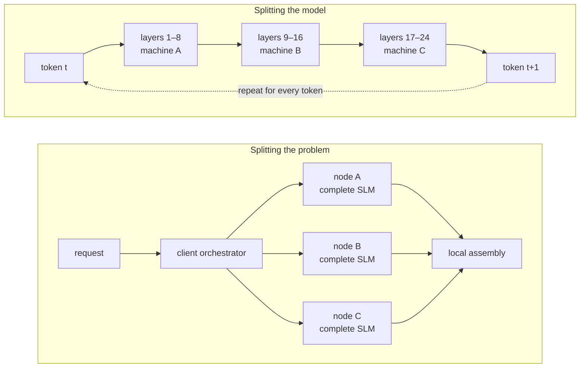
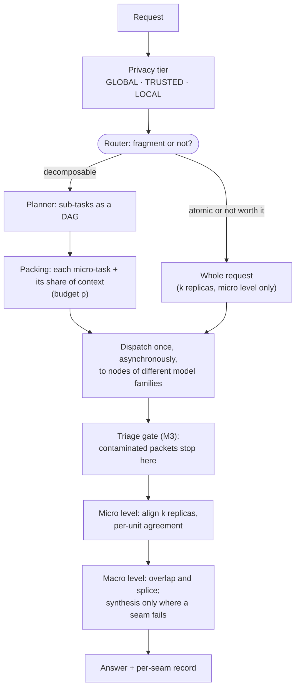
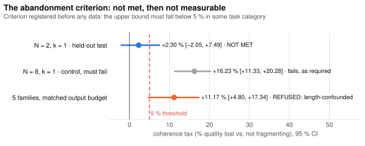
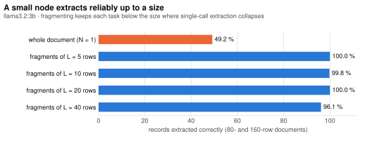
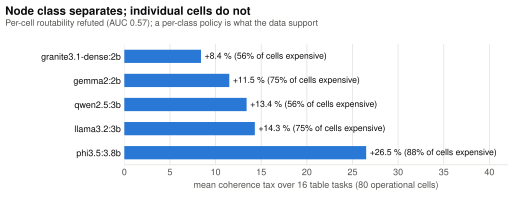
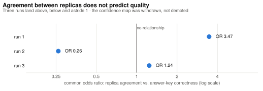
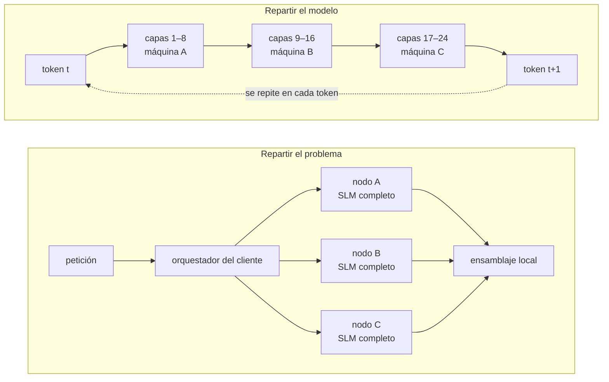
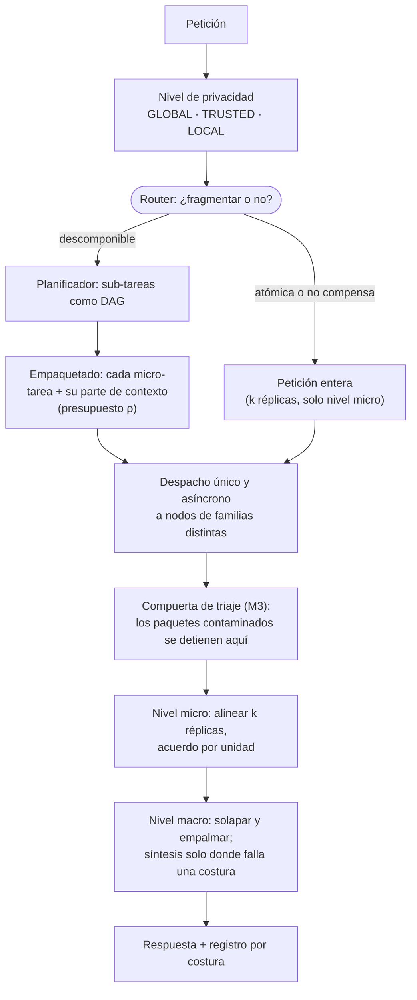

# Swarmbly AI

[](https://doi.org/10.5281/zenodo.21956743)
[](https://doi.org/10.5281/zenodo.23031305)
[](LICENSE)


**A decentralized inference protocol that fragments the *problem*, not the *model*.**

**[English](#english)** · **[Español](#español)**

> **Status: research prototype with published measurements; not peer reviewed.** The abandonment criterion registered before any data was **not met** on its first held-out test (+2.30 %, 95 % CI [−2.05 %, +7.49 %]) and is **not measurable** on the later 473-run campaign, whose harness refuses to rule. Where the design says fragmenting should win — small models extracting, code aggregating — it wins by **+46.9 points** [+33.3, +59.4]. The confidence map was withdrawn. Every figure links to its raw record, and the withdrawn ones are kept with their arithmetic.

---

## English

### Contents

1. [The idea in one minute](#the-idea-in-one-minute)
2. [How a request flows](#how-a-request-flows)
3. [What has been measured](#what-has-been-measured)
4. [What was withdrawn](#what-was-withdrawn)
5. [What Swarmbly claims, and what it does not](#what-swarmbly-claims-and-what-it-does-not)
6. [V0: the coherence-tax harness](#v0-the-coherence-tax-harness)
7. [Two levels of assembly](#two-levels-of-assembly)
8. [Three privacy tiers](#three-privacy-tiers)
9. [Design commitments the code enforces](#design-commitments-the-code-enforces)
10. [Limitations](#limitations--read-before-quoting-any-number)
11. [Repository map](#repository-map)
12. [Prior art, contributing, governance, citation](#prior-art-and-patents)

### The idea in one minute

Swarmbly dispatches semantic micro-tasks to volunteer nodes running complete small language models (SLMs, 1–8B), and reassembles the answers on the client with an orchestrator SLM — using genome shotgun assembly (reads, contigs, overlap, scaffolding, consensus) as its design vocabulary.

Existing peer-to-peer inference systems split the **model**: layers or tensors live on different machines, and activations cross the public internet on **every token**. Swarmbly splits the **problem**: each fragment crosses the network **once**, and every worker runs a whole, small, independent model.



| | Splitting the model | Splitting the problem (Swarmbly) |
|---|---|---|
| What travels | activations, on every token | one fragment per worker, once per session |
| Shape of the work | a chain: each machine waits on the one before | a set: every node works at once |
| What each node runs | a slice of one large model | a complete small model |
| Bandwidth it needs | datacenter interconnect (~900 GB/s vs ~60 Mbps consumer upstream, ~120,000×) | consumer links |
| Where it can fail | the network | the **assembly**: rejoining fragments without losing coherence |

The genome-assembly vocabulary is deliberate, not decorative:

| Genome assembly | Swarmbly |
|---|---|
| reads | micro-tasks and the fragments nodes return |
| contigs | verified, spliced runs of fragments |
| overlap | the shared context (ρ) that lets two fragments be joined |
| scaffolding | the plan (a DAG) that orders sub-tasks |
| consensus | aligning `k` replicas of the same micro-task from different model families |

**Why "Swarmbly"?** *Swarm* and *assembly*. The swarm is the easy half — running many models at once is a scheduling problem, solved decades ago. The assembly is the hard half: turning fragments into one coherent answer is where quality is lost and where this design can fail. The name puts the difficult part in the word.

### How a request flows



| Quantity | Meaning, in plain words |
|---|---|
| **ρ** (rho) | contextual redundancy: tokens dispatched ÷ tokens in the original prompt. At once the privacy leak, the coherence glue and the substitute for worker capacity |
| **N** | number of fragments a task is split into |
| **k** | number of complete replicas of the same micro-task, from different model families |
| **δ** | how much a cut separates information that belongs together (tested as a second axis in M4) |
| **L** | fragment size (rows per fragment in the extraction tasks) |
| **τ_sem** | seam threshold, always calibrated from labelled pairs, never assumed |
| **coherence tax** | relative quality loss of the fragmented answer against the monolithic one. **The headline number** |

### What has been measured

The design rests on one falsifiable claim: **the more shared context each fragment carries, the less quality is lost when the pieces are rejoined.** A go/no-go threshold was registered publicly *before any data existed*: if the coherence tax never fell below 5 % in any task category, the architecture was to be abandoned.

| Question | Run | Result | Verdict |
|---|---|---|---|
| Is the coherence tax below 5 % somewhere? (abandonment criterion) | [held-out test](docs/RESULTS_TABLES_FINAL_CORRECTED.md), 16 prompts | +2.30 % [−2.05 %, +7.49 %]; control N = 8 fails as required | **not met** |
| The same, at a matched output budget | [reference campaign](docs/RESULTS_2026-09-25_refbench_EN.md), 473 runs, 5 families | +11.17 % [+4.80, +17.34], confounded with output length | **not measured** (harness refuses) |
| M4 — is δ a second axis? | campaign | δ rises in 32/32 pairs; the tax worsens in only 15/32 | **falsified** |
| M2 — cardinality in the representation | campaign | `unique_here` obeyed in 23/35; with mechanical enforcement 35/35 | **survives, corrected** |
| M3 — per-level triage gate | campaign | contaminated packets do not reach assembly | **survives** |
| M1 — learned-substitution aligner | campaign | no genuine-disagreement regime in the corpus | **no instrument** |
| Per-cell routability | campaign | AUC 0.57 with δ and reputation (0.61 with neither) | **refuted** |
| Extract with the model, aggregate with code (L curve v3) | campaign | +46.9 points [+33.3, +59.4] over the model alone | **holds** (narrow) |
| Does replica agreement predict quality? (confidence map) | V3c and three ground-truth runs | *r* = −0.030 over 597 units; odds ratios 3.47, 0.26, 1.24 | **withdrawn** |

#### 1 · The abandonment criterion

<picture>
  <source media="(prefers-color-scheme: dark)" srcset="docs/figures/coherence_tax_dark.svg">
  
</picture>

The point estimate on the held-out test is under 5 %; the interval is not, and the criterion was written against the interval precisely so that a favourable point estimate could not carry it. **The criterion is not met and is not being rewritten.** Two caveats travel with that figure:

- **The mean is the wrong statistic.** The median prompt loses **exactly 0.00 %** and **11 of 16 prompts are at or below zero**. Two prompts, `tbl24_outturn` (+28.50 %) and `tbl24_bonded` (+23.08 %), make up **140 %** of the mean; without them the other fourteen average **−1.06 %**. They are also the only two where N = 2 is worse than N = 8, which points to a partition-quality failure rather than a cost of fragmentation — a clue, not yet tested.

  | Prompts at N = 2 | Count |
  |---|---|
  | fragmenting was better (negative tax) | 6 |
  | exactly zero | 5 |
  | positive tax | 5 (two of them carry the mean) |

- **The declared cell was above the packing ceiling.** The pre-registration named ρ = 3.5, but a two-way split of that corpus can hold at most ρ ≈ 3.37, so what was measured is the ceiling cell at ρ ≈ 3.38, with about 4 % less context than its control. The artefact pushes the tax up, the same direction as the verdict; the result document carries it as a banner and asks for a re-run at ρ = 3.0 before the figure is quoted as a test of the declared cell.

On the later campaign, with the output budget matched, fragmenting costs quality in all five families, and the harness still refuses to turn that into a verdict: the two arms write different amounts, and within a task writing more scores more. Truncating to a fixed reading budget flips the sign of the tax (−15.66 % to +7.69 %), and a position-of-first-mention instrument is null and disagrees between corpus halves. The measurement that survives is economic: the per-class policy the data support is *not* to fragment these tasks (+0.0 % against +14.8 % for always fragmenting).

#### 2 · Where fragmenting should win, it does

On structured extraction — reading the records out of a long document and answering questions over all of them — a small model extracting the pieces, with code aggregating them, beats the same model answering alone. A control that extracts the whole document in a single call separates the two mechanisms: at 80 rows the whole gain comes from taking the arithmetic away from the model; at 160 rows single-call extraction collapses and only splitting holds it up.

<picture>
  <source media="(prefers-color-scheme: dark)" srcset="docs/figures/extraction_arms_dark.svg">
  
</picture>

<picture>
  <source media="(prefers-color-scheme: dark)" srcset="docs/figures/extraction_fidelity_dark.svg">
  
</picture>

A small node extracts reliably up to some task size, and fragmenting is what keeps each task below that size. That is the thesis of the design, measured directly. It is also narrow — 8 documents, one model family, two sizes — and it is stated as narrow.

#### 3 · Node class matters more than the individual cell

<picture>
  <source media="(prefers-color-scheme: dark)" srcset="docs/figures/tax_by_node_class_dark.svg">
  
</picture>

A router that predicts, cell by cell, whether fragmenting will be expensive does no better than chance (AUC 0.57, leave-one-task-out), even with pre-dispatch capability probes. What separates is the **class** of node: some families pay much more than others. Routing has to work per class, not per request.

#### 4 · The confidence map did not survive

Because independent model families answer the same micro-task, their agreement can be scored per unit, and a single centralized provider has nothing to align. The mechanism works. The claim that agreement predicts quality does not.

<picture>
  <source media="(prefers-color-scheme: dark)" srcset="docs/figures/confidence_map_dark.svg">
  
</picture>

The first measurement found no relationship (*r* = −0.030 over 597 units) against a weak judge that accepted 93 % of everything; three later runs graded against an answer key landed above, below and astride 1. That is no signal, measured three times, and the confidence map has been **withdrawn**, not demoted. A separate note ([correlated errors across families](docs/FINDING_2026-10-04_correlated_errors_across_families.md), external evidence, not a measurement of this project) adds why: errors of different model families are correlated, more so in more capable models, so convergence between families can be a shared error. Reporting *where* replicas diverged remains useful; inferring correctness from where they converged does not.

### What was withdrawn

A withdrawn result stays in the repository with its arithmetic; [`docs/STATUS.md`](docs/STATUS.md) says, for every document, whether it may be quoted.

| Withdrawn claim | Why it fell | Where |
|---|---|---|
| A coherence tax falling 24.1 % → 13.7 % across ρ ("the prediction held") | **The ρ axis never moved**: below a prompt's packing floor every packet collapses to its bare task, so two ρ labels produced byte-identical packets (13 of 96 cells above floor; none in the two rows anchoring the descent). **The metric was not arm-neutral**: the same text scored 0.9375 monolithic and 0.5000 at N = 8, an apparent tax of +46.7 % on text that never changed | [`RESULTS_V0_V3C.md`](docs/RESULTS_V0_V3C.md) |
| The confidence map as a reliability signal | Agreement does not predict quality (above) | [`RESULTS_V0_V3C.md`](docs/RESULTS_V0_V3C.md), [`RESULTS_TABLES_FINAL_CORRECTED.md`](docs/RESULTS_TABLES_FINAL_CORRECTED.md) |
| Coherence taxes and monotone-in-N claims in V4–V6 | A metric whose penalty grew with N by construction | [`STATUS.md`](docs/STATUS.md) |
| Every figure of the ground-truth V3c run | An arm asymmetry in the stimulus planned all 15 prompts as four-deep chains | [`STATUS.md`](docs/STATUS.md) |
| H-INT (node strength explains the tax) | With an independent predictor ρ = −0.142, and noise reproduces the earlier +0.684 | harness T12 |

Both instrument defects are fixed and regression-tested, and the harness now refuses to publish a below-floor cell rather than flagging it.

### What Swarmbly claims, and what it does not

**What it claims:** **access to capacity you do not own**, for workloads that are decomposable, latency-tolerant and token-intensive — bulk document processing, synthetic data generation, code-migration sweeps, evaluation at scale — bought at a **measurable price in coherence**, which the protocol is designed to report rather than hide. That price is what this repository measures first.

| Not claimed | Why |
|---|---|
| Faster than a centralized API | Single-node speculative decoding already delivers 2–3× with a *proof* that the output distribution is unchanged; Swarmbly's own throughput and latency have not been measured |
| Unlimited context | Only a much higher limit, set by the user's machine instead of a vendor's price tier |
| Encryption | Fragmentation raises the cost of reconstruction and nothing more; sensitive work goes to a trusted swarm or stays local |
| An environmental benefit | The argument is strong; the measurement is not made, and will be published whatever it shows |
| That agreement between replicas means correctness | Measured and withdrawn; errors across families are correlated |

### V0: the coherence-tax harness

The project's make-or-break question, asked before a single line of networking code:

> **How much output quality is lost by fragmenting a prompt and reassembling it — and how does that loss depend on how much context travels with each fragment?**

> **Go / no-go criterion.** There must exist a value of ρ at which coherence degradation is **< 5 % relative to monolithic generation**, in **at least one task category**. If no such ρ exists, the architecture is not viable, and the project should stop or pivot to workloads with no seam to break (classification, extraction, labelling). The harness prints this verdict on every run.

**Quick start**

```bash
pip install -e ".[dev]"
pytest -q

# Full sweep with the deterministic mock backend — no API keys, no downloads
python -m swarmbly_v0 run --rho 1.0,1.25,1.5,2.0 --n 2,4,8 --backend mock --out results/

# Standalone HTML report from an existing CSV
python -m swarmbly_v0 report results/results.csv --out results/report.html
```

**Against real models.** One command, three model families, on your own machine. Start with the smoke tier — it exercises every code path the long runs use, on two prompts, in about five minutes:

```bash
./scripts/run_ollama.sh smoke     # ~5 min    does the wiring hold?
./scripts/run_ollama.sh all       # ~5-7 h    V0 (coherence tax) + V3c (agreement vs quality)
```

The script pulls what is missing, checks the round trip before committing hours to it, and refuses to start with fewer than three distinct model families — three replicas of *one* family measure that family's sampling variance, not the disagreement between independent estimators. See [`scripts/README.md`](scripts/README.md). Under the hood it is any OpenAI-compatible endpoint (Ollama, llama.cpp's server, vLLM), configured by environment:

```bash
export OPENAI_BASE_URL=http://localhost:11434/v1
export OPENAI_API_KEY=ollama
export SWARMBLY_MODEL=llama3.2:3b
export SWARMBLY_EMBED_MODEL=nomic-embed-text
export SWARMBLY_REPLICA_MODELS='llama:llama3.2:3b,qwen:qwen2.5:3b,gemma:gemma2:2b'

python -m swarmbly_v0 run --backend openai --embedder api \
  --rho 1.0,1.25,1.5,2.0 --n 2,4,8 --k 1,3 --out results/real/
```

`--embedder api` uses the server's own `/embeddings` route (`nomic-embed-text` on Ollama), which needs no second model stack and no download from a model hub. `--embedder st` uses `sentence-transformers` instead; `pip install -e ".[embeddings]"` first. The default `hash` embedder is a deterministic stand-in whose cosine values carry no semantics — a τ calibrated on it is not a threshold, it is a number, and the run metadata says so.

**What the harness measures**

| Metric | What it captures |
|---|---|
| `booook_like_score` | Fraction of sentences free of mechanically detectable seam errors, across eight classes: entity omission, duplicated content, contradiction, register/tense shift, dangling reference, missing transition, repeated introduction, inconsistent naming |
| `entity_grid` | Simplified Barzilay & Lapata entity-grid local coherence |
| `judge_score` | Overall answer quality, reported **separately** from coherence — an aggregate "which is better" judgement hides exactly the damage under study |
| `rho_achieved` | Realised context budget, versus the target |
| `coherence_tax_*` | Relative degradation against the monolithic baseline. **The headline number.** |
| `tau_sem` | Calibrated seam threshold — never a fixed constant |
| `k`, `n_families` | Micro-level replica count and how many distinct model families produced them |
| `mean_agreement` | Mean per-unit agreement across the aligned replicas |
| `frac_high` / `frac_medium` / `frac_low` | Share of units taken by medoid, judge-selected, and judge-selected *and flagged* |
| `n_low_conf_regions` | Contiguous spans the swarm did not converge on — reported to the user, not smoothed away |
| `agreement_quality_correlation` | Does agreement actually predict judged acceptability? Reported on every run, including when it is flat |

### Two levels of assembly

Swarmbly assembles twice, and the two are different operations:

| Level | What is split | How it is resolved | Controlled by |
|---|---|---|---|
| **Macro** | Different sub-tasks of one large task | Overlap-and-splice with flanking context; synthesis only where a seam fails | `ρ`, `N` |
| **Micro** | *Nothing.* `k` **complete replicas of the same micro-task**, from deliberately different model families | Progressive multiple alignment over semantic units, then a per-unit agreement score routing to medoid / judge / flag | `k` |

Splitting an **atomic** question into partial sub-questions is supported at neither level, and the code says so where it would be tempting. Decomposition that removes information *before* sampling destroys information no amount of redundancy afterwards can recover — averaging `k` answers to the wrong question yields a confident wrong answer. An atomic request skips the macro level and goes straight to micro with `k` replicas of the whole request. The micro level emits, besides the text, every unit's agreement score, the replicas that contributed and a `HIGH` / `MEDIUM` / `LOW` label; contiguous `LOW` units become named low-confidence regions. Those labels report divergence; since the confidence-map withdrawal they are not a reliability claim.

```bash
python -m swarmbly_v0 run --rho 1.0,1.5 --n 2,4 --k 1,3 --backend mock --out results/
```

### Three privacy tiers

Routing has a second axis, orthogonal to how sensitive the content is: which *population of machines* a request may reach. `swarmbly_v0/privacy.py` is the reference implementation.

| Tier | Population | Transport | Replicas |
|---|---|---|---|
| `GLOBAL` | Any conformant worker in the open registry | Authenticated worker identity | At the derived `k` |
| `TRUSTED` | Only nodes on the named swarm's public-key whitelist, under a declared operator | **Mutual TLS required on every link** | Yes — unless the operator drops to `k = 1`, permitted only with a recorded waiver |
| `LOCAL` | The requesting device only | No network egress | None — nothing to align |

The classifier is pure, local and **cannot** be given a remote backend: a privacy check that asks the network whether a prompt is private has already disclosed the prompt. A manual flag (`--privacy=trusted|local`) is authoritative and is never downgraded by the recall-oriented automatic triage.

```python
from swarmbly_v0 import classify, resolve_k, SwarmRegistry, routing_metadata

reg = SwarmRegistry(swarm_id="hospital-a", operator="Hospital A IT",
                    members=frozenset({"nodeA", "nodeB"}))
d  = classify("Summarise the patient's diagnosis.", swarm_id="hospital-a")
kd = resolve_k(1, d, reg)
routing_metadata(d, kd, reg)["consensus_waived_reason"]   # 'trusted_swarm_k1'
```

A trusted swarm relocates trust to whoever holds the whitelist; it does not remove it, and the specification says so rather than leaving it to be discovered.

### Design commitments the code enforces

| # | Commitment | In practice |
|---|---|---|
| 1 | **The router may refuse to fragment** | Its threshold is asymmetric: wrongly fragmenting costs more than wrongly declining |
| 2 | **Plans are DAGs, not lists** | Dependencies are explicit; only same-level tasks run in parallel |
| 3 | **Select before you synthesize** | The assembler picks a candidate and splices it; synthesis runs only when a seam fails |
| 4 | **τ_sem is calibrated, never assumed** | `metrics.calibrate_tau` derives it from labelled pairs; `α_high`/`α_low` (0.80/0.55) are placeholders replaced by `metrics.calibrate_alpha` |
| 5 | **Coherence is reported, not buried** | Every assembly returns a per-seam record and an error-class breakdown |
| 6 | **Redundancy resolves sampling variance, never missing information** | `k` replicas are `k` complete answers to the same question |
| 7 | **Disagreement is surfaced, not averaged** | Low-confidence regions instead of a smoothed sentence; the coverage model bounds *availability* under packet loss, not correctness |
| 8 | **Nothing that was never computed is reported** | `privacy.resolve_k` returns the waiver reason with the number; the floor `k ≥ 2` under measured loss is not waivable |

### Limitations — read before quoting any number

- **`MockBackend` results are harness validation, not evidence.** The mock simulates context-dependent drift so the pipeline can be exercised without a GPU; its curve says nothing about real language models.
- The metrics are **mechanical proxies**. `booook_like_score` detects error classes that regex and entity tracking can find; it is not a human coherence judgement.
- `HashEmbedder` is a deterministic fallback; any τ calibrated on it is meaningless — use `[embeddings]` for real work.
- **Agreement is not truth.** Models sharing training data share errors, and the evidence now says this holds across families too.
- The measurements are small: models of 2–4B parameters on local hardware, task families chosen because they can be checked. A signal to act on, not a benchmark.
- V0 has **no networking, no verification, no adversarial nodes**. Those are V2 and V3.

### Repository map

| Path | What is there |
|---|---|
| [`docs/ONEPAGER_EN.md`](docs/ONEPAGER_EN.md) | **Start here:** the case in two pages |
| [`docs/WHITEPAPER_V2_EN.md`](docs/WHITEPAPER_V2_EN.md) | Whitepaper v2 (current): fragmentation fundamentals, models M1–M5 and the campaign that measures them. v1.4 is kept as [`docs/WHITEPAPER_EN.md`](docs/WHITEPAPER_EN.md), superseded |
| [`docs/WHITEPAPER_EXT_EN.md`](docs/WHITEPAPER_EXT_EN.md) | Fragmentation fundamentals (focused extension) |
| [`docs/VALIDATION_STRATEGY_V2_EN.md`](docs/VALIDATION_STRATEGY_V2_EN.md) | Validation strategy and its execution |
| [`docs/SPEC_EN.md`](docs/SPEC_EN.md) | Protocol specification |
| [`docs/STATUS.md`](docs/STATUS.md) | Generated index: current, superseded, partially withdrawn and withdrawn documents |
| [`docs/README.md`](docs/README.md) | The documentation set, including the project's own audit and red team |
| [`docs/REFERENCES.md`](docs/REFERENCES.md) | Annotated bibliography |
| [`docs/DIVULGACION_EN.md`](docs/DIVULGACION_EN.md) | Plain-language version |
| `swarmbly_v0/` | V0 harness: privacy, router, planner, packing, assembler (macro), consensus (micro), metrics, experiment, report |
| `swarmbly_ref/` | Reference implementation (protocol v0.3) and the 473-run corpus (`data/benchmark.jsonl`) |
| [`swarmbly_validation/`](swarmbly_validation/README_EN.md) | Falsification harness for M1–M5, zero dependencies |
| `tests/` | pytest suite, including tests that every published figure is one the harness still produces, in both languages |
| `prompts/`, `data/` | Labelled prompt sets and the L-curve records |
| [`swips/`](swips/README.md) | Swarmbly Improvement Proposals |
| `docs/figures/` | The charts in this README, drawn by `scripts/readme_figures.py` from the harness output |

The last two code directories are what make the claims in whitepaper v2 checkable rather than assertable:

```bash
python3 swarmbly_validation/run_all.py --all   # the eighteen empirical tests + the derivation battery
python3 scripts/readme_figures.py              # redraw these charts (needs matplotlib; run run_real.py first)
```

The harness exits non-zero if any test fails — a falsified model counts as a failure — so its summary cannot be ignored. See [`swarmbly_validation/README_EN.md`](swarmbly_validation/README_EN.md) for what reproduces from a clean clone and what refuses.

**Extensions.** [Swarmbly LCE](https://github.com/Sebastardito/SwarmblyLCE) (whitepaper [10.5281/zenodo.23150478](https://doi.org/10.5281/zenodo.23150478)) proposes a local cognitive layer on the client — personal memory, a model that learns its user's voice, optional knowledge capsules — that enters the protocol only through the existing global contract and leaves the workers serving their base model.

### Prior art and patents

This is a **defensive publication**. The techniques described here — semantic fragmentation of a request, the context budget *S*, the coverage model `c ≥ ln(1/ε)/(1−p)`, two-level assembly with cross-family consensus, and privacy-tier routing — are disclosed publicly and in enabling detail so that they remain free for anyone to implement. **The author asserts no patent claims over the disclosed techniques and places them in the public domain for patenting purposes.**

| Record | DOI | Date | Elements |
|---|---|---|---|
| Software artifact | [`10.5281/zenodo.21956743`](https://doi.org/10.5281/zenodo.21956743) | — | — |
| Paper, version 1.4 | [`10.5281/zenodo.21957088`](https://doi.org/10.5281/zenodo.21957088) | 14 August 2026 | E1–E18 |
| Paper, version 2 | [`10.5281/zenodo.23031305`](https://doi.org/10.5281/zenodo.23031305) | 29 September 2026 | E19–E24 |

The disclosure is also dated by this repository at tag `v1`.

### Contributing

DCO sign-off (`git commit -s`), not a CLA — see [`CONTRIBUTING.md`](CONTRIBUTING.md). Protocol changes go through a SWIP. **One rule above the others: any performance or quality claim in a pull request must cite a measurement.** This project exists because a plausible architecture was mistaken for a validated one.

### Governance

Pre-foundation, benevolent maintainer, heading for a Swiss Verein and later a Stiftung. The Foundation will own copyright and trademark and will **not** sell proprietary exceptions — dual licensing is explicitly rejected as incompatible with the mandate. See [`GOVERNANCE.md`](GOVERNANCE.md).

### Citation and licence

Cite the artifact as [`10.5281/zenodo.21956743`](https://doi.org/10.5281/zenodo.21956743) and the paper (v2) as [`10.5281/zenodo.23031305`](https://doi.org/10.5281/zenodo.23031305); v1.4 remains [`10.5281/zenodo.21957088`](https://doi.org/10.5281/zenodo.21957088). Machine-readable metadata in [`CITATION.cff`](CITATION.cff). Licence: AGPL-3.0-or-later; network use triggers clause 13 — see [`NOTICE`](NOTICE).

---

## Español

**Un protocolo de inferencia descentralizada que fragmenta el *problema*, no el *modelo*.**

> **Estado: prototipo de investigación con mediciones publicadas; no revisado por pares.** El criterio de abandono registrado antes de tener datos **no se cumplió** en su primera prueba con datos reservados (+2.30 %, IC95 [−2.05 %, +7.49 %]) y **no es medible** en la campaña posterior de 473 corridas, cuyo arnés se niega a dictaminar. Donde el diseño dice que fragmentar debe ganar —modelos pequeños que extraen y código que agrega—, gana por **+46.9 puntos** [+33.3, +59.4]. El mapa de confianza se retiró. Cada cifra enlaza a su registro crudo, y las retiradas se conservan con su aritmética. Las figuras tienen el texto en inglés; sus cifras son las mismas.

### Contenido

1. [La idea en un minuto](#la-idea-en-un-minuto)
2. [Cómo fluye una petición](#cómo-fluye-una-petición)
3. [Qué se ha medido](#qué-se-ha-medido)
4. [Qué se retiró](#qué-se-retiró)
5. [Qué afirma Swarmbly y qué no](#qué-afirma-swarmbly-y-qué-no)
6. [V0: el banco del impuesto de coherencia](#v0-el-banco-del-impuesto-de-coherencia)
7. [Dos niveles de ensamblado](#dos-niveles-de-ensamblado)
8. [Tres niveles de privacidad](#tres-niveles-de-privacidad)
9. [Compromisos de diseño que el código impone](#compromisos-de-diseño-que-el-código-impone)
10. [Limitaciones](#limitaciones--leer-antes-de-citar-cualquier-cifra)
11. [Mapa del repositorio](#mapa-del-repositorio)
12. [Arte previo, contribuir, gobernanza, cita](#arte-previo-y-patentes)

### La idea en un minuto

Swarmbly despacha micro-tareas semánticas a nodos voluntarios que ejecutan modelos de lenguaje pequeños completos (SLM, de 1 a 8 B) y reensambla las respuestas en el cliente con un SLM orquestador, usando el ensamblaje genómico por shotgun (lecturas, contigs, solapamiento, andamiaje, consenso) como vocabulario de diseño.

Los sistemas P2P de inferencia existentes reparten **el modelo**: capas o tensores viven en máquinas distintas y las activaciones cruzan internet **en cada token**. Swarmbly reparte **el problema**: cada fragmento cruza la red **una sola vez** y cada nodo ejecuta un modelo pequeño, completo e independiente.



| | Repartir el modelo | Repartir el problema (Swarmbly) |
|---|---|---|
| Qué viaja | activaciones, en cada token | un fragmento por nodo, una vez por sesión |
| Forma del trabajo | una cadena: cada máquina espera a la anterior | un conjunto: todos los nodos trabajan a la vez |
| Qué ejecuta cada nodo | una porción de un modelo grande | un modelo pequeño completo |
| Ancho de banda que necesita | el de un centro de datos (~900 GB/s frente a ~60 Mbps de subida doméstica, ~120 000×) | conexiones domésticas |
| Dónde puede fallar | la red | el **ensamblaje**: volver a unir los fragmentos sin perder coherencia |

El vocabulario del ensamblaje genómico es deliberado, no decorativo:

| Ensamblaje genómico | Swarmbly |
|---|---|
| lecturas (reads) | las micro-tareas y los fragmentos que devuelven los nodos |
| contigs | tramos de fragmentos verificados y empalmados |
| solapamiento | el contexto compartido (ρ) que permite unir dos fragmentos |
| andamiaje | el plan (un DAG) que ordena las sub-tareas |
| consenso | alinear `k` réplicas de la misma micro-tarea, de familias de modelos distintas |

**¿Por qué «Swarmbly»?** *Swarm* (enjambre) y *assembly* (ensamblaje). El enjambre es la mitad fácil: ejecutar muchos modelos a la vez es un problema de planificación, resuelto hace décadas. El ensamblaje es la mitad difícil: convertir fragmentos en una respuesta coherente es donde se pierde calidad y donde este diseño puede fallar. El nombre pone la parte difícil en la palabra.

### Cómo fluye una petición



| Magnitud | Qué significa, en palabras simples |
|---|---|
| **ρ** (rho) | redundancia contextual: tokens despachados ÷ tokens del prompt original. Es a la vez la fuga de privacidad, el pegamento de la coherencia y el sustituto de la capacidad del nodo |
| **N** | número de fragmentos en que se divide una tarea |
| **k** | número de réplicas completas de la misma micro-tarea, de familias de modelos distintas |
| **δ** | cuánto separa un corte información que va junta (probado como segundo eje en M4) |
| **L** | tamaño del fragmento (filas por fragmento en las tareas de extracción) |
| **τ_sem** | umbral de costura, siempre calibrado con pares etiquetados, nunca supuesto |
| **impuesto de coherencia** | pérdida relativa de calidad de la respuesta fragmentada frente a la monolítica. **La cifra principal** |

### Qué se ha medido

El diseño descansa en una afirmación refutable: **cuanto más contexto compartido lleva cada fragmento, menos calidad se pierde al volver a unir las piezas.** Se registró públicamente un umbral de continuar o abandonar *antes de que existiera ningún dato*: si el impuesto de coherencia nunca bajaba del 5 % en ninguna categoría de tarea, la arquitectura se abandonaría.

| Pregunta | Corrida | Resultado | Veredicto |
|---|---|---|---|
| ¿El impuesto de coherencia baja del 5 % en algún caso? (criterio de abandono) | [prueba reservada](docs/RESULTS_TABLES_FINAL_CORRECTED_ES.md), 16 prompts | +2.30 % [−2.05 %, +7.49 %]; el control N = 8 falla, como debía | **no se cumple** |
| Lo mismo, con presupuesto de salida igualado | [campaña de referencia](docs/RESULTS_2026-09-25_refbench_ES.md), 473 corridas, 5 familias | +11.17 % [+4.80, +17.34], confundido con la longitud de salida | **no medido** (el arnés se niega) |
| M4: ¿δ es un segundo eje? | campaña | δ sube en 32/32 pares; el impuesto empeora solo en 15/32 | **falsado** |
| M2: cardinalidad en la representación | campaña | `unique_here` se cumple en 23/35; con aplicación mecánica, 35/35 | **sobrevive, corregido** |
| M3: compuerta de triaje por nivel | campaña | los paquetes contaminados no llegan al ensamblaje | **sobrevive** |
| M1: alineador de sustitución aprendida | campaña | el corpus no produjo un régimen de desacuerdo genuino | **sin instrumento** |
| Enrutabilidad por celda | campaña | AUC 0.57 con δ y reputación (0.61 sin ninguno) | **refutada** |
| Extraer con el modelo, agregar con código (curva L v3) | campaña | +46.9 puntos [+33.3, +59.4] sobre el modelo solo | **se sostiene** (estrecho) |
| ¿El acuerdo entre réplicas predice la calidad? (mapa de confianza) | V3c y tres corridas con clave de respuestas | *r* = −0.030 sobre 597 unidades; razones de momios 3.47, 0.26, 1.24 | **retirado** |

#### 1 · El criterio de abandono

<picture>
  <source media="(prefers-color-scheme: dark)" srcset="docs/figures/coherence_tax_dark.svg">
  
</picture>

La estimación puntual de la prueba reservada está por debajo del 5 %; el intervalo no, y el criterio se escribió contra el intervalo precisamente para que una estimación puntual favorable no bastara. **El criterio no se cumple y no se reescribe.** Dos advertencias acompañan a esa cifra:

- **La media es el estadístico equivocado.** El prompt mediano pierde **exactamente 0.00 %** y **11 de 16 prompts quedan en cero o por debajo**. Dos prompts, `tbl24_outturn` (+28.50 %) y `tbl24_bonded` (+23.08 %), suman el **140 %** de la media; sin ellos, los otros catorce promedian **−1.06 %**. Son también los únicos dos donde N = 2 es peor que N = 8, lo que apunta a un fallo de calidad de la partición y no a un costo de fragmentar: una pista, todavía no probada.

  | Prompts con N = 2 | Cantidad |
  |---|---|
  | fragmentar fue mejor (impuesto negativo) | 6 |
  | exactamente cero | 5 |
  | impuesto positivo | 5 (dos de ellos sostienen la media) |

- **La celda declarada estaba por encima del techo de empaquetado.** El preregistro nombró ρ = 3.5, pero una división en dos de ese corpus admite como mucho ρ ≈ 3.37, así que lo medido es la celda del techo, con ρ ≈ 3.38 y cerca de un 4 % menos de contexto que su control. El artefacto empuja el impuesto hacia arriba, en la misma dirección que el veredicto; el documento de resultados lo lleva como aviso y pide repetir la celda con ρ = 3.0 antes de citar la cifra como prueba de la celda declarada.

En la campaña posterior, con el presupuesto de salida igualado, fragmentar cuesta calidad en las cinco familias, y aun así el arnés se niega a convertirlo en veredicto: los dos brazos escriben cantidades distintas y, dentro de una tarea, escribir más puntúa más. Truncar a un presupuesto de lectura fijo invierte el signo del impuesto (de −15.66 % a +7.69 %), y un instrumento por posición de primera mención es nulo y discrepa entre mitades del corpus. Lo que sobrevive es económico: la política por clase que los datos sostienen es *no* fragmentar estas tareas (+0.0 % frente a +14.8 % fragmentando siempre).

#### 2 · Donde fragmentar debe ganar, gana

En extracción estructurada —leer los registros de un documento largo y responder preguntas sobre todos ellos—, un modelo pequeño que extrae las piezas, con código que las agrega, supera al mismo modelo respondiendo solo. Un control que extrae el documento entero en una sola llamada separa los dos mecanismos: con 80 filas toda la ganancia viene de quitarle la aritmética al modelo; con 160 filas la extracción en una llamada colapsa y solo partir la sostiene.

<picture>
  <source media="(prefers-color-scheme: dark)" srcset="docs/figures/extraction_arms_dark.svg">
  
</picture>

<picture>
  <source media="(prefers-color-scheme: dark)" srcset="docs/figures/extraction_fidelity_dark.svg">
  
</picture>

Un nodo pequeño extrae con fiabilidad hasta cierto tamaño de tarea, y fragmentar es lo que mantiene cada tarea por debajo de ese tamaño. Es la tesis del diseño, medida directamente. También es estrecha —8 documentos, una familia de modelos, dos tamaños— y se declara así.

#### 3 · La clase de nodo importa más que la celda individual

<picture>
  <source media="(prefers-color-scheme: dark)" srcset="docs/figures/tax_by_node_class_dark.svg">
  
</picture>

Un router que predice, celda por celda, si fragmentar saldrá caro no lo hace mejor que el azar (AUC 0.57, validación dejando una tarea fuera), ni siquiera con sondas de capacidad antes del despacho. Lo que separa es la **clase** de nodo: unas familias pagan mucho más que otras. El enrutamiento tiene que funcionar por clase, no por petición.

#### 4 · El mapa de confianza no sobrevivió

Como familias de modelos independientes responden la misma micro-tarea, su acuerdo puede puntuarse por unidad, y un proveedor centralizado único no tiene nada que alinear. El mecanismo funciona. La afirmación de que el acuerdo predice la calidad, no.

<picture>
  <source media="(prefers-color-scheme: dark)" srcset="docs/figures/confidence_map_dark.svg">
  
</picture>

La primera medición no encontró relación (*r* = −0.030 sobre 597 unidades) frente a un juez débil que aceptaba el 93 % de todo; tres corridas posteriores calificadas contra una clave de respuestas cayeron por encima, por debajo y a ambos lados de 1. Eso es ausencia de señal, medida tres veces, y el mapa de confianza se **retiró**, no se degradó. Una nota aparte ([errores correlacionados entre familias](docs/FINDING_2026-10-04_correlated_errors_across_families_ES.md), evidencia externa, no una medición de este proyecto) añade por qué: los errores de familias de modelos distintas están correlacionados, más aún en los modelos más capaces, así que la convergencia entre familias puede ser un error compartido. Informar *dónde* divergieron las réplicas sigue siendo útil; inferir corrección de dónde convergieron, no.

### Qué se retiró

Un resultado retirado se queda en el repositorio con su aritmética; [`docs/STATUS.md`](docs/STATUS.md) dice, para cada documento, si se puede citar.

| Afirmación retirada | Por qué cayó | Dónde |
|---|---|---|
| Un impuesto de coherencia que baja de 24.1 % a 13.7 % al subir ρ («la predicción se sostuvo») | **El eje ρ nunca se movió**: por debajo del piso de empaquetado de un prompt, cada paquete se reduce a su tarea desnuda, así que dos etiquetas de ρ producían paquetes idénticos byte a byte (13 de 96 celdas sobre el piso; ninguna en las dos filas que anclaban el descenso). **La métrica no era neutral entre brazos**: el mismo texto puntuaba 0.9375 como monolítico y 0.5000 con N = 8, un impuesto aparente de +46.7 % sobre un texto que nunca cambió | [`RESULTS_V0_V3C_ES.md`](docs/RESULTS_V0_V3C_ES.md) |
| El mapa de confianza como señal de fiabilidad | El acuerdo no predice la calidad (arriba) | [`RESULTS_V0_V3C_ES.md`](docs/RESULTS_V0_V3C_ES.md), [`RESULTS_TABLES_FINAL_CORRECTED_ES.md`](docs/RESULTS_TABLES_FINAL_CORRECTED_ES.md) |
| Impuestos de coherencia y afirmaciones monótonas en N de V4–V6 | Una métrica cuya penalización crecía con N por construcción | [`STATUS.md`](docs/STATUS.md) |
| Todas las cifras de la corrida V3c con clave de respuestas | Una asimetría entre brazos en el estímulo planificó los 15 prompts como cadenas de cuatro niveles | [`STATUS.md`](docs/STATUS.md) |
| H-INT (la fuerza del nodo explica el impuesto) | Con un predictor independiente ρ = −0.142, y el ruido reproduce el +0.684 anterior | arnés, T12 |

Los dos defectos de instrumento están corregidos y tienen pruebas de regresión, y el arnés ahora se niega a publicar una celda bajo el piso en lugar de marcarla.

### Qué afirma Swarmbly y qué no

**Lo que afirma:** **acceso a capacidad que no se posee**, para cargas descomponibles, tolerantes a la latencia e intensivas en tokens —procesamiento masivo de documentos, generación de datos sintéticos, migraciones de código, evaluación a escala—, a un **precio medible en coherencia** que el protocolo está diseñado para informar y no para ocultar. Ese precio es lo primero que mide este repositorio.

| No se afirma | Por qué |
|---|---|
| Ser más rápido que una API centralizada | La decodificación especulativa en un solo nodo ya da 2–3× con una *prueba* de que la distribución de salida no cambia; el rendimiento y la latencia propios de Swarmbly no se han medido |
| Contexto ilimitado | Solo un límite mucho más alto, fijado por la máquina del usuario y no por el nivel de precios de un proveedor |
| Cifrado | Fragmentar encarece la reconstrucción y nada más; el trabajo sensible va a un enjambre de confianza o se queda en local |
| Un beneficio ambiental | El argumento es sólido; la medición no está hecha y se publicará diga lo que diga |
| Que el acuerdo entre réplicas signifique corrección | Medido y retirado; los errores entre familias están correlacionados |

### V0: el banco del impuesto de coherencia

La pregunta de la que depende el proyecto, hecha antes de escribir una sola línea de código de red:

> **¿Cuánta calidad de salida se pierde al fragmentar un prompt y reensamblarlo, y cómo depende esa pérdida de cuánto contexto viaja con cada fragmento?**

> **Criterio de continuar o abandonar.** Debe existir un valor de ρ con una degradación de coherencia **< 5 % frente a la generación monolítica** en **al menos una categoría de tarea**. Si no existe, la arquitectura no es viable, y el proyecto debería detenerse o pivotar hacia cargas sin costura que romper (clasificación, extracción, etiquetado). El banco imprime este veredicto en cada ejecución.

**Inicio rápido**

```bash
pip install -e ".[dev]"
pytest -q

# Barrido completo con el backend simulado determinista: sin claves de API ni descargas
python -m swarmbly_v0 run --rho 1.0,1.25,1.5,2.0 --n 2,4,8 --backend mock --out results/

# Informe HTML autónomo a partir de un CSV existente
python -m swarmbly_v0 report results/results.csv --out results/report.html
```

**Con modelos reales.** Una orden, tres familias de modelos, en tu propia máquina. Empieza por el nivel de humo: recorre todos los caminos de código que usan las corridas largas, con dos prompts, en unos cinco minutos:

```bash
./scripts/run_ollama.sh smoke     # ~5 min    ¿aguanta el cableado?
./scripts/run_ollama.sh all       # ~5-7 h    V0 (impuesto de coherencia) + V3c (acuerdo frente a calidad)
```

El script descarga lo que falta, comprueba la ida y vuelta antes de comprometer horas y se niega a empezar con menos de tres familias de modelos distintas: tres réplicas de *una* familia miden la varianza de muestreo de esa familia, no el desacuerdo entre estimadores independientes. Ver [`scripts/README.md`](scripts/README.md). Por debajo es cualquier endpoint compatible con OpenAI (Ollama, el servidor de llama.cpp, vLLM), configurado por variables de entorno:

```bash
export OPENAI_BASE_URL=http://localhost:11434/v1
export OPENAI_API_KEY=ollama
export SWARMBLY_MODEL=llama3.2:3b
export SWARMBLY_EMBED_MODEL=nomic-embed-text
export SWARMBLY_REPLICA_MODELS='llama:llama3.2:3b,qwen:qwen2.5:3b,gemma:gemma2:2b'

python -m swarmbly_v0 run --backend openai --embedder api \
  --rho 1.0,1.25,1.5,2.0 --n 2,4,8 --k 1,3 --out results/real/
```

`--embedder api` usa la ruta `/embeddings` del propio servidor (`nomic-embed-text` en Ollama), sin una segunda pila de modelos ni descargas de un hub. `--embedder st` usa `sentence-transformers`; antes, `pip install -e ".[embeddings]"`. El embedder `hash` por defecto es un sustituto determinista cuyos cosenos no tienen semántica: un τ calibrado con él no es un umbral, es un número, y los metadatos de la corrida lo dicen.

**Qué mide el banco**

| Métrica | Qué capta |
|---|---|
| `booook_like_score` | Fracción de oraciones libres de errores de costura detectables mecánicamente, en ocho clases: omisión de entidad, contenido duplicado, contradicción, cambio de registro o tiempo verbal, referencia colgante, transición ausente, introducción repetida, nombres inconsistentes |
| `entity_grid` | Coherencia local por rejilla de entidades de Barzilay y Lapata, simplificada |
| `judge_score` | Calidad global de la respuesta, informada **por separado** de la coherencia: un juicio agregado de «cuál es mejor» oculta justo el daño que se estudia |
| `rho_achieved` | Presupuesto de contexto realizado, frente al objetivo |
| `coherence_tax_*` | Degradación relativa frente a la línea base monolítica. **La cifra principal** |
| `tau_sem` | Umbral de costura calibrado, nunca una constante fija |
| `k`, `n_families` | Número de réplicas del nivel micro y cuántas familias distintas las produjeron |
| `mean_agreement` | Acuerdo medio por unidad entre las réplicas alineadas |
| `frac_high` / `frac_medium` / `frac_low` | Parte de las unidades resueltas por medoide, por juez, y por juez *con marca* |
| `n_low_conf_regions` | Tramos contiguos en los que el enjambre no convergió: se informan al usuario, no se alisan |
| `agreement_quality_correlation` | ¿El acuerdo predice de verdad la aceptabilidad juzgada? Se informa en cada corrida, también cuando es plana |

### Dos niveles de ensamblado

Swarmbly ensambla dos veces, y son operaciones distintas:

| Nivel | Qué se divide | Cómo se resuelve | Lo controla |
|---|---|---|---|
| **Macro** | Sub-tareas distintas de una tarea grande | Solapar y empalmar con contexto de flanco; síntesis solo donde falla una costura | `ρ`, `N` |
| **Micro** | *Nada.* `k` **réplicas completas de la misma micro-tarea**, de familias de modelos deliberadamente distintas | Alineamiento múltiple progresivo sobre unidades semánticas y una puntuación de acuerdo por unidad que decide entre medoide, juez o marca | `k` |

Dividir una pregunta **atómica** en sub-preguntas parciales no está soportado en ninguno de los dos niveles, y el código lo dice donde sería tentador. Una descomposición que elimina información *antes* del muestreo destruye información que ninguna redundancia posterior recupera: promediar `k` respuestas a la pregunta equivocada da una respuesta equivocada y segura. Una petición atómica se salta el nivel macro y va directa al micro con `k` réplicas de la petición entera. El nivel micro emite, además del texto, la puntuación de acuerdo de cada unidad, las réplicas que contribuyeron y una etiqueta `HIGH` / `MEDIUM` / `LOW`; las unidades `LOW` contiguas se convierten en regiones de baja confianza con nombre. Esas etiquetas informan divergencia; desde la retirada del mapa de confianza no son una afirmación de fiabilidad.

```bash
python -m swarmbly_v0 run --rho 1.0,1.5 --n 2,4 --k 1,3 --backend mock --out results/
```

### Tres niveles de privacidad

El enrutamiento tiene un segundo eje, independiente de cuán sensible es el contenido: a qué *población de máquinas* puede llegar una petición. `swarmbly_v0/privacy.py` es la implementación de referencia.

| Nivel | Población | Transporte | Réplicas |
|---|---|---|---|
| `GLOBAL` | Cualquier nodo conforme del registro abierto | Identidad del nodo autenticada | Con el `k` derivado |
| `TRUSTED` | Solo los nodos de la lista blanca de claves públicas del enjambre nombrado, bajo un operador declarado | **TLS mutuo obligatorio en cada enlace** | Sí, salvo que el operador baje a `k = 1`, permitido solo con una exención registrada |
| `LOCAL` | Solo el dispositivo que pide | Sin salida a la red | Ninguna: no hay nada que alinear |

El clasificador es puro, local y **no puede** tener un backend remoto: una comprobación de privacidad que pregunta a la red si un prompt es privado ya ha revelado el prompt. Una marca manual (`--privacy=trusted|local`) manda y nunca la rebaja el triaje automático orientado a la exhaustividad.

```python
from swarmbly_v0 import classify, resolve_k, SwarmRegistry, routing_metadata

reg = SwarmRegistry(swarm_id="hospital-a", operator="Hospital A IT",
                    members=frozenset({"nodeA", "nodeB"}))
d  = classify("Summarise the patient's diagnosis.", swarm_id="hospital-a")
kd = resolve_k(1, d, reg)
routing_metadata(d, kd, reg)["consensus_waived_reason"]   # 'trusted_swarm_k1'
```

Un enjambre de confianza traslada la confianza a quien tiene la lista blanca; no la elimina, y la especificación lo dice en lugar de dejar que se descubra.

### Compromisos de diseño que el código impone

| # | Compromiso | En la práctica |
|---|---|---|
| 1 | **El router puede negarse a fragmentar** | Su umbral es asimétrico: fragmentar por error cuesta más que declinar por error |
| 2 | **Los planes son DAG, no listas** | Las dependencias son explícitas; solo corren en paralelo las tareas del mismo nivel |
| 3 | **Seleccionar antes de sintetizar** | El ensamblador elige un candidato y lo empalma; la síntesis corre solo cuando falla una costura |
| 4 | **τ_sem se calibra, nunca se supone** | `metrics.calibrate_tau` lo deriva de pares etiquetados; `α_high`/`α_low` (0.80/0.55) son marcadores que reemplaza `metrics.calibrate_alpha` |
| 5 | **La coherencia se informa, no se entierra** | Cada ensamblaje devuelve un registro por costura y un desglose por clase de error |
| 6 | **La redundancia resuelve varianza de muestreo, nunca información ausente** | `k` réplicas son `k` respuestas completas a la misma pregunta |
| 7 | **El desacuerdo se muestra, no se promedia** | Regiones de baja confianza en vez de una oración alisada; el modelo de cobertura acota la *disponibilidad* ante pérdida de paquetes, no la corrección |
| 8 | **No se informa nada que no se haya calculado** | `privacy.resolve_k` devuelve el motivo de la exención junto al número; el piso `k ≥ 2` con pérdida medida no admite exención |

### Limitaciones — leer antes de citar cualquier cifra

- **Los resultados con `MockBackend` validan el banco, no son evidencia.** El simulador imita una deriva dependiente del contexto para ejercitar la tubería sin GPU; su curva no dice nada de los modelos de lenguaje reales.
- Las métricas son **aproximaciones mecánicas**. `booook_like_score` detecta clases de error que las expresiones regulares y el seguimiento de entidades pueden encontrar; no es un juicio humano de coherencia.
- `HashEmbedder` es un sustituto determinista; cualquier τ calibrado con él no significa nada: usa `[embeddings]` para trabajo real.
- **El acuerdo no es verdad.** Los modelos que comparten datos de entrenamiento comparten errores, y la evidencia dice ahora que eso ocurre también entre familias.
- Las mediciones son pequeñas: modelos de 2–4 B parámetros en hardware local, familias de tareas elegidas porque se pueden comprobar. Una señal para actuar, no un benchmark.
- V0 **no tiene red, ni verificación, ni nodos adversarios**. Eso es V2 y V3.

### Mapa del repositorio

| Ruta | Qué contiene |
|---|---|
| [`docs/ONEPAGER_ES.md`](docs/ONEPAGER_ES.md) | **Empieza aquí:** el caso en dos páginas |
| [`docs/WHITEPAPER_V2_ES.md`](docs/WHITEPAPER_V2_ES.md) | Whitepaper v2 (vigente): fundamentos de la fragmentación, modelos M1–M5 y la campaña que los mide. La v1.4 se conserva como [`docs/WHITEPAPER_ES.md`](docs/WHITEPAPER_ES.md), superada |
| [`docs/WHITEPAPER_EXT_ES.md`](docs/WHITEPAPER_EXT_ES.md) | Fundamentos de la fragmentación (extensión focalizada) |
| [`docs/VALIDATION_STRATEGY_V2_ES.md`](docs/VALIDATION_STRATEGY_V2_ES.md) | Estrategia de validación y su ejecución |
| [`docs/SPEC_ES.md`](docs/SPEC_ES.md) | Especificación del protocolo |
| [`docs/STATUS.md`](docs/STATUS.md) | Índice generado: documentos vigentes, superados, parcialmente retirados y retirados |
| [`docs/README.md`](docs/README.md) | El conjunto de documentos, incluida la auditoría y el red team del propio proyecto |
| [`docs/REFERENCES.md`](docs/REFERENCES.md) | Bibliografía anotada |
| [`docs/DIVULGACION_ES.md`](docs/DIVULGACION_ES.md) | Versión divulgativa |
| `swarmbly_v0/` | Banco V0: privacidad, router, planificador, empaquetado, ensamblador (macro), consenso (micro), métricas, experimento, informe |
| `swarmbly_ref/` | Implementación de referencia (protocolo v0.3) y el corpus de 473 corridas (`data/benchmark.jsonl`) |
| [`swarmbly_validation/`](swarmbly_validation/README.md) | Arnés de falsación de M1–M5, sin dependencias |
| `tests/` | Suite de pytest, incluidas pruebas de que cada cifra publicada es una que el arnés sigue produciendo, en ambos idiomas |
| `prompts/`, `data/` | Conjuntos de prompts etiquetados y los registros de la curva L |
| [`swips/`](swips/README.md) | Propuestas de mejora de Swarmbly (SWIP) |
| `docs/figures/` | Las figuras de este README, dibujadas por `scripts/readme_figures.py` a partir de la salida del arnés |

Los dos últimos directorios de código son lo que hace que las afirmaciones del whitepaper v2 sean comprobables y no solo afirmables:

```bash
python3 swarmbly_validation/run_all.py --all   # las dieciocho pruebas empíricas + la batería de derivación
python3 scripts/readme_figures.py              # redibuja estas figuras (requiere matplotlib; antes, run_real.py)
```

El arnés termina con error si alguna prueba falla —un modelo falsado cuenta como fallo—, así que su resumen no se puede ignorar. Ver [`swarmbly_validation/README.md`](swarmbly_validation/README.md) para lo que se reproduce desde un clon limpio y lo que se niega.

**Extensiones.** [Swarmbly LCE](https://github.com/Sebastardito/SwarmblyLCE) (whitepaper [10.5281/zenodo.23150478](https://doi.org/10.5281/zenodo.23150478)) propone una capa cognitiva local en el cliente —memoria personal, un modelo que aprende la voz de su usuario, cápsulas de conocimiento opcionales— que entra al protocolo solo por el contrato global existente y deja a los nodos sirviendo su modelo base.

### Arte previo y patentes

Esta es una **publicación defensiva**. Las técnicas descritas aquí —fragmentación semántica de una petición, el presupuesto de contexto *S*, el modelo de cobertura `c ≥ ln(1/ε)/(1−p)`, el ensamblado en dos niveles con consenso entre familias y el enrutamiento por niveles de privacidad— se divulgan públicamente y con detalle suficiente para implementarlas, de modo que sigan libres para cualquiera. **El autor no reclama patentes sobre las técnicas divulgadas y las sitúa en el dominio público a efectos de patentabilidad.**

| Registro | DOI | Fecha | Elementos |
|---|---|---|---|
| Artefacto de software | [`10.5281/zenodo.21956743`](https://doi.org/10.5281/zenodo.21956743) | — | — |
| Artículo, versión 1.4 | [`10.5281/zenodo.21957088`](https://doi.org/10.5281/zenodo.21957088) | 14 de agosto de 2026 | E1–E18 |
| Artículo, versión 2 | [`10.5281/zenodo.23031305`](https://doi.org/10.5281/zenodo.23031305) | 29 de septiembre de 2026 | E19–E24 |

La divulgación queda fechada también por este repositorio en la etiqueta `v1`.

### Contribuir

Firma DCO (`git commit -s`), no un CLA: ver [`CONTRIBUTING.md`](CONTRIBUTING.md). Los cambios al protocolo pasan por una SWIP. **Una regla por encima de las demás: cualquier afirmación de rendimiento o calidad en un pull request debe citar una medición.** Este proyecto existe porque una arquitectura plausible se confundió con una validada.

### Gobernanza

Antes de la fundación, con un mantenedor benevolente, rumbo a una Verein suiza y después a una Stiftung. La Fundación tendrá los derechos de autor y la marca y **no** venderá excepciones propietarias: la doble licencia se rechaza explícitamente por incompatible con el mandato. Ver [`GOVERNANCE.md`](GOVERNANCE.md).

### Cita y licencia

Cita el artefacto como [`10.5281/zenodo.21956743`](https://doi.org/10.5281/zenodo.21956743) y el artículo (v2) como [`10.5281/zenodo.23031305`](https://doi.org/10.5281/zenodo.23031305); la v1.4 sigue siendo [`10.5281/zenodo.21957088`](https://doi.org/10.5281/zenodo.21957088). Metadatos legibles por máquina en [`CITATION.cff`](CITATION.cff). Licencia: AGPL-3.0-or-later; el uso en red activa la cláusula 13: ver [`NOTICE`](NOTICE).

---

Copyright © 2026 Sebastián A. Espinoza-Ulloa. Licensed under AGPL-3.0-or-later.
