# Swarmbly LCE — Local Cognitive Extension

[](LICENSE)

[](https://doi.org/10.5281/zenodo.23150478)
[](https://doi.org/10.5281/zenodo.23289041)
[](https://github.com/Sebastardito/SwarmblyLCE/actions/workflows/tests.yml)
[](https://buymeacoffee.com/swarmbly)

**A local-first extension for [Swarmbly](https://github.com/Sebastardito/Swarmbly-AI): personal memory, a model that learns its user's voice, and light knowledge exchange between nodes — without deforming the protocol.**

**[English](#english)** · **[Español](#español)**

> **Status: draft with confirmatory results; not peer reviewed.** Every run is pre-registered before it is made. Local memory helps (F1a: +0.500 [0.420, 0.578]). The anchored wiki, however, **loses** to plain retrieval over the user's own documents (R13 confirmatory: A3 − A2 = −0.146 [−0.186, −0.106]), so it is kept as a governance layer rather than as the answering memory. Forgetting a source works as a mechanism. Three runs issued no verdict, and the reasons are documented. Details in [whitepaper v0.2](docs/WHITEPAPER_LCE_v0.2_EN.md).

---

## English

### Contents

1. [The idea in one minute](#the-idea-in-one-minute)
2. [Architecture](#architecture)
3. [Eight invariants](#eight-invariants)
4. [What has been measured](#what-has-been-measured)
5. [What the results change](#what-the-results-change)
6. [How evidence is produced here](#how-evidence-is-produced-here)
7. [What is not claimed](#what-is-not-claimed)
8. [Repository map](#repository-map)
9. [Getting started](#getting-started)
10. [Next steps](#next-steps)
11. [Support the project](#support-the-project)
12. [Citation and licence](#citation-and-licence)

### The idea in one minute

Swarmbly splits the **problem**, not the model: the client breaks a request into small tasks, volunteer nodes run complete small models on them, and the client assembles the answer. Workers are deliberately almost stateless, so the client is the only place where memory can live. The LCE proposes what to do with that memory:

| Piece | Plain-language description | Where it lives |
|---|---|---|
| **Wiki** | A readable notebook the local model writes from the user's documents. Every note points to the exact sentence it came from, has a type (fact, opinion, style, procedure…) and a maturity state. | the user's device |
| **Adapter** | A small fine-tune (LoRA) that learns *how* the user writes and works — never their facts. Rebuilt from the base model and the wiki, never patched. | the user's device |
| **Γ projection** | A short "preferences card" (register, preferred terms, entities) attached to each task sent to the network. Workers see the card, not the memory. | travels with each request |
| **Capsules** | Small signed pieces of written knowledge a node may *pull* from another on demand. Optional. | between nodes |

### Architecture

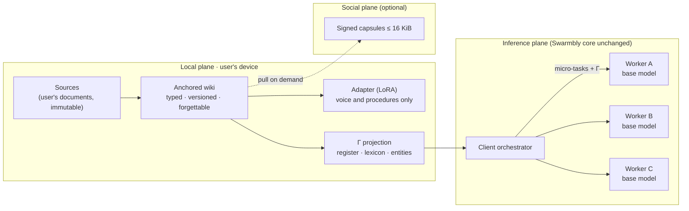

| Plane | Where | What it does |
|---|---|---|
| **Local** | user's device | immutable sources → anchored, typed, versioned wiki (learns fast) → LoRA adapter with replay, regenerated from base + wiki (learns slowly) |
| **Inference** | Swarmbly, no core changes | personalization enters only through the Γ contract; workers serve their base model; verification stays intact; plural answer from the E16 consensus |
| **Social** | optional, on demand | signed capsules ≤ 16 KiB, pull never gossip; variation only with new human evidence; persistence by use and replicas derived from a tolerance |

### Eight invariants

| # | Rule | Why, in plain words |
|---|---|---|
| I1 | Facts in the wiki, behaviour in the weights | Fine-tuning new facts works worse than retrieving them and raises hallucination. |
| I2 | Workers serve the base model | Keeps verification possible, keeps the adapter private, avoids shared-material errors. |
| I3 | Accumulate, never replace | Replacing data with model output erodes rare knowledge (model collapse). |
| I4 | Variation comes from people | A capsule may have descendants only with new human evidence. |
| I5 | Prevalence is a label, not an adoption criterion | Copying what is popular would drive out minority variants (conformity). |
| I6 | Every adapter from base + wiki, with replay and a fresh test | Prevents drift and test-set reuse. |
| I7 | Diversity is budgeted and reported | Homogenization is measured, not assumed away. |
| I8 | What is not declared does not train | Nothing enters the weights without explicit permission. |

### What has been measured

All runs use three small model families (`qwen2.5:3b`, `llama3.2:3b`, `gemma2:2b`; five in F1a) served by Ollama on one Apple Silicon machine, with synthetic users whose corpora are in this repository. Intervals are bootstrap 95 % CIs. Each row links to a result document with its raw outputs.

| Question | Run | Result | Verdict |
|---|---|---|---|
| Does the pipeline work at all? (C1) | [C1/C2 run 2](docs/RESULTS_2026-10-05_C1_C2_run2_EN.md), confirmatory | accuracy 0.80 with memory vs 0.00 without | **holds** |
| Does Γ carry the user's vocabulary? (H-C2, lexicon) | run 2 | adherence 0.667 vs 0.033; difference 0.633 [0.500, 0.750] | **holds** |
| Does Γ make users' answers less alike? (H-C17a) | run 2 | homogeneity 0.879 → 0.806; beats a placebo by 0.048 [0.023, 0.070] | **holds**, with a qualification |
| Does Γ leave shared errors alone? (H-C17b) | run 2 | Δ error agreement 0.039 [0.009, 0.069], inside ±0.10 | **holds** as equivalence |
| Does local memory help? (H-C1 at scale) | [F1a](results/BENCH_REPORT.md), exploratory | +0.500 [0.420, 0.578] | **holds** descriptively |
| Does the wiki beat raw retrieval? (R13-H1) | [R13 confirmatory](docs/RESULTS_2026-10-11_R13_confirm_EN.md) | A3 − A2 = −0.146 [−0.186, −0.106] | **dies** |
| Does forgetting a source work? | [F-forget](docs/RESULTS_2026-10-10_Fforget_AA_EN.md) | residue 0, collateral 0; behaviour at never-seen level | **holds** as a mechanism |
| Are runs reproducible? (R14) | [A/A](docs/RESULTS_2026-10-10_Fforget_AA_EN.md) | generation 98.4 % identical; digestion 8/15 wikis | **open** |
| Does the adapter beat retrieval? (H-C6) | [R11 confirmatory](docs/RESULTS_2026-10-11_R11_confirm_EN.md) | adapter never applied at evaluation | **no verdict** |
| Instruction-matched placebo (C2-bis) | [C2-bis](docs/RESULTS_2026-10-11_C2bis_EN.md) | measured within-user, not across users | **no verdict** |
| Is Γ worth its ρ cost? (H-C2 closure) | [H-C2 closure](docs/RESULTS_2026-10-11_HC2_closure_EN.md) | measured QA accuracy, not adherence | **no verdict** |
| Social plane (H-C11) | [R12](docs/RESULTS_2026-10-09_R12_exploratory_EN.md), exploratory | 0/40 by construction; canary unverified | **not measured** |

#### 1 · Local memory helps

With its wiki, the same model answers questions about its user that it cannot answer without it. The gain holds in every family; the weakest digester (phi3.5) built wikis too small to pass the anchored-claim floor for three of five users.

<picture>
  <source media="(prefers-color-scheme: dark)" srcset="docs/figures/f1a_memory_gain_dark.svg">
  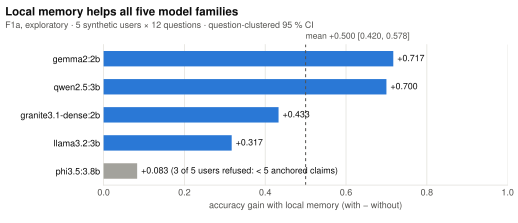
</picture>

#### 2 · …but the digested wiki loses to raw retrieval

The decisive test (R13, pre-registered, 251 questions including 8 public LongMemEval questions) gave every arm the same 200-token context budget. Retrieving raw sentences from the user's documents (A2) beat retrieving the wiki's notes (A3) with every digester.

<picture>
  <source media="(prefers-color-scheme: dark)" srcset="docs/figures/r13_arms_dark.svg">
  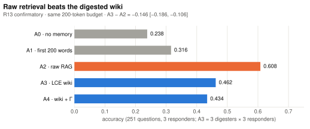
</picture>

<picture>
  <source media="(prefers-color-scheme: dark)" srcset="docs/figures/r13_types_dark.svg">
  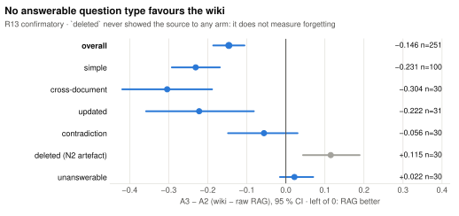
</picture>

The only type where the wiki looks better, `deleted`, is an artefact declared before the run: no arm ever saw the deleted source, and the arm with no memory scores perfectly by abstaining. It says nothing about forgetting; forgetting is tested separately below.

#### 3 · Why: digestion drops the answer

The loss is explained, not just measured. When the small model digests documents into notes, the answer sometimes does not survive. The fraction of questions whose answer reaches the context orders the arms exactly as accuracy does.

<picture>
  <source media="(prefers-color-scheme: dark)" srcset="docs/figures/r13_coverage_dark.svg">
  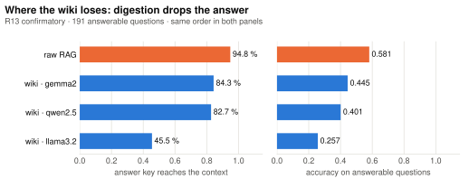
</picture>

#### 4 · Forgetting works

After `forget_source`, no note anchored to the source survives and no other note changes (15 wikis and a sweep of 116 forgets). On questions about the forgotten source, the wiki abstains as often as one that never saw it. Plain RAG forgets by deleting a file; the point here is that a wiki which *transforms* sources into notes keeps that property.

<picture>
  <source media="(prefers-color-scheme: dark)" srcset="docs/figures/forget_abstention_dark.svg">
  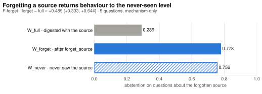
</picture>

#### 5 · Reproducibility (A/A)

| Test | Result | Threshold | Outcome |
|---|---|---|---|
| AA1 · same answers at temperature 0 | 98.4 % identical (369 answers) | ≥ 99 % | fails |
| AA2 · same wiki from the same sources | 8 of 15 identical (Jaccard 0.961) | ≥ 14 of 15 | fails |
| AA3 · seed honoured by the server | native endpoint 100 %; OpenAI-compatible 80 % | ≥ 95 % | native adopted for digestion |
| AA4 · stochastic measure stable | Δ homogeneity −0.0011 | ≤ 0.01 | passes |

Digestion with this server is not reproducible run to run even with a fixed seed. Each run's wikis are therefore saved as auditable artefacts.

#### 6 · Runs that decided nothing, and why

| Run | What went wrong | What a valid re-run needs |
|---|---|---|
| R11 · adapter vs retrieval | Adapter and base produced byte-identical text on all 720 tasks: the adapter was never loaded at evaluation | a manipulation check first: the adapter must change its output on its own training examples |
| C2-bis · instruction-matched placebo | Measured how alike one user's three samples are, not how alike different users are; no no-contract arm | cross-user homogeneity, three arms, a neutral placebo |
| H-C2 closure · ρ vs gain | Measured QA accuracy instead of adherence; ρ by arithmetic, not the real packer; an 80 % rule that is almost unreachable | per-task adherence vs packer Δρ, with a rule rewritten before running |

### What the results change

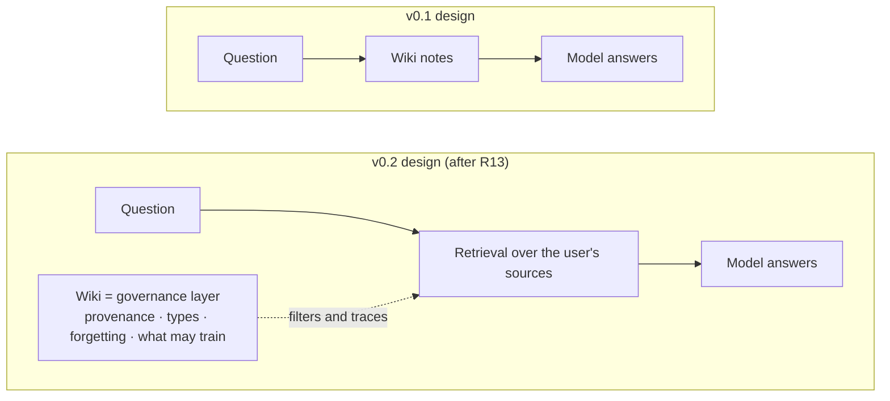

1. **Default retrieval runs over the sources.** The wiki stops being the answering memory and becomes the layer that knows where each piece came from, what kind of statement it is, what may be used for training, and what has been forgotten. This is the simplification R13's pre-registration foresees for this case (its death rule itself does not fire by the letter, only because of the invalid `deleted` type, so the decision rests on the wiki losing and on the measured cause). The normative specification does not change yet; the change is proposed for its next revision.
2. **Digester quality is measured by coverage, not size.** Every wiki cleared the 5-claim floor easily; what differs is how many answers survive digestion.
3. **Γ's value is in writing, not QA.** In question answering it barely moves accuracy (A4 − A3 between −0.036 and +0.016), which is expected: it carries form preferences, not facts.
4. **The adapter remains untested**, not refuted.

### How evidence is produced here

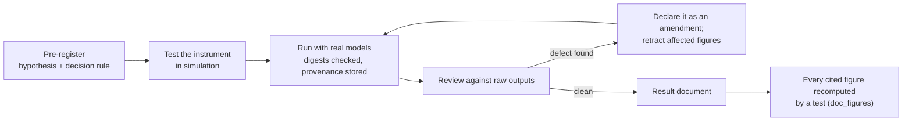

- **Mock or simulated outputs are never evidence.** They show that an instrument responds to what it measures.
- **Pre-registration first.** Hypotheses, thresholds and death conditions are committed before running; every later change is a dated amendment ([R13/R11/R14 pre-registration](docs/PREREGISTRATION_BENCH_R1X_EN.md), amendments 1–15).
- **Retractions stay visible.** Wrong conclusions are struck in the documents, not deleted. Whitepaper v0.2, Section 11.9, lists them.
- **Figures are anchored.** `tests/test_doc_figures.py` recomputes every figure cited in the results, the SWIP, this README, the whitepaper and the charts above from the stored JSON; a hand-edited or stale number fails CI.

### What is not claimed

| Not claimed | Why |
|---|---|
| That the personal model learns facts | Fine-tuning new facts underperforms retrieval and raises hallucination; facts live in the wiki. |
| Verifiable forgetting in the weights, except by regenerating | Current unlearning methods are unreliable. |
| That diverse model families make errors independent | Recent evidence shows correlated errors across families. |
| That the network becomes smarter by communicating | Kept only as a measurable hypothesis about saved work. |
| That the incentive problem of volunteer computing is solved | A candidate mechanism with a metric that can refute it. |
| That the anchored wiki answers better than retrieval over the sources | R13 measured it, and the wiki lost. |

### Repository map

| Path | What is there |
|---|---|
| [`docs/WHITEPAPER_LCE_v0.2_EN.md`](docs/WHITEPAPER_LCE_v0.2_EN.md) ([PDF](docs/WHITEPAPER_LCE_v0.2_EN.pdf)) | Whitepaper v0.2: rationale, architecture, hypotheses, **results, design consequences, retractions** |
| [`docs/WHITEPAPER_LCE_EN.md`](docs/WHITEPAPER_LCE_EN.md) ([PDF](docs/WHITEPAPER_LCE_EN.pdf)) | Whitepaper v0.1 as published on Zenodo (frozen, no results) |
| [`docs/SPEC_LCE_EN.md`](docs/SPEC_LCE_EN.md) | Normative specification (RFC 2119), parameters, code map (Section 21) |
| [`swips/`](swips/SWIP-XXXX-local-cognitive-extension.md) | Protocol-facing proposal (SWIP, revision 3) with its validation status |
| [`docs/PREREGISTRATION_*`](docs/PREREGISTRATION_BENCH_R1X_EN.md) | Pre-registrations with every amendment |
| [`docs/RESULTS_*`](docs/STATUS.md) | One document per run, with verdicts and declared deviations |
| [`results/`](results/BENCH_REPORT.md) | Raw outputs of every run and the generated benchmark report |
| [`swarmbly_lce/`](swarmbly_lce/) | Reference implementation of the whole specification |
| [`lce_validation/`](lce_validation/README.md) | Harness: instrument tests, real-model runners, analyses, figure anchoring |
| [`tests/`](tests/) | 109 tests, including one per invariant I1–I8 and the figure-anchoring test |
| [`docs/REFERENCES_LCE.md`](docs/REFERENCES_LCE.md) | Annotated bibliography (68 entries) |
| [`docs/STATUS.md`](docs/STATUS.md) | Status of every document |
| [`docs/ARCHITECTURE_LCE.html`](docs/ARCHITECTURE_LCE.html) | Interactive architecture diagram |

### Getting started

Python 3.10 or later; numpy is the only required dependency.

```bash
pip install -e '.[dev]'           # extras: crypto (Ed25519), yaml, mlx (LoRA on Apple Silicon)
python -m pytest                  # full suite; some tests skip without optional extras
python -m lce_validation.run_all  # ten instrument tests + mock-backend experiments
python -m lce_validation.run_derive  # recompute every stored figure from the raw outputs
```

The `swarmbly-lce` command covers the local cycle:

| Command | What it does |
|---|---|
| `init DIR` | creates source folders and a policy in which nothing trains by default |
| `ingest --sources DIR [--backend ollama --model qwen2.5:3b]` | digests and anchors the sources |
| `cycle` | advances claim maturity |
| `status` | shows the state of the wiki |
| `project "request"` | shows what would leave in Γ and in which privacy lane |
| `forget SOURCE` | removes everything anchored to a source |
| `export-md OUT` | exports the wiki as Markdown |
| `replicas --eps 1e-3` | replica count for a loss tolerance |
| `capsule keygen\|make\|verify PATH` | creates keys, makes and verifies signed capsules |
| `validate` | runs the instrument harness (same as `run_all`) |

Real-model runs: `python -m lce_validation.run_real --models qwen2.5:3b,llama3.2:3b,gemma2:2b` against Ollama or any OpenAI-compatible server. The charts in this README are regenerated from the stored results with `python -m lce_validation.readme_figures` (needs matplotlib).

### Next steps

| Priority | Step | What it would decide |
|---|---|---|
| 1 | Re-run R11 with a manipulation check | whether the adapter (layer 2) lives or is withdrawn |
| 2 | Test the v0.2 design: retrieval over sources + wiki as governance | whether the simplification keeps RAG-level accuracy *and* forgetting |
| 3 | Measure Γ in writing with the real packer | whether H-C2 survives its actual death condition |
| 4 | Extractive digestion (copy sentences instead of paraphrasing) | whether the coverage gap closes |
| 5 | Re-run C2-bis across users | whether the H-C17a qualification closes |
| 6 | Verify the canary set with native speakers | enables the social-plane experiments |

### Support the project

Swarmbly is developed independently, with no institutional funding, as an AGPL-licensed digital public good. If you find it useful or want it to exist, you can support its early development at **[buymeacoffee.com/swarmbly](https://buymeacoffee.com/swarmbly)**. Support never buys influence over the roadmap, the licence or the governance (see [`GOVERNANCE.md`](https://github.com/Sebastardito/SwarmblyAI/blob/main/GOVERNANCE.md)).

### Citation and licence

**Whitepaper:** Espinoza-Ulloa, S. A. (2026). *Local cognition and anchored transmission: A local-first cognitive extension for Swarmbly* (Version 0.1, draft). Zenodo. https://doi.org/10.5281/zenodo.23150478

**Software:** Espinoza-Ulloa, S. A. (2026). *Swarmbly LCE: reference implementation, validation harness and pre-registered runs* (Version 0.1.1) [Software]. Zenodo. https://doi.org/10.5281/zenodo.23289041

Code: AGPL-3.0-or-later ([`LICENSE`](LICENSE), [`NOTICE`](NOTICE)). Texts: CC BY 4.0. Citation metadata: [`CITATION.cff`](CITATION.cff). LongMemEval (MIT) attribution in [`NOTICE`](NOTICE).

*Sebastián A. Espinoza-Ulloa · Independent Researcher · [ORCID 0000-0003-1497-356X](https://orcid.org/0000-0003-1497-356X) · [@Sebastardito](https://github.com/Sebastardito)*

---

## Español

**Una extensión local-first para [Swarmbly](https://github.com/Sebastardito/Swarmbly-AI): memoria personal, un modelo que aprende la voz de su usuario e intercambio ligero de conocimiento entre nodos, sin deformar el protocolo.**

> **Estado: borrador con resultados confirmatorios; no revisado por pares.** Cada corrida se preregistra antes de hacerse. La memoria local ayuda (F1a: +0.500 [0.420, 0.578]). La wiki anclada, en cambio, **pierde** frente a una recuperación simple sobre los documentos del propio usuario (R13 confirmatoria: A3 − A2 = −0.146 [−0.186, −0.106]), así que se conserva como capa de gobierno y no como memoria de respuesta. Olvidar una fuente funciona como mecanismo. Tres corridas no emitieron veredicto, y las razones están documentadas. Detalle en el [whitepaper v0.2](docs/WHITEPAPER_LCE_v0.2_ES.md). Las figuras tienen el texto en inglés; sus cifras son las mismas.

### Contenido

1. [La idea en un minuto](#la-idea-en-un-minuto)
2. [Arquitectura](#arquitectura)
3. [Ocho invariantes](#ocho-invariantes)
4. [Qué se ha medido](#qué-se-ha-medido)
5. [Qué cambian los resultados](#qué-cambian-los-resultados)
6. [Cómo se produce aquí la evidencia](#cómo-se-produce-aquí-la-evidencia)
7. [Lo que no se afirma](#lo-que-no-se-afirma)
8. [Mapa del repositorio](#mapa-del-repositorio)
9. [Primeros pasos](#primeros-pasos)
10. [Próximos pasos](#próximos-pasos)
11. [Apoya el proyecto](#apoya-el-proyecto)
12. [Cita y licencia](#cita-y-licencia)

### La idea en un minuto

Swarmbly fragmenta el **problema**, no el modelo: el cliente divide una petición en tareas pequeñas, nodos voluntarios las resuelven con modelos pequeños completos y el cliente ensambla la respuesta. Los workers son deliberadamente casi sin estado, así que el cliente es el único lugar donde puede vivir la memoria. La LCE propone qué hacer con esa memoria:

| Pieza | Descripción sencilla | Dónde vive |
|---|---|---|
| **Wiki** | Un cuaderno legible que el modelo local escribe a partir de los documentos del usuario. Cada nota apunta a la frase exacta de la que salió, tiene un tipo (hecho, opinión, estilo, procedimiento…) y un estado de madurez. | el dispositivo del usuario |
| **Adaptador** | Un ajuste pequeño (LoRA) que aprende *cómo* escribe y trabaja el usuario, nunca sus hechos. Se reconstruye desde el modelo base y la wiki; nunca se parcha. | el dispositivo del usuario |
| **Proyección Γ** | Una «ficha de preferencias» corta (registro, términos preferidos, entidades) que acompaña cada tarea enviada a la red. Los workers ven la ficha, no la memoria. | viaja con cada petición |
| **Cápsulas** | Piezas pequeñas y firmadas de conocimiento escrito que un nodo puede *pedir* a otro bajo demanda. Opcionales. | entre nodos |

### Arquitectura

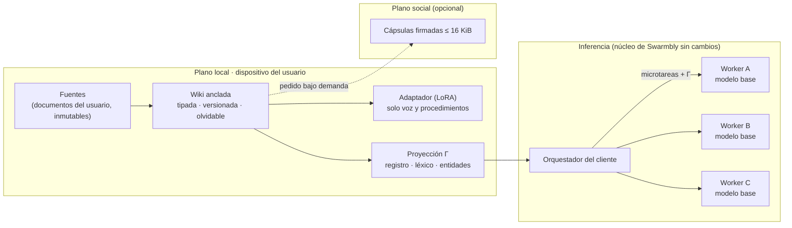

| Plano | Dónde vive | Qué hace |
|---|---|---|
| **Local** | dispositivo del usuario | fuentes inmutables → wiki anclada, tipada y versionada (aprende rápido) → adaptador LoRA con repaso, regenerado desde base + wiki (aprende despacio) |
| **Inferencia** | Swarmbly, sin cambios en el núcleo | la personalización entra solo por el contrato Γ; los workers sirven su modelo base; la verificación queda intacta; respuesta plural desde el consenso E16 |
| **Social** | opcional, bajo demanda | cápsulas firmadas de ≤ 16 KiB, pull y nunca gossip; variación solo con evidencia humana nueva; persistencia por uso y réplicas derivadas de una tolerancia |

### Ocho invariantes

| # | Regla | Por qué, en palabras simples |
|---|---|---|
| I1 | Hechos en la wiki, comportamiento en los pesos | Ajustar un modelo con hechos nuevos rinde menos que recuperarlos y aumenta la alucinación. |
| I2 | Los workers sirven el modelo base | Mantiene posible la verificación, el adaptador privado y evita errores por material compartido. |
| I3 | Acumular, nunca reemplazar | Reemplazar datos por salidas del modelo erosiona el conocimiento raro (colapso de modelos). |
| I4 | La variación viene de personas | Una cápsula solo puede tener descendientes con evidencia humana nueva. |
| I5 | La prevalencia es una etiqueta, no un criterio de adopción | Copiar lo popular expulsaría las variantes minoritarias (conformismo). |
| I6 | Cada adaptador desde base + wiki, con repaso y prueba nueva | Evita la deriva y la reutilización del conjunto de prueba. |
| I7 | La diversidad se presupuesta y se reporta | La homogeneización se mide, no se supone resuelta. |
| I8 | Lo no declarado no entrena | Nada entra a los pesos sin permiso explícito. |

### Qué se ha medido

Todas las corridas usan tres familias de modelos pequeños (`qwen2.5:3b`, `llama3.2:3b`, `gemma2:2b`; cinco en F1a) servidas por Ollama en un solo equipo Apple Silicon, con usuarios sintéticos cuyos corpus están en este repositorio. Los intervalos son IC95 por bootstrap. Cada fila enlaza al documento de resultados con sus salidas crudas.

| Pregunta | Corrida | Resultado | Veredicto |
|---|---|---|---|
| ¿Funciona la tubería? (C1) | [C1/C2 corrida 2](docs/RESULTS_2026-10-05_C1_C2_run2_ES.md), confirmatoria | exactitud 0.80 con memoria frente a 0.00 sin ella | **se sostiene** |
| ¿Γ transmite el vocabulario del usuario? (H-C2, léxico) | corrida 2 | adherencia 0.667 frente a 0.033; diferencia 0.633 [0.500, 0.750] | **se sostiene** |
| ¿Γ hace menos parecidas las respuestas de usuarios distintos? (H-C17a) | corrida 2 | homogeneidad 0.879 → 0.806; supera a un placebo por 0.048 [0.023, 0.070] | **se sostiene**, con matiz |
| ¿Γ deja intactos los errores compartidos? (H-C17b) | corrida 2 | Δ de acuerdo de errores 0.039 [0.009, 0.069], dentro de ±0.10 | **se sostiene** como equivalencia |
| ¿Ayuda la memoria local? (H-C1 a escala) | [F1a](results/BENCH_REPORT.md), exploratoria | +0.500 [0.420, 0.578] | **se sostiene** descriptivamente |
| ¿La wiki supera a la recuperación cruda? (R13-H1) | [R13 confirmatoria](docs/RESULTS_2026-10-11_R13_confirm_ES.md) | A3 − A2 = −0.146 [−0.186, −0.106] | **muere** |
| ¿Funciona olvidar una fuente? | [F-forget](docs/RESULTS_2026-10-10_Fforget_AA_ES.md) | residuo 0, colateral 0; conducta al nivel de no haberla visto | **se sostiene** como mecanismo |
| ¿Son reproducibles las corridas? (R14) | [A/A](docs/RESULTS_2026-10-10_Fforget_AA_ES.md) | generación 98.4 % idéntica; digestión 8/15 wikis | **abierto** |
| ¿El adaptador supera a la recuperación? (H-C6) | [R11 confirmatoria](docs/RESULTS_2026-10-11_R11_confirm_ES.md) | el adaptador nunca se aplicó en la evaluación | **sin veredicto** |
| Placebo igualado en instrucción (C2-bis) | [C2-bis](docs/RESULTS_2026-10-11_C2bis_ES.md) | midió dentro del usuario, no entre usuarios | **sin veredicto** |
| ¿Γ compensa su costo en ρ? (cierre de H-C2) | [Cierre de H-C2](docs/RESULTS_2026-10-11_HC2_closure_ES.md) | midió exactitud de QA, no adherencia | **sin veredicto** |
| Plano social (H-C11) | [R12](docs/RESULTS_2026-10-09_R12_exploratory_ES.md), exploratorio | 0/40 por construcción; canario sin verificar | **no medido** |

#### 1 · La memoria local ayuda

Con su wiki, el mismo modelo responde preguntas sobre su usuario que sin ella no puede responder. La ganancia aparece en todas las familias; el digestor más débil (phi3.5) construyó wikis demasiado pequeñas para pasar el piso de afirmaciones ancladas en tres de cinco usuarios.

<picture>
  <source media="(prefers-color-scheme: dark)" srcset="docs/figures/f1a_memory_gain_dark.svg">
  
</picture>

#### 2 · …pero la wiki digerida pierde frente a la recuperación cruda

La prueba decisiva (R13, preregistrada, 251 preguntas, incluidas 8 preguntas públicas de LongMemEval) dio a todos los brazos el mismo presupuesto de 200 tokens de contexto. Recuperar frases crudas de los documentos del usuario (A2) superó a recuperar las notas de la wiki (A3) con todos los digestores.

<picture>
  <source media="(prefers-color-scheme: dark)" srcset="docs/figures/r13_arms_dark.svg">
  
</picture>

<picture>
  <source media="(prefers-color-scheme: dark)" srcset="docs/figures/r13_types_dark.svg">
  
</picture>

El único tipo donde la wiki parece mejor, `deleted`, es un artefacto declarado antes de correr: ningún brazo vio nunca la fuente borrada, y el brazo sin memoria saca la nota máxima absteniéndose. No dice nada del olvido; el olvido se prueba aparte, más abajo.

#### 3 · Por qué: la digestión pierde la respuesta

La pérdida está explicada, no solo medida. Cuando el modelo pequeño digiere los documentos en notas, a veces la respuesta no sobrevive. La fracción de preguntas cuya respuesta llega al contexto ordena los brazos exactamente igual que la exactitud.

<picture>
  <source media="(prefers-color-scheme: dark)" srcset="docs/figures/r13_coverage_dark.svg">
  
</picture>

#### 4 · Olvidar funciona

Después de `forget_source` no sobrevive ninguna nota anclada a la fuente y ninguna otra cambia (15 wikis y un barrido de 116 olvidos). En las preguntas sobre la fuente olvidada, la wiki se abstiene tanto como una que nunca la vio. Un RAG simple olvida borrando un archivo; lo que importa aquí es que una wiki que *transforma* las fuentes en notas conserva esa propiedad.

<picture>
  <source media="(prefers-color-scheme: dark)" srcset="docs/figures/forget_abstention_dark.svg">
  
</picture>

#### 5 · Reproducibilidad (A/A)

| Prueba | Resultado | Umbral | Desenlace |
|---|---|---|---|
| AA1 · mismas respuestas a temperatura 0 | 98.4 % idénticas (369 respuestas) | ≥ 99 % | falla |
| AA2 · misma wiki desde las mismas fuentes | 8 de 15 idénticas (Jaccard 0.961) | ≥ 14 de 15 | falla |
| AA3 · el servidor respeta la semilla | endpoint nativo 100 %; compatible con OpenAI 80 % | ≥ 95 % | el nativo se adoptó para la digestión |
| AA4 · medida estocástica estable | Δ de homogeneidad −0.0011 | ≤ 0.01 | pasa |

Con este servidor, la digestión no es reproducible corrida a corrida ni con semilla fija. Por eso las wikis de cada corrida se guardan como artefactos auditables.

#### 6 · Corridas que no decidieron nada, y por qué

| Corrida | Qué falló | Qué necesita una re-corrida válida |
|---|---|---|
| R11 · adaptador frente a recuperación | Adaptador y base dieron texto idéntico byte a byte en las 720 tareas: el adaptador nunca se cargó en la evaluación | primero una comprobación de manipulación: el adaptador debe cambiar su salida en sus propios ejemplos de entrenamiento |
| C2-bis · placebo igualado en instrucción | Midió cuánto se parecen las tres muestras de un usuario, no cuánto se parecen usuarios distintos; sin brazo sin contrato | homogeneidad entre usuarios, tres brazos y un placebo neutro |
| Cierre de H-C2 · ρ frente a ganancia | Midió exactitud de QA en vez de adherencia; ρ por aritmética, no con el packer real; una regla del 80 % casi inalcanzable | adherencia por tarea frente al Δρ del packer, con una regla reescrita antes de correr |

### Qué cambian los resultados

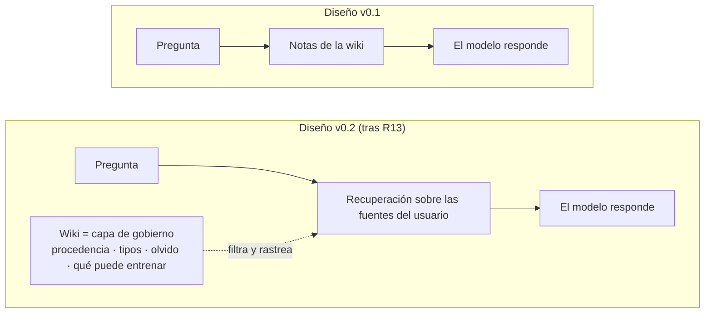

1. **La recuperación por defecto va sobre las fuentes.** La wiki deja de ser la memoria que responde y pasa a ser la capa que sabe de dónde viene cada dato, qué tipo de afirmación es, qué puede usarse para entrenar y qué se ha olvidado. Es la simplificación que el preregistro de R13 prevé para este caso (su regla de muerte no dispara por la letra, solo por el tipo `deleted` inválido, así que la decisión se apoya en que la wiki pierde y en la causa medida). La especificación normativa aún no cambia; el cambio se propone para su próxima revisión.
2. **La calidad del digestor se mide por cobertura, no por tamaño.** Todas las wikis superaron con holgura el piso de 5 afirmaciones; lo que cambia es cuántas respuestas sobreviven a la digestión.
3. **El valor de Γ está en la escritura, no en QA.** En pregunta-respuesta casi no mueve la exactitud (A4 − A3 entre −0.036 y +0.016), lo esperable: transporta preferencias de forma, no hechos.
4. **El adaptador sigue sin probarse**, no refutado.

### Cómo se produce aquí la evidencia

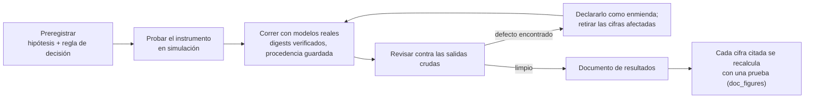

- **Las salidas simuladas nunca son evidencia.** Muestran que un instrumento responde a lo que mide.
- **Primero el preregistro.** Hipótesis, umbrales y condiciones de muerte se confirman antes de correr; cada cambio posterior es una enmienda con fecha ([preregistro de R13/R11/R14](docs/PREREGISTRATION_BENCH_R1X_ES.md), enmiendas 1–15).
- **Las retracciones quedan visibles.** Las conclusiones equivocadas se tachan en los documentos, no se borran. El whitepaper v0.2, sección 11.9, las enumera.
- **Las cifras están ancladas.** `tests/test_doc_figures.py` recalcula desde los JSON guardados cada cifra citada en los resultados, la SWIP, este README, el whitepaper y las figuras de arriba; una cifra editada a mano o desactualizada hace fallar la integración continua.

### Lo que no se afirma

| No se afirma | Por qué |
|---|---|
| Que el modelo personal aprenda hechos | Ajustar con hechos nuevos rinde menos que recuperarlos y aumenta la alucinación; los hechos viven en la wiki. |
| Olvido verificable en los pesos, salvo regenerando | Los métodos de desaprendizaje actuales no son fiables. |
| Que familias de modelos distintas tengan errores independientes | La evidencia reciente muestra errores correlacionados entre familias. |
| Que la red se vuelva más inteligente por comunicarse | Se conserva solo como hipótesis medible sobre trabajo ahorrado. |
| Que el problema de incentivo de la computación voluntaria quede resuelto | Un mecanismo candidato con una métrica que puede refutarlo. |
| Que la wiki anclada responda mejor que recuperar sobre las fuentes | R13 lo midió y la wiki perdió. |

### Mapa del repositorio

| Ruta | Qué contiene |
|---|---|
| [`docs/WHITEPAPER_LCE_v0.2_ES.md`](docs/WHITEPAPER_LCE_v0.2_ES.md) ([PDF](docs/WHITEPAPER_LCE_v0.2_ES.pdf)) | Whitepaper v0.2: fundamento, arquitectura, hipótesis, **resultados, consecuencias de diseño y retracciones** |
| [`docs/WHITEPAPER_LCE_ES.md`](docs/WHITEPAPER_LCE_ES.md) ([PDF](docs/WHITEPAPER_LCE_ES.pdf)) | Whitepaper v0.1 tal como se publicó en Zenodo (congelado, sin resultados) |
| [`docs/SPEC_LCE_ES.md`](docs/SPEC_LCE_ES.md) | Especificación normativa (RFC 2119), parámetros, correspondencia con el código (sección 21) |
| [`swips/`](swips/SWIP-XXXX-local-cognitive-extension.md) | Propuesta para el protocolo (SWIP, revisión 3, en inglés) con su estado de validación |
| [`docs/PREREGISTRATION_*`](docs/PREREGISTRATION_BENCH_R1X_ES.md) | Preregistros con todas sus enmiendas |
| [`docs/RESULTS_*`](docs/STATUS.md) | Un documento por corrida, con veredictos y desviaciones declaradas |
| [`results/`](results/BENCH_REPORT.md) | Salidas crudas de cada corrida y el reporte de benchmarks generado |
| [`swarmbly_lce/`](swarmbly_lce/) | Implementación de referencia de toda la especificación |
| [`lce_validation/`](lce_validation/README.md) | Arnés: pruebas de instrumento, corredores con modelos reales, análisis y anclaje de cifras |
| [`tests/`](tests/) | 109 pruebas, incluida una por invariante I1–I8 y la de anclaje de cifras |
| [`docs/REFERENCES_LCE.md`](docs/REFERENCES_LCE.md) | Bibliografía anotada (68 entradas) |
| [`docs/STATUS.md`](docs/STATUS.md) | Estado de cada documento |
| [`docs/ARCHITECTURE_LCE.html`](docs/ARCHITECTURE_LCE.html) | Diagrama interactivo de la arquitectura |

### Primeros pasos

Requiere Python 3.10 o superior; la única dependencia obligatoria es numpy.

```bash
pip install -e '.[dev]'           # extras: crypto (Ed25519), yaml, mlx (LoRA en Apple Silicon)
python -m pytest                  # toda la suite; algunas pruebas se omiten sin los extras opcionales
python -m lce_validation.run_all  # diez pruebas de instrumento + experimentos con backend simulado
python -m lce_validation.run_derive  # recalcula cada cifra guardada desde las salidas crudas
```

La orden `swarmbly-lce` cubre el ciclo local:

| Orden | Qué hace |
|---|---|
| `init DIR` | crea las carpetas de fuentes y una política en la que nada entrena por defecto |
| `ingest --sources DIR [--backend ollama --model qwen2.5:3b]` | digiere y ancla las fuentes |
| `cycle` | avanza la madurez de las afirmaciones |
| `status` | muestra el estado de la wiki |
| `project "petición"` | muestra lo que saldría en Γ y en qué carril de privacidad |
| `forget FUENTE` | elimina todo lo anclado a una fuente |
| `export-md SALIDA` | exporta la wiki como Markdown |
| `replicas --eps 1e-3` | número de réplicas para una tolerancia de pérdida |
| `capsule keygen\|make\|verify RUTA` | crea claves, hace y verifica cápsulas firmadas |
| `validate` | corre el arnés de instrumentos (igual que `run_all`) |

Corridas con modelos reales: `python -m lce_validation.run_real --models qwen2.5:3b,llama3.2:3b,gemma2:2b` contra Ollama o cualquier servidor compatible con OpenAI. Las figuras de este README se regeneran desde los resultados guardados con `python -m lce_validation.readme_figures` (requiere matplotlib).

### Próximos pasos

| Prioridad | Paso | Qué decidiría |
|---|---|---|
| 1 | Re-correr R11 con comprobación de manipulación | si el adaptador (capa 2) vive o se retira |
| 2 | Probar el diseño v0.2: recuperación sobre fuentes + wiki como gobierno | si la simplificación conserva la exactitud del RAG *y* el olvido |
| 3 | Medir Γ al escribir, con el packer real | si H-C2 sobrevive a su condición de muerte real |
| 4 | Digestión extractiva (copiar frases en vez de parafrasear) | si se cierra la brecha de cobertura |
| 5 | Re-correr C2-bis entre usuarios | si se cierra el matiz de H-C17a |
| 6 | Verificar el conjunto canario con hablantes nativos | habilita los experimentos del plano social |

### Apoya el proyecto

Swarmbly se desarrolla de forma independiente, sin financiación institucional, como un bien público digital con licencia AGPL. Si te resulta útil o quieres que exista, puedes apoyar su desarrollo en estas primeras etapas en **[buymeacoffee.com/swarmbly](https://buymeacoffee.com/swarmbly)**. El apoyo nunca compra influencia sobre la hoja de ruta, la licencia ni la gobernanza (ver [`GOVERNANCE.md`](https://github.com/Sebastardito/SwarmblyAI/blob/main/GOVERNANCE.md)).

### Cita y licencia

**Whitepaper:** Espinoza-Ulloa, S. A. (2026). *Local cognition and anchored transmission: A local-first cognitive extension for Swarmbly* (Version 0.1, draft). Zenodo. https://doi.org/10.5281/zenodo.23150478

**Software:** Espinoza-Ulloa, S. A. (2026). *Swarmbly LCE: reference implementation, validation harness and pre-registered runs* (Version 0.1.1) [Software]. Zenodo. https://doi.org/10.5281/zenodo.23289041

Código: AGPL-3.0-or-later ([`LICENSE`](LICENSE), [`NOTICE`](NOTICE)). Textos: CC BY 4.0. Metadatos de cita: [`CITATION.cff`](CITATION.cff). Atribución de LongMemEval (MIT) en [`NOTICE`](NOTICE).

*Sebastián A. Espinoza-Ulloa · Investigador independiente · [ORCID 0000-0003-1497-356X](https://orcid.org/0000-0003-1497-356X) · [@Sebastardito](https://github.com/Sebastardito)*
