<h1 align="center">Swarmbly AI</h1>

<p align="center"><b>Decentralized AI that fragments the <i>problem</i>, not the <i>model</i>.</b><br>
A local orchestrator, a private memory and a peer-to-peer network of small models — in one install.</p>

<p align="center">
<a href="LICENSE"></a>

<a href="https://github.com/Sebastardito/SwarmblyAI/actions/workflows/distribution.yml"></a>

<a href="https://doi.org/10.5281/zenodo.23650763"></a>
<a href="https://buymeacoffee.com/swarmbly"></a>
</p>

<p align="center"><b><a href="#english">English</a></b> · <b><a href="#español">Español</a></b></p>

<p align="center">
<picture>
  <source media="(prefers-color-scheme: dark)" srcset="docs/figures/flow_animated_dark.svg">
  
</picture>
</p>

> **Status: alpha.** A working research prototype with published measurements, not peer reviewed. Each component states what has been measured and what has not; read [What works today](#what-works-today) before quoting any capability.
>
> **Latest release: [3.0.0 — integrated distribution](docs/releases/v3.0.0.md)** (2026-10-25) · DOI [10.5281/zenodo.23650763](https://doi.org/10.5281/zenodo.23650763).

---

## English

### Contents

| Understand | Use | Take part |
|---|---|---|
| [The idea in one minute](#the-idea-in-one-minute) | [Install](#install) | [How this repository is maintained](#how-this-repository-is-maintained) |
| [The three components](#the-three-components) | [First steps](#first-steps) | [Roadmap](#roadmap) |
| [How a request flows](#how-a-request-flows) | [A tour of the app](#a-tour-of-the-app) | [Support the project](#support-the-project) |
| [What works today](#what-works-today) | [Repository layout](#repository-layout) | [Citation, licence and governance](#citation-licence-and-governance) |
| [The evidence, in figures](#the-evidence-in-figures) | | |

### The idea in one minute

Peer-to-peer AI systems usually split the **model**: its layers live on different machines, and activations cross the network for every generated token, so the slowest machine sets the pace. Swarmbly splits the **problem**, the way shotgun genome assembly splits a genome into reads, overlaps them and builds a consensus.

| | Split the model (pipeline parallelism) | **Swarmbly: split the problem** |
|---|---|---|
| What a node holds | a slice of one big model | a complete small model |
| What crosses the network | activations, on every token | each fragment, once |
| A slow or lost node | stalls the whole chain | is hedged or replaced; the answer falls back to your computer |
| Your private data | travels with the request | never leaves your computer |
| Diversity | one model | several model families that vote per item |

A local orchestrator decides what stays on your computer and what can be shared. Public work that decomposes well (many items to classify, translate or extract) is cut into small tasks; volunteer nodes answer them; the answer is assembled on your computer. Your documents are read in place by a local memory (the LCE) and used only for answers produced on your machine. When an answer needs public facts, only the *names* of the things asked about are looked up (Wikidata, Wikipedia, PubMed and, optionally, a web search engine that runs on your computer).

<p align="center">
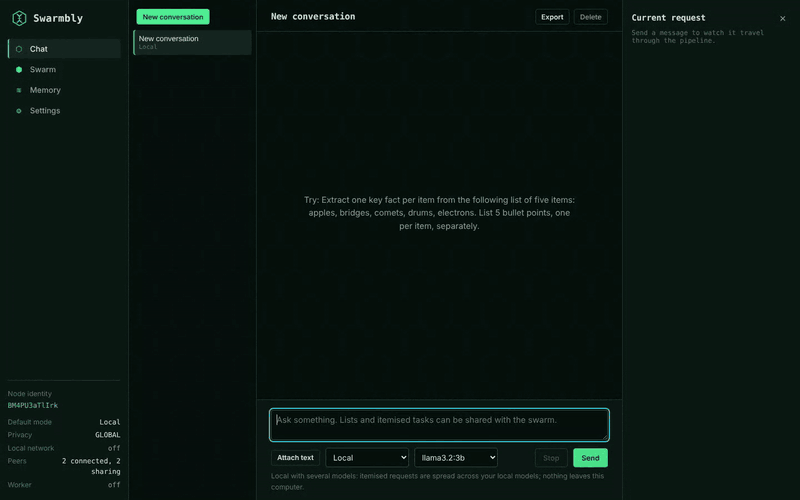<br>
<sub>Interface preview with a simulated swarm: the pipeline and monitor are real, the answers are fixed placeholders.</sub>
</p>

### The three components

Swarmbly AI is the integrated distribution of three components. Each keeps its own repository, releases and DOI; this repository brings versions that were tested together, so one download installs everything.

| | Component | What it does | Here | Repository · DOI |
|:-:|---|---|---|---|
| ⬡ | **SwarmblyCore** | Protocol and specification, reference implementation, measurement harness (V0) and benchmark. The orchestrator moves here in the next releases | [`SwarmblyCore/`](SwarmblyCore/) | this repository · [10.5281/zenodo.21956743](https://doi.org/10.5281/zenodo.21956743) |
| ◈ | **SwarmblyLCE** | Local Cognitive Extension: memory that lives only on your device — retrieval over your documents, provenance, forgetting, style card (Γ), signed capsules | [`SwarmblyLCE/`](SwarmblyLCE/) (mirror) | [SwarmblyLCE](https://github.com/Sebastardito/SwarmblyLCE) · [10.5281/zenodo.23289041](https://doi.org/10.5281/zenodo.23289041) |
| ▣ | **SwarmblyApp** | Desktop application: chat, network monitor, settings, peer-to-peer node (mDNS discovery, TLS + Ed25519), public evidence, local web search | [`SwarmblyApp/`](SwarmblyApp/) (mirror) | [SwarmblyApp](https://github.com/Sebastardito/SwarmblyApp) · [10.5281/zenodo.23322638](https://doi.org/10.5281/zenodo.23322638) |

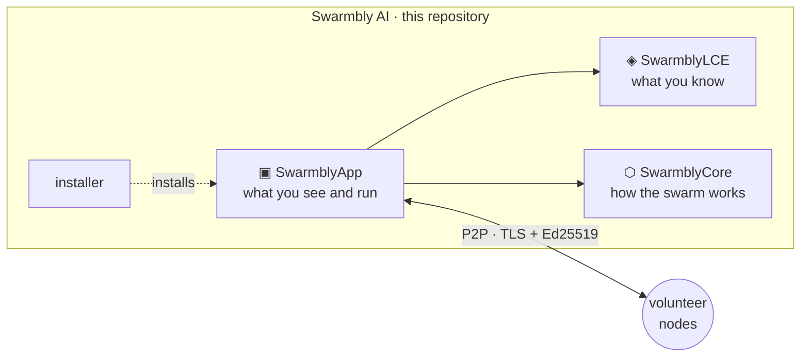

The exact versions are pinned in [`components.lock`](components.lock) and described in [`docs/COMPONENTS.md`](docs/COMPONENTS.md).

### How a request flows

Every request first gets a **lane** (personal, sensitive or public) and then a **route** (local or fragmented). Only public work that splits into independent items ever reaches the network.

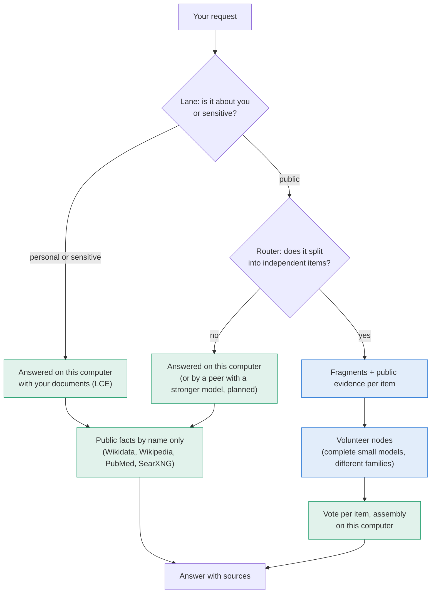

| Stage | Where | What can leave your computer |
|---|---|---|
| Lane classification | your computer | nothing |
| Routing and fragmentation | your computer | nothing |
| Public evidence | your computer → public sources | the names being asked about, never the question or your documents |
| Dispatch | authenticated LAN peers | fragments of public requests, without session id and never a complete request |
| Vote and assembly | your computer | nothing |

The *Explore processing* panel of every answer shows each of these stages, what was measured and what was estimated. More detail: [`docs/ARCHITECTURE.md`](docs/ARCHITECTURE.md).

### What works today

| Works, measured | Not yet, or refuted |
|---|---|
| Privacy lanes; your passages never leave the device; requests about you stay local | Distributed long-form writing does not beat a single local model |
| LAN network: authenticated peers, hedging, immediate local fallback, learned speed, rediscovery | Internet-wide swarms (Phase 3) are not implemented |
| Batches with per-item public evidence: the network fixes facts small models lack (IUCN status 8/8 against about 1/8 without evidence) | The coherence-tax abandonment criterion is **not met** on its held-out test; the confidence map was **withdrawn** |
| Extract with small models, aggregate with code: +46.9 points over the model alone (narrow scope) | Measurements so far come from one user's material; a held-out benchmark is being built |
| Local memory (LCE C1) over text, Word, HTML and PDF, with public facts fused and labelled | Answers are only as good as the model that writes them; 1–3 B models invent in open composition |

### The evidence, in figures

Every number below comes from a published record; the record is named under each figure. Measurements on one person's material are labelled as such.

**1 · Public evidence fixes what small models do not know.** The same batches on the LAN network (four nodes, three runs each), before and after per-item evidence was added.

<picture>
  <source media="(prefers-color-scheme: dark)" srcset="docs/figures/evidence_effect_dark.svg">
  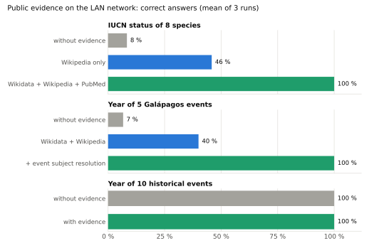
</picture>

<sub>Record: [SwarmblyApp CHANGELOG](SwarmblyApp/docs/CHANGELOG.md), rounds 10b, 11 and 12. Well-known facts (historical years) were already right; evidence matters for niche facts.</sub>

**2 · A private memory that answers from your own documents.** Sixteen questions about one person's CV, papers and notes, scored against 44 key facts, as each improvement was added to the local memory.

<picture>
  <source media="(prefers-color-scheme: dark)" srcset="docs/figures/local_answers_dark.svg">
  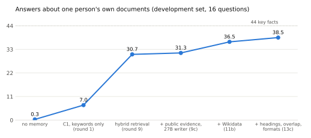
</picture>

<sub>Record: [SwarmblyApp CHANGELOG](SwarmblyApp/docs/CHANGELOG.md), P2e rounds 1–13c, mean of the repetitions. **Development set, one person, not held out**: it shows the direction of each change, not a general accuracy.</sub>

**3 · Where fragmenting wins — and where it does not.** From SwarmblyCore's campaign and the LCE's pre-registered runs.

<table>
<tr>
<td width="50%">
<picture>
  <source media="(prefers-color-scheme: dark)" srcset="SwarmblyCore/docs/figures/extraction_arms_dark.svg">
  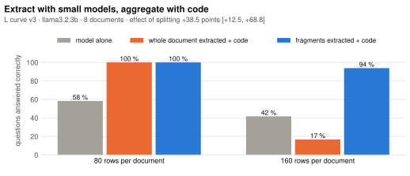
</picture>
<sub><b>Wins:</b> small models extract, code aggregates. Record: <a href="SwarmblyCore/README.md">SwarmblyCore README</a>.</sub>
</td>
<td width="50%">
<picture>
  <source media="(prefers-color-scheme: dark)" srcset="SwarmblyCore/docs/figures/coherence_tax_dark.svg">
  
</picture>
<sub><b>Not met:</b> the coherence-tax criterion on its held-out test. Record: <a href="SwarmblyCore/README.md">SwarmblyCore README</a>.</sub>
</td>
</tr>
<tr>
<td width="50%">
<picture>
  <source media="(prefers-color-scheme: dark)" srcset="SwarmblyLCE/docs/figures/f1a_memory_gain_dark.svg">
  
</picture>
<sub><b>Holds:</b> local memory helps, +0.500 [0.420, 0.578], pre-registered. Record: <a href="SwarmblyLCE/README.md">SwarmblyLCE README</a>.</sub>
</td>
<td width="50%">
<picture>
  <source media="(prefers-color-scheme: dark)" srcset="docs/figures/coverage_simulation_dark.svg">
  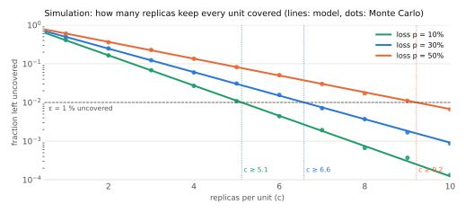
</picture>
<sub><b>Design rule (simulation):</b> replicas needed so that at most ε of the work is lost, c ≥ ln(1/ε)/(1−p). Model: SwarmblyCore specification; dots: Monte Carlo.</sub>
</td>
</tr>
</table>

The full tables with intervals and the withdrawn results are in each component: [SwarmblyCore](SwarmblyCore/README.md#what-has-been-measured), [SwarmblyLCE](SwarmblyLCE/README.md#what-has-been-measured), [SwarmblyApp](SwarmblyApp/docs/CHANGELOG.md).

### Install

**Requirements:** macOS, Linux or Windows · Python 3.10 or newer (the Windows installer offers to install it) · about 5 GB free for a model · 8 GB of RAM or more recommended.

| System | Run |
|---|---|
| macOS | double-click `install.command`, or `./install.sh` in a terminal |
| Linux | `./install.sh` |
| Windows | double-click `install.bat`, or `.\install.ps1` in PowerShell |

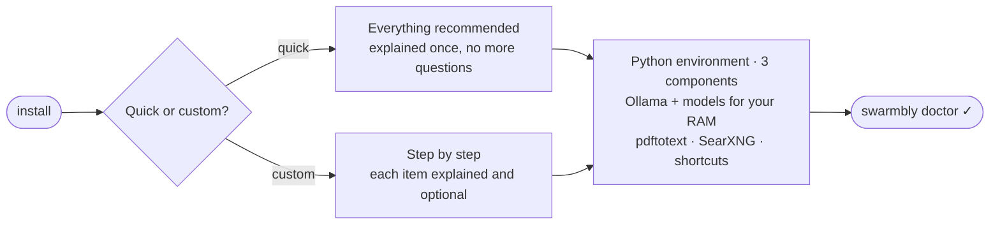

| Your RAM | Chat model installed | Plus |
|---|---|---|
| 24 GB or more | `qwen2.5:7b` | `nomic-embed-text` (retrieval over your documents) |
| 10–24 GB | `qwen2.5:3b` | `nomic-embed-text` |
| less than 10 GB | `qwen2.5:1.5b` | `nomic-embed-text` |

Nothing outside this folder, the Swarmbly data folder and the shortcuts is changed, and the system Python is never modified. In a quick install, steps that need an administrator password are skipped and listed at the end with the exact command. Full guide, options (`--doctor`, `--uninstall`, `--dry-run`, `--sources`…) and troubleshooting: [`docs/INSTALL.md`](docs/INSTALL.md).

### First steps

| # | Do | Where |
|:-:|---|---|
| 1 | Start Swarmbly | `swarmbly`, or the desktop shortcut → opens `http://127.0.0.1:8765` |
| 2 | Check the recommended models | first-run assistant, or Settings → Models |
| 3 | Add your documents (CV, papers, notes) — read in place, never copied, never sent | Memory → Your sources → Add folder |
| 4 | Turn on web search (optional) | Settings → Privacy → Web search → Install SearXNG |
| 5 | Share your computer with the network | Settings → Network (other Swarmbly computers on your LAN are found automatically) |
| 6 | Check everything | `swarmbly doctor` |

### A tour of the app

<table>
<tr>
<td width="50%"><picture><source media="(prefers-color-scheme: dark)" srcset="docs/img/chat_dark.png">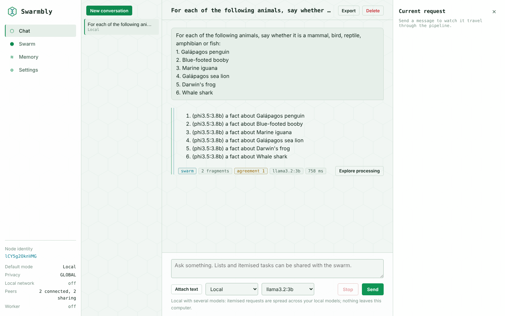</picture><br><sub><b>Chat</b> — every stage of the request, live, on the right.</sub></td>
<td width="50%"><picture><source media="(prefers-color-scheme: dark)" srcset="docs/img/swarm_dark.png">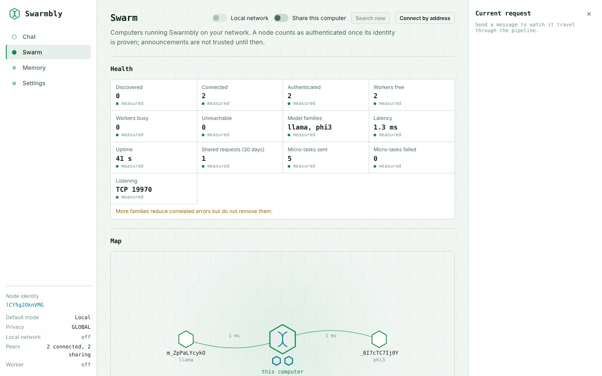</picture><br><sub><b>Swarm</b> — peers, model families and health, measured.</sub></td>
</tr>
<tr>
<td width="50%"><picture><source media="(prefers-color-scheme: dark)" srcset="docs/img/sources_dark.png">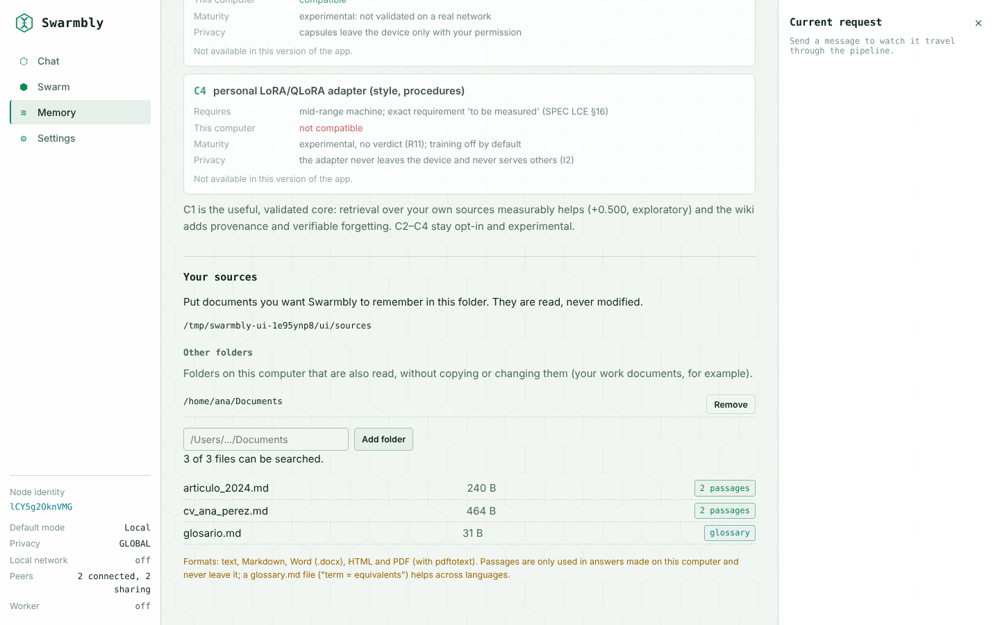</picture><br><sub><b>Your sources</b> — folders read in place; they never leave the device.</sub></td>
<td width="50%"><picture><source media="(prefers-color-scheme: dark)" srcset="docs/img/websearch_dark.png">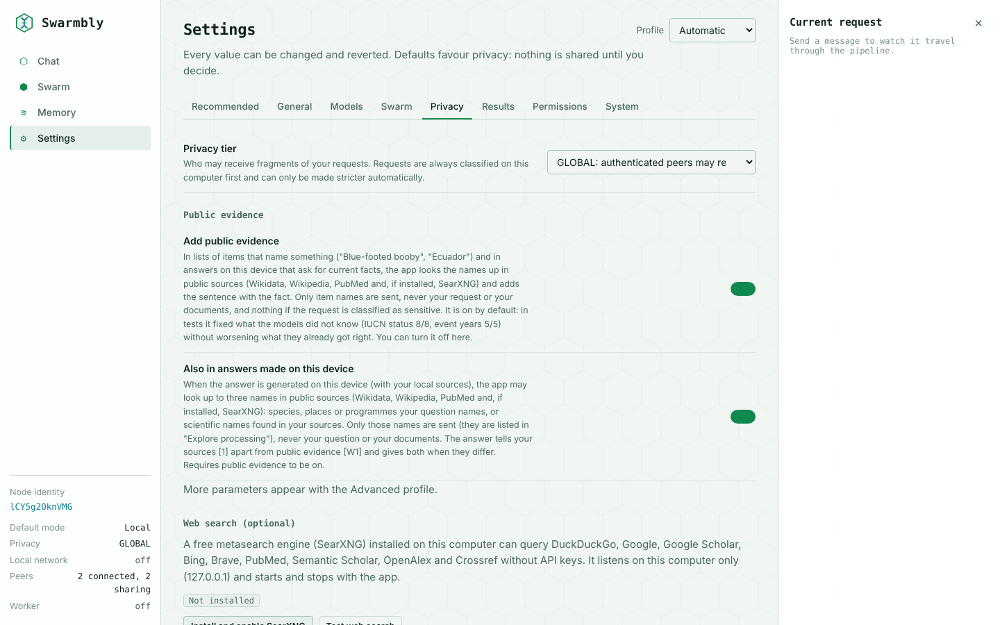</picture><br><sub><b>Privacy</b> — public evidence and local web search, off until you turn them on.</sub></td>
</tr>
</table>

<details>
<summary><b>More: memory levels and "How this answer was made"</b></summary>
<br>
<picture><source media="(prefers-color-scheme: dark)" srcset="docs/img/memory_dark.png">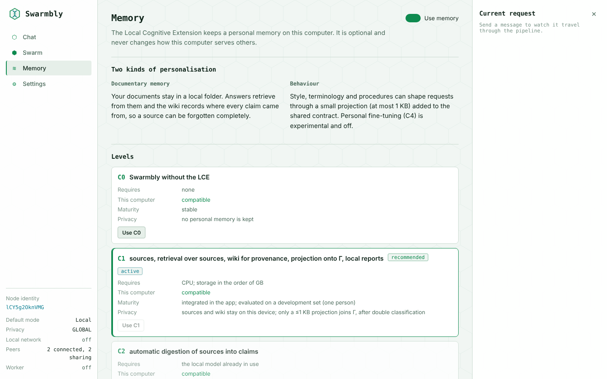</picture>
<br><br>
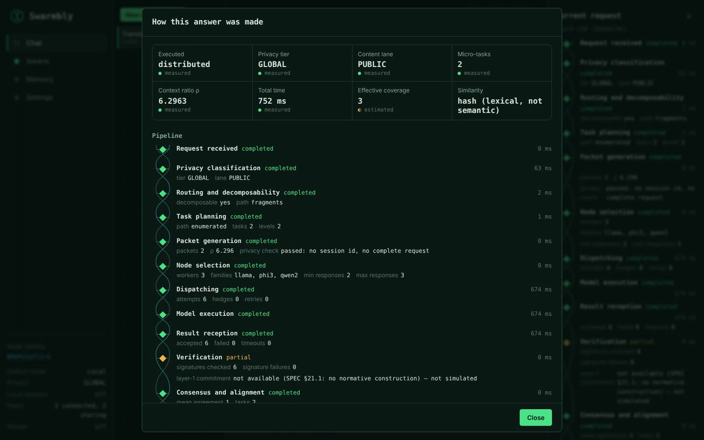
</details>

<sub>Screenshots from the app's preview mode with a simulated swarm and a fictitious user (Ana Pérez); the answers are placeholders.</sub>

### Repository layout

```
SwarmblyAI/
├── SwarmblyCore/        protocol, specification, reference implementation, harness, benchmark (edited here)
├── SwarmblyLCE/         mirror of github.com/Sebastardito/SwarmblyLCE (never edited here)
├── SwarmblyApp/         mirror of github.com/Sebastardito/SwarmblyApp (never edited here)
├── installer/           install.py: the interactive installer (standard library only)
├── install.sh · install.command · install.ps1 · install.bat
├── components.lock      the component versions tested together
├── scripts/             sync_components.py, check_components.py, readme_figures.py
├── docs/                ARCHITECTURE, INSTALL, COMPONENTS, ROADMAP, releases/, figures/, img/
└── LICENSE · NOTICE · GOVERNANCE.md · TRADEMARK.md · CITATION.cff · CHANGELOG.md
```

### How this repository is maintained

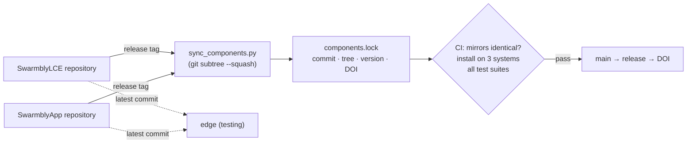

- **SwarmblyCore** is developed here. **SwarmblyLCE and SwarmblyApp** are developed in their own repositories; their folders here are exact copies of a commit recorded in `components.lock`, and continuous integration fails if a mirror differs. Changes go to their repositories, never to the mirror.
- **Branches:** `main` takes tagged releases of the components, tested together; `edge` follows their latest commits.
- **Releases:** each release of Swarmbly AI is a distribution — a set of component versions — with its own DOI; the components keep releasing on their own.

Maintainer workflow: [`docs/COMPONENTS.md`](docs/COMPONENTS.md). Where to contribute: [`CONTRIBUTING.md`](CONTRIBUTING.md). The figures in this file are regenerated with `python scripts/readme_figures.py`.

### Roadmap

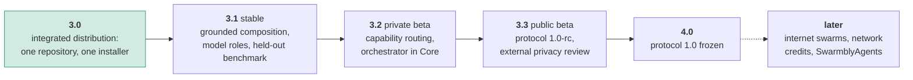

Goals without dates; each phase opens when the previous one's exit criteria are met. Details: [`docs/ROADMAP.md`](docs/ROADMAP.md).

### Support the project

Swarmbly is developed independently, with no institutional funding, as an AGPL-licensed digital public good. If you find it useful or want it to exist, you can support its early development at **[buymeacoffee.com/swarmbly](https://buymeacoffee.com/swarmbly)**. Support never buys influence over the roadmap, the licence or the governance (see [`GOVERNANCE.md`](GOVERNANCE.md)).

<p><a href="https://buymeacoffee.com/swarmbly"></a></p>

### Citation, licence and governance

| | |
|---|---|
| **Cite** | the distribution, 3.0.0: [10.5281/zenodo.23650763](https://doi.org/10.5281/zenodo.23650763) ([`CITATION.cff`](CITATION.cff)); each component has its own DOI (table above); whitepaper v2: [10.5281/zenodo.23031305](https://doi.org/10.5281/zenodo.23031305) |
| **Licence** | software and specification under AGPL-3.0-or-later ([`LICENSE`](LICENSE)); document text under CC BY 4.0; network use triggers clause 13 ([`NOTICE`](NOTICE)) |
| **Governance** | pre-foundation, benevolent maintainer, heading for a Swiss Verein and later a Stiftung; dual licensing is rejected ([`GOVERNANCE.md`](GOVERNANCE.md), [`TRADEMARK.md`](TRADEMARK.md)) |
| **Security** | report privately: [`SECURITY.md`](SECURITY.md) |

---

## Español

> **Última versión: [3.0.0, distribución integrada](docs/releases/v3.0.0.md#español)** (2026-10-25) · DOI [10.5281/zenodo.23650763](https://doi.org/10.5281/zenodo.23650763). Las figuras tienen el texto en inglés; sus cifras son las mismas.

### Contenido

| Entender | Usar | Participar |
|---|---|---|
| [La idea en un minuto](#la-idea-en-un-minuto) | [Instalación](#instalación) | [Cómo se mantiene este repositorio](#cómo-se-mantiene-este-repositorio) |
| [Los tres componentes](#los-tres-componentes) | [Primeros pasos](#primeros-pasos) | [Hoja de ruta](#hoja-de-ruta) |
| [Cómo fluye una petición](#cómo-fluye-una-petición) | [Un recorrido por la app](#un-recorrido-por-la-app) | [Apoya el proyecto](#apoya-el-proyecto) |
| [Qué funciona hoy](#qué-funciona-hoy) | [Estructura del repositorio](#estructura-del-repositorio) | [Cita, licencia y gobernanza](#cita-licencia-y-gobernanza) |
| [La evidencia, en figuras](#la-evidencia-en-figuras) | | |

### La idea en un minuto

Los sistemas de IA entre pares suelen repartir **el modelo**: sus capas viven en máquinas distintas y las activaciones cruzan la red en cada token generado, así que la máquina más lenta marca el ritmo. Swarmbly reparte **el problema**, igual que el ensamblaje genómico por shotgun corta un genoma en lecturas, las solapa y construye un consenso.

| | Repartir el modelo (paralelismo de tubería) | **Swarmbly: repartir el problema** |
|---|---|---|
| Qué tiene un nodo | una porción de un modelo grande | un modelo pequeño completo |
| Qué cruza la red | activaciones, en cada token | cada fragmento, una sola vez |
| Un nodo lento o caído | detiene toda la cadena | se cubre o se reemplaza; la respuesta vuelve a tu computadora |
| Tus datos privados | viajan con la petición | nunca salen de tu computadora |
| Diversidad | un modelo | varias familias de modelos que votan por elemento |

Un orquestador local decide qué se queda en tu computadora y qué puede compartirse. El trabajo público que se descompone bien (muchos elementos que clasificar, traducir o extraer) se corta en tareas pequeñas; los nodos voluntarios las responden; la respuesta se ensambla en tu computadora. Tus documentos los lee en su sitio una memoria local (la LCE) y solo se usan en respuestas producidas en tu equipo. Cuando una respuesta necesita datos públicos, solo se consultan los *nombres* de lo que se pregunta (Wikidata, Wikipedia, PubMed y, si lo instalas, un buscador web que corre en tu computadora).

<p align="center">
<br>
<sub>Vista previa de la interfaz con un enjambre simulado: la tubería y el monitor son reales, las respuestas son textos fijos.</sub>
</p>

### Los tres componentes

Swarmbly AI es la distribución integrada de tres componentes. Cada uno conserva su repositorio, sus versiones y su DOI; este repositorio reúne versiones probadas juntas para que una sola descarga lo instale todo.

| | Componente | Qué hace | Aquí | Repositorio · DOI |
|:-:|---|---|---|---|
| ⬡ | **SwarmblyCore** | Protocolo y especificación, implementación de referencia, banco de medición (V0) y benchmark. El orquestador se muda aquí en las próximas versiones | [`SwarmblyCore/`](SwarmblyCore/) | este repositorio · [10.5281/zenodo.21956743](https://doi.org/10.5281/zenodo.21956743) |
| ◈ | **SwarmblyLCE** | Extensión Cognitiva Local: la memoria que vive solo en tu equipo — recuperación sobre tus documentos, procedencia, olvido, tarjeta de estilo (Γ), cápsulas firmadas | [`SwarmblyLCE/`](SwarmblyLCE/) (espejo) | [SwarmblyLCE](https://github.com/Sebastardito/SwarmblyLCE) · [10.5281/zenodo.23289041](https://doi.org/10.5281/zenodo.23289041) |
| ▣ | **SwarmblyApp** | Aplicación de escritorio: chat, monitor de la red, ajustes, nodo P2P (descubrimiento mDNS, TLS + Ed25519), evidencia pública, búsqueda web local | [`SwarmblyApp/`](SwarmblyApp/) (espejo) | [SwarmblyApp](https://github.com/Sebastardito/SwarmblyApp) · [10.5281/zenodo.23322638](https://doi.org/10.5281/zenodo.23322638) |

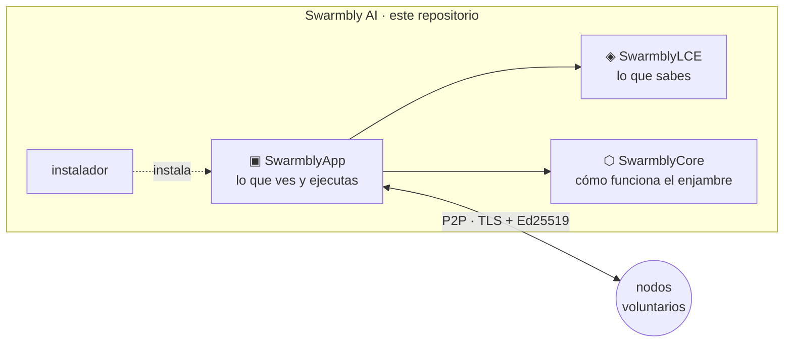

Las versiones exactas están fijadas en [`components.lock`](components.lock) y descritas en [`docs/COMPONENTS.md`](docs/COMPONENTS.md).

### Cómo fluye una petición

Cada petición recibe primero un **carril** (personal, sensible o pública) y después una **ruta** (local o fragmentada). Solo el trabajo público que se divide en elementos independientes llega a la red.

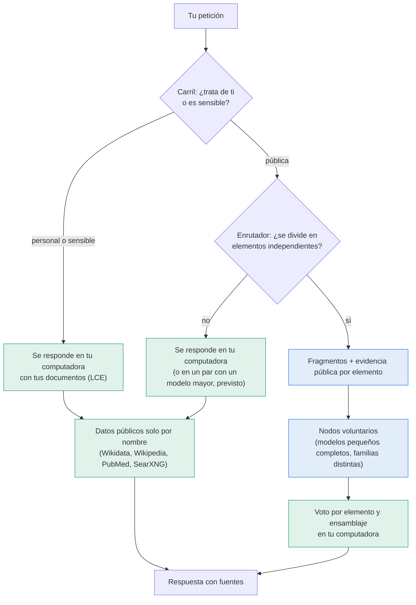

| Etapa | Dónde | Qué puede salir de tu computadora |
|---|---|---|
| Clasificación del carril | tu computadora | nada |
| Enrutamiento y fragmentación | tu computadora | nada |
| Evidencia pública | tu computadora → fuentes públicas | los nombres consultados, nunca la pregunta ni tus documentos |
| Despacho | pares LAN autenticados | fragmentos de peticiones públicas, sin id de sesión y nunca una petición completa |
| Voto y ensamblaje | tu computadora | nada |

El panel *Explorar procesamiento* de cada respuesta muestra cada etapa, qué se midió y qué se estimó. Más detalle: [`docs/ARCHITECTURE.md`](docs/ARCHITECTURE.md).

### Qué funciona hoy

| Funciona, medido | Todavía no, o refutado |
|---|---|
| Carriles de privacidad; tus pasajes nunca salen del equipo; las peticiones sobre ti se quedan en local | La redacción larga distribuida no supera a un modelo local único |
| Red LAN: pares autenticados, coberturas, respaldo local inmediato, velocidad aprendida, redescubrimiento | Los enjambres por internet (fase 3) no están implementados |
| Lotes con evidencia pública por elemento: la red corrige datos que los modelos pequeños no saben (estado UICN 8/8 frente a cerca de 1/8 sin evidencia) | El criterio de abandono del impuesto de coherencia **no se cumple** en su prueba reservada; el mapa de confianza se **retiró** |
| Extraer con modelos pequeños y agregar con código: +46,9 puntos sobre el modelo solo (alcance acotado) | Lo medido hasta ahora procede del material de un solo usuario; se está construyendo un banco con conjunto reservado |
| Memoria local (LCE C1) sobre texto, Word, HTML y PDF, con datos públicos fusionados y etiquetados | Una respuesta es tan buena como el modelo que la redacta; los modelos de 1–3 B inventan en la composición abierta |

### La evidencia, en figuras

Cada cifra procede de un registro publicado, que se nombra bajo cada figura. Lo medido sobre el material de una sola persona se etiqueta como tal.

**1 · La evidencia pública corrige lo que los modelos pequeños no saben.** Los mismos lotes en la red LAN (cuatro nodos, tres repeticiones cada uno), antes y después de añadir evidencia por elemento.

<picture>
  <source media="(prefers-color-scheme: dark)" srcset="docs/figures/evidence_effect_dark.svg">
  
</picture>

<sub>Registro: [CHANGELOG de SwarmblyApp](SwarmblyApp/docs/CHANGELOG.md), rondas 10b, 11 y 12. Los datos conocidos (años históricos) ya eran correctos; la evidencia importa en los datos de nicho.</sub>

**2 · Una memoria privada que responde con tus propios documentos.** Dieciséis preguntas sobre el CV, los artículos y las notas de una persona, puntuadas sobre 44 datos clave, a medida que se añadía cada mejora a la memoria local.

<picture>
  <source media="(prefers-color-scheme: dark)" srcset="docs/figures/local_answers_dark.svg">
  
</picture>

<sub>Registro: [CHANGELOG de SwarmblyApp](SwarmblyApp/docs/CHANGELOG.md), rondas P2e 1–13c, media de las repeticiones. **Conjunto de desarrollo, una sola persona, no reservado**: muestra la dirección de cada cambio, no una exactitud general.</sub>

**3 · Dónde gana fragmentar, y dónde no.** De la campaña de SwarmblyCore y de las corridas preregistradas de la LCE.

<table>
<tr>
<td width="50%">
<picture>
  <source media="(prefers-color-scheme: dark)" srcset="SwarmblyCore/docs/figures/extraction_arms_dark.svg">
  
</picture>
<sub><b>Gana:</b> los modelos pequeños extraen y el código agrega. Registro: <a href="SwarmblyCore/README.md">README de SwarmblyCore</a>.</sub>
</td>
<td width="50%">
<picture>
  <source media="(prefers-color-scheme: dark)" srcset="SwarmblyCore/docs/figures/coherence_tax_dark.svg">
  
</picture>
<sub><b>No se cumple:</b> el criterio del impuesto de coherencia en su prueba reservada. Registro: <a href="SwarmblyCore/README.md">README de SwarmblyCore</a>.</sub>
</td>
</tr>
<tr>
<td width="50%">
<picture>
  <source media="(prefers-color-scheme: dark)" srcset="SwarmblyLCE/docs/figures/f1a_memory_gain_dark.svg">
  
</picture>
<sub><b>Se sostiene:</b> la memoria local ayuda, +0,500 [0,420; 0,578], preregistrado. Registro: <a href="SwarmblyLCE/README.md">README de SwarmblyLCE</a>.</sub>
</td>
<td width="50%">
<picture>
  <source media="(prefers-color-scheme: dark)" srcset="docs/figures/coverage_simulation_dark.svg">
  
</picture>
<sub><b>Regla de diseño (simulación):</b> réplicas necesarias para perder como mucho ε del trabajo, c ≥ ln(1/ε)/(1−p). Modelo: especificación de SwarmblyCore; puntos: Monte Carlo.</sub>
</td>
</tr>
</table>

Las tablas completas con intervalos y los resultados retirados están en cada componente: [SwarmblyCore](SwarmblyCore/README.md#qué-se-ha-medido), [SwarmblyLCE](SwarmblyLCE/README.md#qué-se-ha-medido), [SwarmblyApp](SwarmblyApp/docs/CHANGELOG.md).

### Instalación

**Requisitos:** macOS, Linux o Windows · Python 3.10 o superior (el instalador de Windows ofrece instalarlo) · unos 5 GB libres para un modelo · se recomiendan 8 GB de RAM o más.

| Sistema | Ejecuta |
|---|---|
| macOS | doble clic en `install.command`, o `./install.sh` en una terminal |
| Linux | `./install.sh` |
| Windows | doble clic en `install.bat`, o `.\install.ps1` en PowerShell |

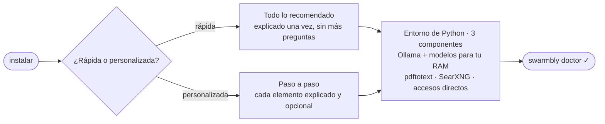

| Tu RAM | Modelo de chat que se instala | Además |
|---|---|---|
| 24 GB o más | `qwen2.5:7b` | `nomic-embed-text` (recuperación sobre tus documentos) |
| 10–24 GB | `qwen2.5:3b` | `nomic-embed-text` |
| menos de 10 GB | `qwen2.5:1.5b` | `nomic-embed-text` |

No cambia nada fuera de esta carpeta, la carpeta de datos de Swarmbly y los accesos directos, y nunca modifica el Python del sistema. En la instalación rápida, los pasos que necesitan contraseña de administrador se omiten y se listan al final con el comando exacto. Guía completa, opciones (`--doctor`, `--uninstall`, `--dry-run`, `--sources`…) y solución de problemas: [`docs/INSTALL.md`](docs/INSTALL.md).

### Primeros pasos

| # | Haz | Dónde |
|:-:|---|---|
| 1 | Abre Swarmbly | `swarmbly`, o el acceso directo → abre `http://127.0.0.1:8765` |
| 2 | Revisa los modelos recomendados | asistente inicial, o Ajustes → Modelos |
| 3 | Añade tus documentos (CV, artículos, notas): se leen en su sitio, nunca se copian ni se envían | Memoria → Tus fuentes → Añadir carpeta |
| 4 | Activa la búsqueda web (opcional) | Ajustes → Privacidad → Búsqueda web → Instalar SearXNG |
| 5 | Comparte tu computadora con la red | Ajustes → Red (las demás computadoras con Swarmbly de tu red local se encuentran solas) |
| 6 | Comprueba todo | `swarmbly doctor` |

### Un recorrido por la app

<table>
<tr>
<td width="50%"><picture><source media="(prefers-color-scheme: dark)" srcset="docs/img/chat_dark.png"></picture><br><sub><b>Chat</b>: cada etapa de la petición, en vivo, a la derecha.</sub></td>
<td width="50%"><picture><source media="(prefers-color-scheme: dark)" srcset="docs/img/swarm_dark.png"></picture><br><sub><b>Enjambre</b>: pares, familias de modelos y salud, medidos.</sub></td>
</tr>
<tr>
<td width="50%"><picture><source media="(prefers-color-scheme: dark)" srcset="docs/img/sources_dark.png"></picture><br><sub><b>Tus fuentes</b>: carpetas leídas en su sitio; nunca salen del equipo.</sub></td>
<td width="50%"><picture><source media="(prefers-color-scheme: dark)" srcset="docs/img/websearch_dark.png"></picture><br><sub><b>Privacidad</b>: evidencia pública y búsqueda web local, apagadas hasta que las actives.</sub></td>
</tr>
</table>

<details>
<summary><b>Más: niveles de memoria y «Cómo se hizo esta respuesta»</b></summary>
<br>
<picture><source media="(prefers-color-scheme: dark)" srcset="docs/img/memory_dark.png"></picture>
<br><br>

</details>

<sub>Capturas del modo de vista previa de la app, con un enjambre simulado y una usuaria ficticia (Ana Pérez); las respuestas son textos fijos. La interfaz está en inglés en las capturas y también puede usarse en español.</sub>

### Estructura del repositorio

```
SwarmblyAI/
├── SwarmblyCore/        protocolo, especificación, implementación de referencia, banco, benchmark (se edita aquí)
├── SwarmblyLCE/         espejo de github.com/Sebastardito/SwarmblyLCE (nunca se edita aquí)
├── SwarmblyApp/         espejo de github.com/Sebastardito/SwarmblyApp (nunca se edita aquí)
├── installer/           install.py: el instalador interactivo (solo biblioteca estándar)
├── install.sh · install.command · install.ps1 · install.bat
├── components.lock      las versiones de los componentes probadas juntas
├── scripts/             sync_components.py, check_components.py, readme_figures.py
├── docs/                ARCHITECTURE, INSTALL, COMPONENTS, ROADMAP, releases/, figures/, img/
└── LICENSE · NOTICE · GOVERNANCE.md · TRADEMARK.md · CITATION.cff · CHANGELOG.md
```

### Cómo se mantiene este repositorio

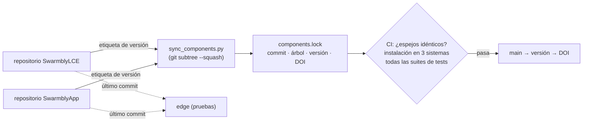

- **SwarmblyCore** se desarrolla aquí. **SwarmblyLCE y SwarmblyApp** se desarrollan en sus propios repositorios; sus carpetas aquí son copias exactas de un commit anotado en `components.lock`, y la integración continua falla si un espejo difiere. Los cambios se hacen en sus repositorios, nunca en el espejo.
- **Ramas:** `main` recibe versiones etiquetadas de los componentes, probadas juntas; `edge` sigue sus últimos commits.
- **Versiones:** cada versión de Swarmbly AI es una distribución —un conjunto de versiones de los componentes— con su propio DOI; los componentes siguen publicando por su cuenta.

Flujo de mantenimiento: [`docs/COMPONENTS.md`](docs/COMPONENTS.md). Dónde contribuir: [`CONTRIBUTING.md`](CONTRIBUTING.md). Las figuras de este archivo se regeneran con `python scripts/readme_figures.py`.

### Hoja de ruta

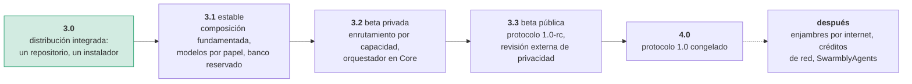

Objetivos sin fechas; cada fase se abre cuando se cumplen los criterios de salida de la anterior. Detalle: [`docs/ROADMAP.md`](docs/ROADMAP.md).

### Apoya el proyecto

Swarmbly se desarrolla de forma independiente, sin financiación institucional, como un bien público digital con licencia AGPL. Si te resulta útil o quieres que exista, puedes apoyar su desarrollo en estas primeras etapas en **[buymeacoffee.com/swarmbly](https://buymeacoffee.com/swarmbly)**. El apoyo nunca compra influencia sobre la hoja de ruta, la licencia ni la gobernanza (ver [`GOVERNANCE.md`](GOVERNANCE.md)).

<p><a href="https://buymeacoffee.com/swarmbly"></a></p>

### Cita, licencia y gobernanza

| | |
|---|---|
| **Cita** | la distribución, 3.0.0: [10.5281/zenodo.23650763](https://doi.org/10.5281/zenodo.23650763) ([`CITATION.cff`](CITATION.cff)); cada componente tiene su DOI (tabla de arriba); whitepaper v2: [10.5281/zenodo.23031305](https://doi.org/10.5281/zenodo.23031305) |
| **Licencia** | software y especificación bajo AGPL-3.0-or-later ([`LICENSE`](LICENSE)); texto de los documentos bajo CC BY 4.0; el uso en red activa la cláusula 13 ([`NOTICE`](NOTICE)) |
| **Gobernanza** | antes de la fundación, con un mantenedor benevolente, rumbo a una Verein suiza y después a una Stiftung; se rechaza la doble licencia ([`GOVERNANCE.md`](GOVERNANCE.md), [`TRADEMARK.md`](TRADEMARK.md)) |
| **Seguridad** | informa en privado: [`SECURITY.md`](SECURITY.md) |
