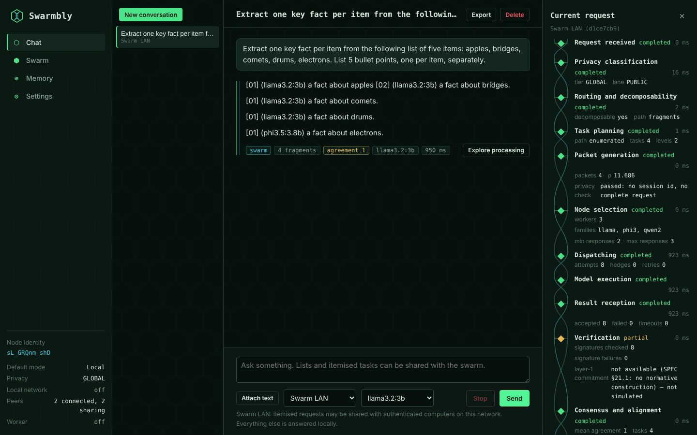
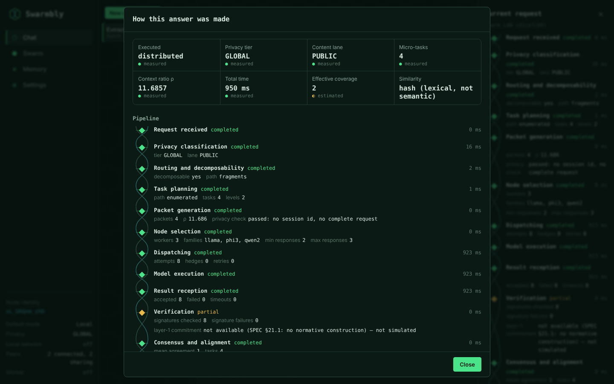
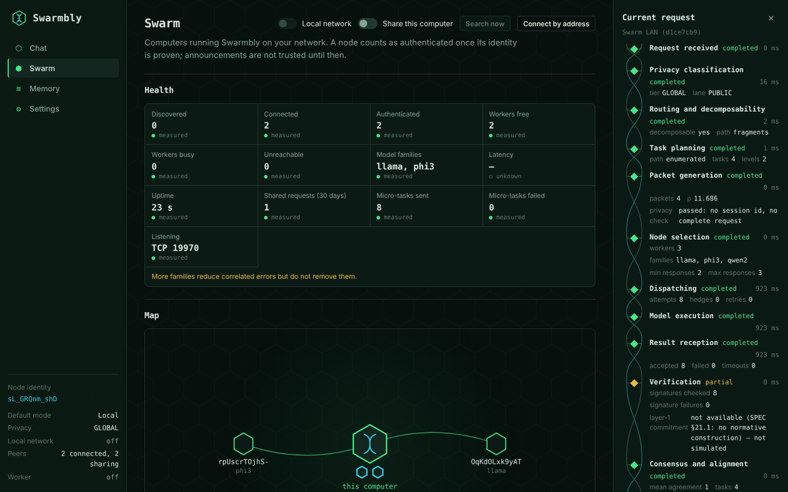
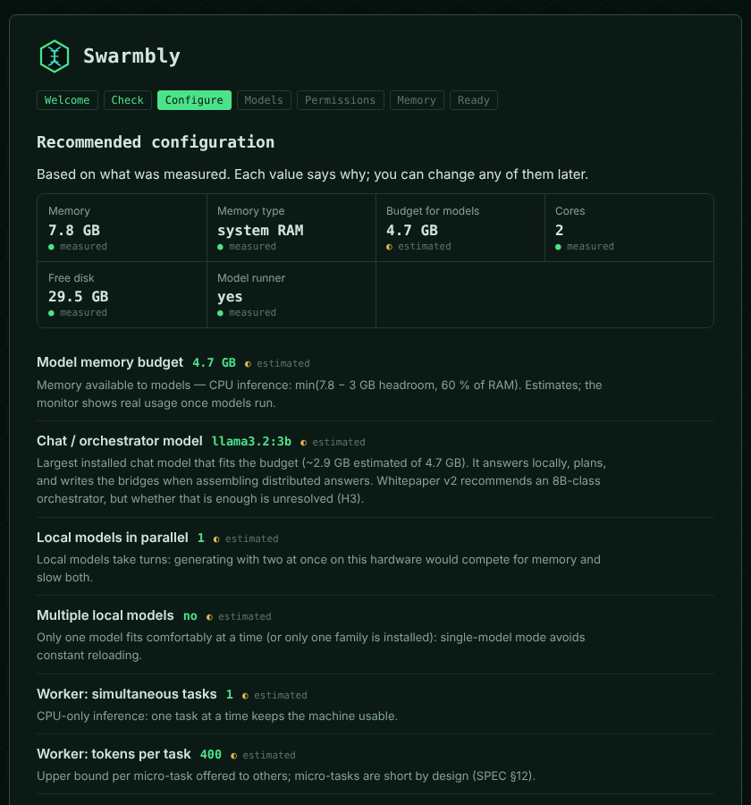
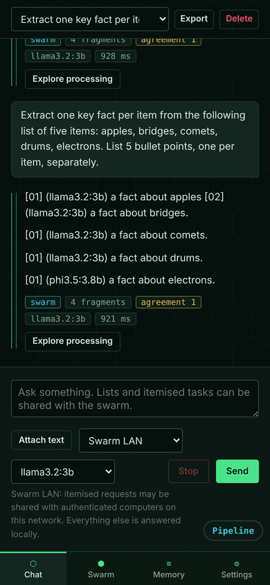

# Swarmbly App

[](https://github.com/Sebastardito/SwarmblyApp/actions/workflows/tests.yml)
[](LICENSE)


[](https://doi.org/10.5281/zenodo.23322639)
[](https://buymeacoffee.com/swarmbly)

**A desktop client and network dashboard for
[SwarmblyAI](https://github.com/Sebastardito/SwarmblyAI) — decentralized
language-model inference that fragments the *problem*, not the *model*.**

Chat with the models on your own computer. Join other Swarmbly computers on
your network without typing an address. Then open any answer and see exactly
how it was made: which parts were shared, with whom, how replicas agreed, and
what was measured versus estimated.

*Lea este documento en [español](#español).*



> **Status: v0.2 alpha.** Local chat, guided setup and LAN swarms work and are
> tested. Internet swarms and the full Local Cognitive Extension are later
> phases. Nothing here claims performance it has not measured — see
> [Known limitations](docs/LIMITATIONS.md).

---

## Start in one command

```bash
git clone https://github.com/Sebastardito/SwarmblyApp.git
cd SwarmblyApp
./launch.sh                # macOS / Linux   (Windows: launch.bat)
```

On macOS you can also double-click **`Swarmbly.command`** in Finder.

The launcher checks everything, asks before changing anything, and starts the
app in your browser at `http://127.0.0.1:8765`:

| Step | What it checks | What it may do (after asking) |
|---|---|---|
| Python | 3.10 or newer | — (tells you how to install it) |
| git | present | — (needed for the first install) |
| Environment | `.venv` exists and runs | create or rebuild it |
| Packages | everything imports, requirements unchanged | install / update inside `.venv` only |
| Ollama | installed, running, models | start it; never installs it for you |
| Port | 8765 free, or Swarmbly already running | open the running app, or use the next free port |

Useful options: `--check` (report only), `--headless` (no window, for worker
computers), `--yes` (unattended), `--port 8766`. All of them:
`./launch.sh --help`.

The first time, a short assistant measures your computer and proposes a
configuration — every value says why, and you can change or revert it. It
also asks whether Swarmbly may look for other computers on your network and
whether it may download models. Both start as *no*.

## What you can do

**Chat locally.** Streaming answers from Ollama or any OpenAI-compatible
server (llama.cpp, vLLM). Conversations, text attachments, stop and retry,
export to Markdown.

**Share structured work with a swarm.** When a request has a structure —
a list of items, questions tied to their material — Swarmbly splits it into
micro-tasks, sends them in parallel to authenticated computers on your
network, verifies the signed results and stitches the answer back together.
Free prose stays on your computer, and the app says why.

**Ask several models at once.** With multi-model on, replicas go to different
model families (on your computer, on the swarm, or both) and are aligned by
SwarmblyAI's consensus. Agreement is reported as agreement — never as truth.

**See how every answer was made.** *Explore processing* opens the full record:
the 14 pipeline stages, each attempt and which node served it, consensus
units, seam similarity, caveats, and a report you can save as JSON, Markdown or
HTML.



**Watch the swarm.** Health, latency, model families, a live map where a pulse
travels only when a real micro-task is sent, and how much your computer has
contributed versus consumed.



**Lend your computer, on your terms.** Turn on *Share this computer* to serve
micro-tasks for others: choose the models, limit simultaneous tasks and
tokens, pause any time, serve only when idle or plugged in. Your memory and
files are never used.

**Set up without guesswork.** Hardware detection (memory, unified memory on
Apple Silicon, GPU, disk, battery), a recommended configuration with
explanations, a system check, consented installs, and model downloads through
Ollama that show size and licence first.

<p align="center">
&nbsp;&nbsp;</p>

## How a shared request flows

```
your request
  │  PRIVACY        tier + content lane, on your computer
  │  ROUTING        only structural partitions are fragmented
  │  PLANNING       micro-tasks and their dependencies
  │  PACKETS        minimal context; never your session or the whole request
  ▼
  NODE SELECTION ── family diversity → distinct machines → load → latency
  DISPATCH       ── parallel by readiness, replicas, hedges and retries
  ▼
  VERIFICATION      Ed25519 signatures, attempt ids, schema
  CONSENSUS         multiple alignment across replicas (agreement, not accuracy)
  ASSEMBLY          select-then-splice, coherence report
  ▼
answer + SPEC §19 metadata + stage log
```

Nodes find each other with mDNS, authenticate with Ed25519 identities bound to
their TLS 1.3 certificates (a man in the middle is detected), and exchange
signed capability advertisements. Details: [Architecture](docs/ARCHITECTURE.md).

## Privacy by default

- Nothing leaves your computer until you allow local-network discovery **and**
  choose a privacy tier that permits sharing. The default tier is LOCAL.
- Content the lane classifier marks sensitive never leaves the device.
- Workers receive a micro-task and minimal context, never your session id or
  the complete request; a self-check blocks any packet that would leak them.
- The local interface accepts only loopback hosts, checks origins and needs a
  per-launch token, so other web pages cannot drive it.

## What works today

| Capability | Status |
|---|---|
| Local app, browser interface, headless node, one-command launcher | ✅ |
| Hardware detection and explained, revertible recommended configuration | ✅ |
| First-run assistant, explicit permissions, system check, consented installs | ✅ |
| Model downloads through Ollama after consent (size and licence shown) | ✅ |
| Chat with local models: streaming, attachments, stop/retry, history, export | ✅ |
| LAN discovery without IPs (mDNS) and manual `host:port` fallback | ✅ |
| Ed25519 identity bound to TLS 1.3 | ✅ |
| Distributed execution: plan admission, parallel dispatch, family-diverse replicas, hedging and retries | ✅ |
| Several local models aligned by consensus | ✅ |
| Explore processing, swarm view, contribution, reports (JSON/MD/HTML) | ✅ |
| Local interface protection (Host, Origin, token, CSP) | ✅ |
| Memory: C0 active; C1 selectable, not yet used by chat | ✅ / 🚧 |
| Layer-1 verification commitments | ❌ no normative construction upstream — reported, never simulated |
| Internet swarms (rendezvous on a VPS and a Raspberry Pi) | ⏸ Phase 3 |
| Memory levels C2–C4 | ⏸ Phases 4–5 |

## Try it without models or a second computer

```bash
.venv/bin/python scripts/ui_preview.py            # interface with a fake swarm
.venv/bin/python scripts/ui_preview.py --fresh    # starting with the first-run assistant
.venv/bin/python scripts/two_nodes_demo.py --fake # protocol path between two local nodes
```

The preview's workers answer with canned text, listen on loopback only and are
never announced on your network. To test with two real computers, follow
[P2P testing](docs/P2P_TESTING.md).

## Documentation

| Document | For |
|---|---|
| [User guide](docs/USER_GUIDE.md) | Using the app: chat modes, sharing, the swarm view, memory, settings |
| [Installation](docs/INSTALL.md) | The launcher, manual install, data locations, troubleshooting |
| [P2P testing](docs/P2P_TESTING.md) | Two- and five-computer acceptance tests |
| [Architecture](docs/ARCHITECTURE.md) | Components, request flow, security model, decisions |
| [Known limitations](docs/LIMITATIONS.md) | What is partial, estimated or not yet built |
| [Changelog](docs/CHANGELOG.md) | Release notes |
| [Phase 0 audit](docs/AUDIT_FASE0_ES.md) (Spanish) | Compatibility audit against the SwarmblyAI and SwarmblyLCE specs |
| [SWIP draft: model-family hint](docs/SWIP-DRAFT-model-family-hint.md) | Proposed protocol extension used by the app |
| [Contributing](CONTRIBUTING.md) · [Security](SECURITY.md) | Working on the code; reporting vulnerabilities |

## The Swarmbly ecosystem

Swarmbly App is **one way** to take part in Swarmbly; the protocol never
depends on it.

| Project | Role | |
|---|---|---|
| [SwarmblyAI](https://github.com/Sebastardito/SwarmblyAI) | Protocol specification and reference implementation | [10.5281/zenodo.21956743](https://doi.org/10.5281/zenodo.21956743) |
| [SwarmblyLCE](https://github.com/Sebastardito/SwarmblyLCE) | Local Cognitive Extension: personal memory that stays on your device | [10.5281/zenodo.23289041](https://doi.org/10.5281/zenodo.23289041) |
| **SwarmblyApp** | Desktop client, network layer, local interface, observability | this repository |

The app installs SwarmblyAI and SwarmblyLCE as packages pinned to audited
commits (`51eb44e`, `fd8d97d`) and never copies their code. Protocol
whitepaper: [10.5281/zenodo.21957088](https://doi.org/10.5281/zenodo.21957088)
(v2: [10.5281/zenodo.23031305](https://doi.org/10.5281/zenodo.23031305)) — a
preprint, not peer-reviewed.

## Honesty is a feature

- SwarmblyAI's go/no-go coherence criterion was **not met** in its published
  measurements; the app shows coherence metadata instead of hiding it.
- Inter-model agreement is labelled agreement. Errors are correlated across
  model families (SwarmblyAI L13, L23).
- Verification is shown as *partial*: signatures are checked; the Layer-1
  commitment has no normative construction yet and is never simulated.
- Every number in the interface is labelled *measured*, *estimated* or
  *unknown*. Canned answers validate instruments, never models.

## Support the project

Swarmbly is developed independently, with no institutional funding, as an AGPL-licensed digital public good. If you find it useful or want it to exist, you can support its early development at **[buymeacoffee.com/swarmbly](https://buymeacoffee.com/swarmbly)**. Support never buys influence over the roadmap, the licence or the governance (see [`GOVERNANCE.md`](https://github.com/Sebastardito/SwarmblyAI/blob/main/GOVERNANCE.md)).

## Contributing, security, license

Contributions are welcome — read [CONTRIBUTING.md](CONTRIBUTING.md). Report
vulnerabilities privately as described in [SECURITY.md](SECURITY.md).

Licensed under **AGPL-3.0-or-later** ([LICENSE](LICENSE), [NOTICE](NOTICE)).
If you use Swarmbly App in research, please cite it:

> Espinoza-Ulloa, S. A. (2026). *Swarmbly App: desktop client and network
> dashboard for decentralized problem-fragmenting inference* (Version 0.2.0)
> [Software]. Zenodo. https://doi.org/10.5281/zenodo.23322639

To cite every version at once, use the concept DOI
[10.5281/zenodo.23322638](https://doi.org/10.5281/zenodo.23322638). Details in
[CITATION.cff](CITATION.cff).

Copyright © 2026 Sebastián A. Espinoza-Ulloa.

---

## Español

**Cliente de escritorio y panel de red para
[SwarmblyAI](https://github.com/Sebastardito/SwarmblyAI): inferencia
descentralizada de modelos de lenguaje que fragmenta el *problema*, no el
*modelo*.**

Conversa con los modelos de tu propia computadora, únete a otras
computadoras Swarmbly de tu red sin escribir direcciones y abre cualquier
respuesta para ver cómo se hizo: qué partes se compartieron, con quién, cómo
coincidieron las réplicas y qué se midió frente a lo que se estimó.

> **Estado: v0.2 alfa.** El chat local, la configuración guiada y los
> enjambres en red local funcionan y están probados. Los enjambres por
> internet y la Extensión Cognitiva Local completa llegan en fases
> posteriores.

### Arranque con un comando

```bash
git clone https://github.com/Sebastardito/SwarmblyApp.git
cd SwarmblyApp
./launch.sh                # macOS / Linux   (Windows: launch.bat)
```

En macOS también puedes hacer doble clic en **`Swarmbly.command`**. El
lanzador comprueba Python (3.10 o más), git, el entorno `.venv`, los paquetes,
Ollama y el puerto; **pregunta antes de instalar o iniciar nada**, instala
solo dentro de `.venv`, nunca instala Ollama por ti y abre la app en
`http://127.0.0.1:8765`. Opciones: `--check` (solo informar), `--headless`
(sin ventana, para equipos que prestan cómputo), `--yes` (sin preguntas),
`--port`.

La primera vez, un asistente mide tu equipo y propone una configuración
explicando cada valor (reversible), y pregunta si Swarmbly puede buscar otros
equipos en tu red y descargar modelos. Ambas respuestas empiezan en *no*.

### Qué puedes hacer

- **Chat local** con Ollama o servidores compatibles con OpenAI: streaming,
  adjuntos de texto, detener y reintentar, historial y exportación.
- **Compartir trabajo estructurado** con el enjambre: listas y preguntas
  ligadas a su material se dividen en microtareas, se envían en paralelo a
  equipos autenticados, se verifican y se ensamblan. La prosa libre se queda
  en tu equipo y la app explica por qué.
- **Varios modelos a la vez**, alineados por consenso: acuerdo, no verdad.
- **Ver cómo se hizo cada respuesta**: las 14 etapas, cada intento y qué nodo
  lo sirvió, el consenso, las costuras y un reporte en JSON, Markdown o HTML.
- **Observar el enjambre**: salud, latencia, familias de modelos y un mapa
  donde un pulso viaja solo cuando se envía una microtarea real.
- **Prestar tu equipo** con tus condiciones: modelos, límites, pausa, solo
  inactivo o conectado a la corriente. Tu memoria y tus archivos nunca se usan.

### Privacidad por defecto

Nada sale de tu equipo hasta que permites el descubrimiento en la red local
**y** eliges un nivel de privacidad que admita compartir (por defecto LOCAL).
El contenido sensible nunca sale. Los workers reciben una microtarea y un
contexto mínimo, nunca tu sesión ni la solicitud completa. La interfaz local
solo acepta conexiones locales con un token por arranque.

### Pruébalo sin modelos

`.venv/bin/python scripts/ui_preview.py` muestra la interfaz con un enjambre
ficticio (respuestas enlatadas, solo loopback, nunca anunciado en la red).
Para la prueba con dos computadoras reales: [P2P testing](docs/P2P_TESTING.md).

### Documentación

[Guía de uso](docs/USER_GUIDE.md) · [Instalación](docs/INSTALL.md) ·
[Pruebas P2P](docs/P2P_TESTING.md) · [Arquitectura](docs/ARCHITECTURE.md) ·
[Limitaciones](docs/LIMITATIONS.md) · [Cambios](docs/CHANGELOG.md) ·
[Auditoría Fase 0](docs/AUDIT_FASE0_ES.md) · [Contribuir](CONTRIBUTING.md) ·
[Seguridad](SECURITY.md). Cada documento incluye una sección en español.

### Apoya el proyecto

Swarmbly se desarrolla de forma independiente, sin financiación institucional, como un bien público digital con licencia AGPL. Si te resulta útil o quieres que exista, puedes apoyar su desarrollo en estas primeras etapas en **[buymeacoffee.com/swarmbly](https://buymeacoffee.com/swarmbly)**. El apoyo nunca compra influencia sobre la hoja de ruta, la licencia ni la gobernanza (ver [`GOVERNANCE.md`](https://github.com/Sebastardito/SwarmblyAI/blob/main/GOVERNANCE.md)).

Swarmbly App es **una** de las formas de participar en Swarmbly; el protocolo
no depende de ella. Licencia **AGPL-3.0-or-later**. Véanse [NOTICE](NOTICE) y
[CITATION.cff](CITATION.cff).

**Cómo citar:** Espinoza-Ulloa, S. A. (2026). *Swarmbly App: desktop client
and network dashboard for decentralized problem-fragmenting inference*
(Version 0.2.0) [Software]. Zenodo. https://doi.org/10.5281/zenodo.23322639 —
para citar todas las versiones: 10.5281/zenodo.23322638.

Copyright © 2026 Sebastián A. Espinoza-Ulloa.
