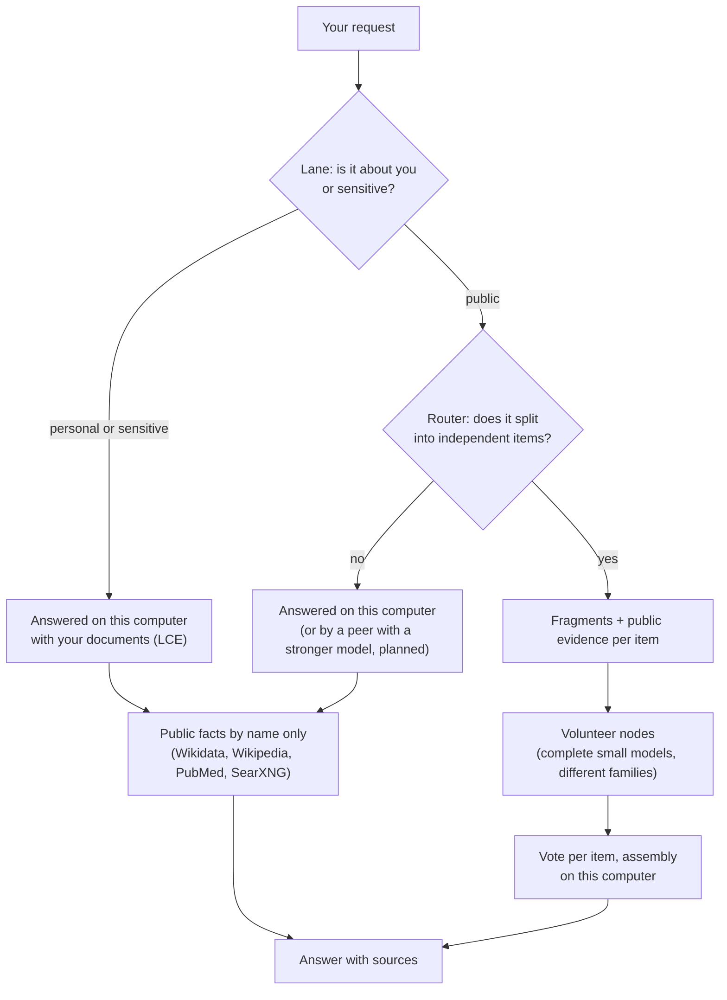
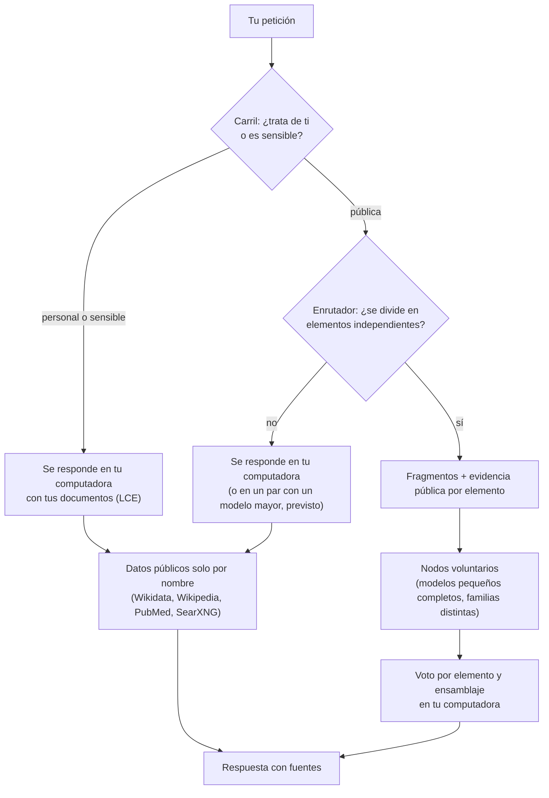

# Swarmbly AI

[](LICENSE)
[](https://doi.org/10.5281/zenodo.21956743)


**Language / Idioma:** [English](#english) · [Español](#español)

> **Status: alpha.** A working research prototype with published measurements, not peer reviewed. What has been measured — and what has not — is stated in each component; read [What works today](#what-works-today) before quoting any capability.

---

## English

### Contents

1. [The idea in one minute](#the-idea-in-one-minute)
2. [The three components](#the-three-components)
3. [How a request flows](#how-a-request-flows)
4. [What works today](#what-works-today)
5. [Install](#install)
6. [First steps](#first-steps)
7. [Repository layout](#repository-layout)
8. [How this repository is maintained](#how-this-repository-is-maintained)
9. [Roadmap](#roadmap)
10. [Citation, licence and governance](#citation-licence-and-governance)

### The idea in one minute

Peer-to-peer AI systems usually split the **model**: layers live on different machines and activations cross the network on every generated token. Swarmbly splits the **problem**. A local orchestrator decides what can stay on your computer and what can be shared. Public work that decomposes well (many items to classify, translate or extract) is cut into small tasks and sent once to volunteer nodes, each running a complete small language model. The answer is assembled on your computer. Genome shotgun assembly — reads, overlaps, contigs, consensus — is the design vocabulary.

Your own documents never leave your computer: a local memory (the LCE) reads them in place and uses them only for answers produced on your machine. When an answer needs public facts, only the names of the things asked about are looked up (Wikidata, Wikipedia, PubMed and, optionally, a web search engine that runs locally).

### The three components

Swarmbly AI is this repository: the integrated distribution of three components. Each component keeps its own repository, releases and DOI; this repository brings tested versions together so that one download installs everything.

| Component | What it does | Folder | Own repository | DOI |
|---|---|---|---|---|
| **SwarmblyCore** | Protocol and specification, the reference implementation, the measurement harness (V0) and the benchmark. The orchestrator moves here in the next releases | [`SwarmblyCore/`](SwarmblyCore/) | this repository | [10.5281/zenodo.21956743](https://doi.org/10.5281/zenodo.21956743) |
| **SwarmblyLCE** | Local Cognitive Extension: the memory that lives only on your device — retrieval over your documents, provenance, forgetting, style card (Γ), signed capsules | [`SwarmblyLCE/`](SwarmblyLCE/) (mirror) | [SwarmblyLCE](https://github.com/Sebastardito/SwarmblyLCE) | [10.5281/zenodo.23289041](https://doi.org/10.5281/zenodo.23289041) |
| **SwarmblyApp** | The desktop application: chat, network monitor, settings, peer-to-peer node (mDNS discovery, TLS + Ed25519), public evidence, local web search | [`SwarmblyApp/`](SwarmblyApp/) (mirror) | [SwarmblyApp](https://github.com/Sebastardito/SwarmblyApp) | [10.5281/zenodo.23322638](https://doi.org/10.5281/zenodo.23322638) |

The exact versions of this distribution are in [`components.lock`](components.lock) and [`docs/COMPONENTS.md`](docs/COMPONENTS.md).

### How a request flows



More detail in [`docs/ARCHITECTURE.md`](docs/ARCHITECTURE.md).

### What works today

| Works, measured | Not yet, or refuted |
|---|---|
| Privacy lanes; your passages never leave the device; requests about you stay local | Distributed long-form writing does not beat a single local model |
| LAN network: authenticated peers, hedging, immediate local fallback, learned speed, rediscovery | Internet-wide swarms (Phase 3) are not implemented |
| Batches with per-item public evidence: the network fixes facts small models lack (e.g. IUCN statuses 8/8 vs 1/8 without evidence) | The coherence-tax abandonment criterion is **not met** on its held-out test; the confidence map was **withdrawn** |
| Extract with small models, aggregate with code: +46.9 points over the model alone (narrow scope) | Measurements so far come from one user's material; a held-out benchmark is being built |
| Local memory (LCE C1) over text, Word, HTML and PDF, with public facts fused and labelled | Answers are only as good as the model that writes them; 1–3 B models invent in open composition |

Every figure links to its record in the component documents: [SwarmblyCore README](SwarmblyCore/README.md), [SwarmblyLCE README](SwarmblyLCE/README.md), [SwarmblyApp CHANGELOG](SwarmblyApp/docs/CHANGELOG.md).

### Install

**Requirements:** macOS, Linux or Windows; Python 3.10 or newer (the Windows installer offers to install it); about 5 GB free for a model; 8 GB of RAM or more recommended.

| System | Run |
|---|---|
| macOS | double-click `install.command`, or `./install.sh` in a terminal |
| Linux | `./install.sh` |
| Windows | double-click `install.bat`, or `.\install.ps1` in PowerShell |

The installer starts by asking:

- **Quick install** — everything recommended for your computer, explained once, then no more questions. Steps that need an administrator password are skipped and listed at the end with the exact command.
- **Custom install** — step by step; each item is explained and optional.

It sets up an isolated Python environment with the three components, Ollama and models that fit your memory, pdftotext (reading PDFs) and SearXNG (local web search) as optional extras, a `swarmbly` command, a desktop shortcut and `swarmbly doctor`. Nothing outside this folder, the Swarmbly data folder and the shortcuts is changed, and the system Python is never modified. Full guide, options and troubleshooting: [`docs/INSTALL.md`](docs/INSTALL.md).

### First steps

1. Start Swarmbly: `swarmbly`, or the desktop shortcut. The interface opens in your browser at `http://127.0.0.1:8765`.
2. **Models:** the first-run assistant recommends models for your computer; you can change them in Settings → Models.
3. **Your documents:** Memory → Your sources → add a folder (CV, papers, notes). Files are read in place, never copied, and never leave the computer.
4. **Web search (optional):** Settings → Privacy → Web search → install SearXNG, if you skipped it during installation.
5. **Share your computer with the network:** Settings → Network. Other computers on your LAN running Swarmbly are found automatically.
6. Check everything at any time: `swarmbly doctor`.

### Repository layout

```
SwarmblyAI/
├── SwarmblyCore/        protocol, specification, reference implementation, harness, benchmark (edited here)
├── SwarmblyLCE/         mirror of github.com/Sebastardito/SwarmblyLCE (never edited here)
├── SwarmblyApp/         mirror of github.com/Sebastardito/SwarmblyApp (never edited here)
├── installer/           install.py: the interactive installer (standard library only)
├── install.sh · install.command · install.ps1 · install.bat
├── components.lock      the component versions tested together
├── scripts/             sync_components.py, check_components.py
├── docs/                ARCHITECTURE, INSTALL, COMPONENTS, ROADMAP
└── LICENSE · NOTICE · GOVERNANCE.md · TRADEMARK.md · CITATION.cff · CHANGELOG.md
```

### How this repository is maintained

- **SwarmblyCore** is developed here.
- **SwarmblyLCE and SwarmblyApp** are developed in their own repositories. Their folders here are exact copies (`git subtree --squash`) of a commit recorded in `components.lock`; a check in continuous integration fails if a mirror differs from it. Changes to them go to their repositories, never to the mirror.
- **Branches:** `main` takes tagged releases of the components only, tested together; `edge` follows the components' latest commits for testing.
- **Releases:** each release of Swarmbly AI is a distribution — a set of component versions — with its own DOI. The components keep releasing and minting DOIs on their own.

Maintainer workflow: [`docs/COMPONENTS.md`](docs/COMPONENTS.md). Where to contribute: [`CONTRIBUTING.md`](CONTRIBUTING.md).

### Roadmap

[`docs/ROADMAP.md`](docs/ROADMAP.md): stabilisation (grounded composition, author search with consent, model roles, a held-out benchmark), private beta, public beta with a frozen protocol, 1.0. Later: internet-wide swarms, network credits and SwarmblyAgents (sub-orchestrators specialised by function).

### Citation, licence and governance

- **Cite** the distribution with [`CITATION.cff`](CITATION.cff); each component has its own DOI (table above). The whitepaper (version 2) is [10.5281/zenodo.23031305](https://doi.org/10.5281/zenodo.23031305).
- **Licence:** software and specification under AGPL-3.0-or-later ([`LICENSE`](LICENSE)); document text under CC BY 4.0. Network use triggers clause 13 — see [`NOTICE`](NOTICE).
- **Governance:** pre-foundation, benevolent maintainer, heading for a Swiss Verein and later a Stiftung; dual licensing is rejected. See [`GOVERNANCE.md`](GOVERNANCE.md) and [`TRADEMARK.md`](TRADEMARK.md).
- **Security:** report privately — [`SECURITY.md`](SECURITY.md).

---

## Español

### Contenido

1. [La idea en un minuto](#la-idea-en-un-minuto)
2. [Los tres componentes](#los-tres-componentes)
3. [Cómo fluye una petición](#cómo-fluye-una-petición)
4. [Qué funciona hoy](#qué-funciona-hoy)
5. [Instalación](#instalación)
6. [Primeros pasos](#primeros-pasos)
7. [Estructura del repositorio](#estructura-del-repositorio)
8. [Cómo se mantiene este repositorio](#cómo-se-mantiene-este-repositorio)
9. [Hoja de ruta](#hoja-de-ruta)
10. [Cita, licencia y gobernanza](#cita-licencia-y-gobernanza)

### La idea en un minuto

Los sistemas de IA entre pares suelen repartir **el modelo**: las capas viven en máquinas distintas y las activaciones cruzan la red en cada token generado. Swarmbly reparte **el problema**. Un orquestador local decide qué se queda en tu computadora y qué puede compartirse. El trabajo público que se descompone bien (muchos elementos que clasificar, traducir o extraer) se corta en tareas pequeñas que se envían una sola vez a nodos voluntarios, cada uno con un modelo de lenguaje pequeño y completo. La respuesta se ensambla en tu computadora. El ensamblaje genómico por shotgun —lecturas, solapamientos, contigs, consenso— es el vocabulario de diseño.

Tus documentos nunca salen de tu computadora: una memoria local (la LCE) los lee en su sitio y los usa solo en las respuestas que se producen en tu equipo. Cuando una respuesta necesita datos públicos, solo se consultan los nombres de lo que se pregunta (Wikidata, Wikipedia, PubMed y, si lo instalas, un buscador web que corre en tu equipo).

### Los tres componentes

Swarmbly AI es este repositorio: la distribución integrada de tres componentes. Cada componente conserva su repositorio, sus versiones y su DOI; este repositorio reúne versiones probadas juntas para que una sola descarga lo instale todo.

| Componente | Qué hace | Carpeta | Repositorio propio | DOI |
|---|---|---|---|---|
| **SwarmblyCore** | Protocolo y especificación, implementación de referencia, banco de medición (V0) y benchmark. El orquestador se muda aquí en las próximas versiones | [`SwarmblyCore/`](SwarmblyCore/) | este repositorio | [10.5281/zenodo.21956743](https://doi.org/10.5281/zenodo.21956743) |
| **SwarmblyLCE** | Extensión Cognitiva Local: la memoria que vive solo en tu equipo — recuperación sobre tus documentos, procedencia, olvido, tarjeta de estilo (Γ), cápsulas firmadas | [`SwarmblyLCE/`](SwarmblyLCE/) (espejo) | [SwarmblyLCE](https://github.com/Sebastardito/SwarmblyLCE) | [10.5281/zenodo.23289041](https://doi.org/10.5281/zenodo.23289041) |
| **SwarmblyApp** | La aplicación de escritorio: chat, monitor de la red, ajustes, nodo P2P (descubrimiento mDNS, TLS + Ed25519), evidencia pública, búsqueda web local | [`SwarmblyApp/`](SwarmblyApp/) (espejo) | [SwarmblyApp](https://github.com/Sebastardito/SwarmblyApp) | [10.5281/zenodo.23322638](https://doi.org/10.5281/zenodo.23322638) |

Las versiones exactas de esta distribución están en [`components.lock`](components.lock) y [`docs/COMPONENTS.md`](docs/COMPONENTS.md).

### Cómo fluye una petición



Más detalle en [`docs/ARCHITECTURE.md`](docs/ARCHITECTURE.md).

### Qué funciona hoy

| Funciona, medido | Todavía no, o refutado |
|---|---|
| Carriles de privacidad; tus pasajes nunca salen del equipo; las peticiones sobre ti se quedan en local | La redacción larga distribuida no supera a un modelo local único |
| Red LAN: pares autenticados, coberturas, respaldo local inmediato, velocidad aprendida, redescubrimiento | Los enjambres por internet (fase 3) no están implementados |
| Lotes con evidencia pública por elemento: la red corrige datos que los modelos pequeños no saben (p. ej. estado UICN 8/8 frente a 1/8 sin evidencia) | El criterio de abandono del impuesto de coherencia **no se cumple** en su prueba reservada; el mapa de confianza se **retiró** |
| Extraer con modelos pequeños y agregar con código: +46,9 puntos sobre el modelo solo (alcance acotado) | Lo medido hasta ahora procede del material de un solo usuario; se está construyendo un banco con conjunto reservado |
| Memoria local (LCE C1) sobre texto, Word, HTML y PDF, con datos públicos fusionados y etiquetados | Una respuesta es tan buena como el modelo que la redacta; los modelos de 1–3 B inventan en la composición abierta |

Cada cifra enlaza a su registro en los documentos de los componentes: [README de SwarmblyCore](SwarmblyCore/README.md), [README de SwarmblyLCE](SwarmblyLCE/README.md), [CHANGELOG de SwarmblyApp](SwarmblyApp/docs/CHANGELOG.md).

### Instalación

**Requisitos:** macOS, Linux o Windows; Python 3.10 o superior (el instalador de Windows ofrece instalarlo); unos 5 GB libres para un modelo; se recomiendan 8 GB de RAM o más.

| Sistema | Ejecuta |
|---|---|
| macOS | doble clic en `install.command`, o `./install.sh` en una terminal |
| Linux | `./install.sh` |
| Windows | doble clic en `install.bat`, o `.\install.ps1` en PowerShell |

El instalador empieza preguntando:

- **Instalación rápida**: todo lo recomendado para tu computadora, explicado una vez y sin más preguntas. Los pasos que necesitan contraseña de administrador se omiten y se listan al final con el comando exacto.
- **Instalación personalizada**: paso a paso; cada elemento se explica y es opcional.

Prepara un entorno de Python aislado con los tres componentes, Ollama y modelos que caben en tu memoria, pdftotext (lectura de PDF) y SearXNG (búsqueda web local) como extras opcionales, un comando `swarmbly`, un acceso directo en el escritorio y `swarmbly doctor`. No cambia nada fuera de esta carpeta, la carpeta de datos de Swarmbly y los accesos directos, y nunca modifica el Python del sistema. Guía completa, opciones y solución de problemas: [`docs/INSTALL.md`](docs/INSTALL.md).

### Primeros pasos

1. Abre Swarmbly: `swarmbly`, o el acceso directo. La interfaz se abre en el navegador en `http://127.0.0.1:8765`.
2. **Modelos:** el asistente inicial recomienda modelos para tu computadora; se cambian en Ajustes → Modelos.
3. **Tus documentos:** Memoria → Tus fuentes → añade una carpeta (CV, artículos, notas). Los archivos se leen en su sitio, nunca se copian y nunca salen del equipo.
4. **Búsqueda web (opcional):** Ajustes → Privacidad → Búsqueda web → instalar SearXNG, si lo omitiste al instalar.
5. **Compartir tu computadora con la red:** Ajustes → Red. Las demás computadoras de tu red local con Swarmbly se encuentran solas.
6. Comprueba todo cuando quieras: `swarmbly doctor`.

### Estructura del repositorio

```
SwarmblyAI/
├── SwarmblyCore/        protocolo, especificación, implementación de referencia, banco, benchmark (se edita aquí)
├── SwarmblyLCE/         espejo de github.com/Sebastardito/SwarmblyLCE (nunca se edita aquí)
├── SwarmblyApp/         espejo de github.com/Sebastardito/SwarmblyApp (nunca se edita aquí)
├── installer/           install.py: el instalador interactivo (solo biblioteca estándar)
├── install.sh · install.command · install.ps1 · install.bat
├── components.lock      las versiones de los componentes probadas juntas
├── scripts/             sync_components.py, check_components.py
├── docs/                ARCHITECTURE, INSTALL, COMPONENTS, ROADMAP
└── LICENSE · NOTICE · GOVERNANCE.md · TRADEMARK.md · CITATION.cff · CHANGELOG.md
```

### Cómo se mantiene este repositorio

- **SwarmblyCore** se desarrolla aquí.
- **SwarmblyLCE y SwarmblyApp** se desarrollan en sus propios repositorios. Sus carpetas aquí son copias exactas (`git subtree --squash`) de un commit anotado en `components.lock`; una comprobación de la integración continua falla si un espejo difiere. Los cambios se hacen en sus repositorios, nunca en el espejo.
- **Ramas:** `main` solo recibe versiones etiquetadas de los componentes, probadas juntas; `edge` sigue los últimos commits de los componentes para pruebas.
- **Versiones:** cada versión de Swarmbly AI es una distribución —un conjunto de versiones de los componentes— con su propio DOI. Los componentes siguen publicando versiones y DOI por su cuenta.

Flujo de mantenimiento: [`docs/COMPONENTS.md`](docs/COMPONENTS.md). Dónde contribuir: [`CONTRIBUTING.md`](CONTRIBUTING.md).

### Hoja de ruta

[`docs/ROADMAP.md`](docs/ROADMAP.md): estabilización (composición fundamentada, búsqueda de autor con consentimiento, modelos por papel, banco con conjunto reservado), beta privada, beta pública con el protocolo congelado, 1.0. Después: enjambres por internet, créditos de red y SwarmblyAgents (suborquestadores especializados por función).

### Cita, licencia y gobernanza

- **Cita** la distribución con [`CITATION.cff`](CITATION.cff); cada componente tiene su DOI (tabla de arriba). El whitepaper (versión 2) es [10.5281/zenodo.23031305](https://doi.org/10.5281/zenodo.23031305).
- **Licencia:** software y especificación bajo AGPL-3.0-or-later ([`LICENSE`](LICENSE)); texto de los documentos bajo CC BY 4.0. El uso en red activa la cláusula 13: ver [`NOTICE`](NOTICE).
- **Gobernanza:** antes de la fundación, con un mantenedor benevolente, rumbo a una Verein suiza y después a una Stiftung; se rechaza la doble licencia. Ver [`GOVERNANCE.md`](GOVERNANCE.md) y [`TRADEMARK.md`](TRADEMARK.md).
- **Seguridad:** informa en privado: [`SECURITY.md`](SECURITY.md).
