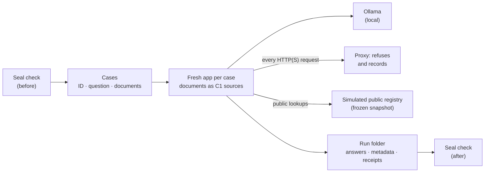

# Blind benchmark harness · Arnés de evaluación a ciegas

**Language / Idioma:** [English](#english) · [Español](#español)

---

## English

`run_bank.py` runs a **sealed** S2/S3 benchmark bank against Swarmbly AI. The bank stays private, outside this repository; the harness reads it by itself and **never prints a question, a document or an answer**, only case IDs, timings and counts.



| Step | What happens |
|---|---|
| Seal | Every file in the bank's SHA-256 manifest is checked; with a broken seal nothing runs |
| Cases | Only the fields `ID`, `Pregunta` and `Documentos` are read; keys and expected behaviour are never sent anywhere |
| App | A new Swarmbly App instance per case: its own data folder, no history, the case documents as the user's sources (LCE C1) |
| Network | Anything leaving the computer over HTTP(S) goes to a local proxy that refuses it and records the destination |
| Public source | A local stand-in for SearXNG answers with the bank's frozen public snapshot and records exactly what was asked |
| Receipt | Built from what was observed (schema `swarmbly.privacy_receipt/1.0`); fields the app does not report yet (lane in local mode, consent) are marked as not reported |
| Record | `registro_ejecucion.md`, one JSON per case, receipts, network log, app logs and the seal check after the run, in the bank's run folder |

### v4 banks (harness 1.3)

A v4 bank is detected by `03_REFERENCIA/` (or by the cases file
`02_CASOS_RESERVADOS/S2_S3_S4_reservados.md`). The old v3 layout keeps working
exactly as before.

Several fields may share one line, separated by ` | `
(`ID: S2-01 | Nivel: N2 | Capacidades: …`); a segment starts a new field only
when it begins with a known field name. Skills and MCP servers may be named by a
legend code (`K1 = informe-tecnico`, `M1 = planillas`), like documents (1.3.1). A code in `Archivos` or `Columna` is replaced by its
file name; `Columna` may also read `archivo, columna X` or `columna X de
archivo`; `Cambio de servidor` only needs the turn and a server of the card;
`Comprobaciones` written on one line are split on ` | ` and `; ` (1.3.2).

| Card field | What the harness does |
|---|---|
| `Nivel`, `Capacidades` | groups observations for the four tables of step 10 |
| `Receta: código` + `Archivos` + `Script` | opens a project, proposes one script, then approves, cancels or (for `aprobar y corregir`) proposes one correction; never runs `03_REFERENCIA` |
| `Resultado exacto` + `Tolerancia` | compares the computed output with the numbers copied into the card; a missing number is a failure. An N7 card without `Tolerancia` is compared with zero tolerance, and the comparison lists the numbers that matched (`coinciden`) |
| `Archivo de salida` | compares the named file with what the run produced: it must exist, have the named extension and not be empty; when the field also gives `columnas` or `filas`/`rows`, the harness reads the produced CSV/TSV/JSON/Markdown and checks them. The result is `salida` in the case summary and a named `Comprobaciones` entry |
| `Material necesario` | matches its quoted phrases against the documents, skill, MCP servers, roles, team and the web titles/URLs the App retrieved, with the same folded whole-word rule as names; a phrase that is not material (an author name included) may also be found in the answer. Each phrase adds a named check and the summary counts `frases`, `usadas` and `faltan` |
| `Receta: lista` + `Lista` / `Columna` + `Dónde` | calls the list preview, then sends the list as `recipe: list`; the CSV column is read by the harness |
| `Usar herramientas: sí` + `Servidores` + `Aprobadas en Ajustes` + `Decisiones` | adds/starts each catalogue, approves only the listed tools, and plays the approval cards in order; a card whose arguments are not the ones the card says is **skipped**, never approved |
| `Cambio de servidor: <server> en el turno N` | swaps in `<server>.cambio.json` before turn N and waits for the App to suspend the server (`tools/list_changed`) |
| `Skill` + `Activar skill` | imports the folder into the project (`POST /api/skills/import`) and activates it only when the card says so; checks `MARCADOR_SKILL.txt` |
| `Autor` + `Servicios` + `Decisión autor` | drives `POST /api/author/lookup`: cancel, exact name, edited name, or pick one ORCID iD when the first answer is ambiguous; the chosen or only iD is recorded and later works lookups by that iD are authorised and grouped in `obras_por_id` |
| `Envíos permitidos` | every observed send is compared by code; `consulta exacta «Q»`/`exactamente «Q»` fixes a public query (case, accents, spacing and punctuation folded), `debe contener «X»` requires a term, and `NADA al círculo`/`sin envíos al círculo` forbids CIRCLE. Anything outside the list becomes `envios_no_autorizados.json` with destination, size and content hash (never the content) |
| `Corrección` | `sí` (turn 2) or a turn 2–5. The correcting message runs as a second turn in the same conversation and the corrected answer is the one scored; the receipts and hashes of both turns are kept and reported. A `Turno 2` that starts like a correction is detected when the field is absent |
| `Comprobaciones` | the harness evaluates the checks it can decide and leaves the rest (`cumple: null`) to the judge. If a card asks to list author-works lookups by identifier separately (for example `lista las obras por iD aparte`), those calls are reported in their own `obras_por_id` group (`envios_obras_por_id`, `envios_por_grupo`, `resumen_por_grupo` in the receipt) instead of being mixed with ordinary public queries |

The MCP servers are `bench/mcp_catalog_server.py` (stdio for `local`, Streamable
HTTP on loopback for `remoto`, with the declared host reached through the App's
`--test-host-map`). The author stand-in is `bench/author_fake.py` for
`pub.orcid.org`, `api.openalex.org` and `eutils.ncbi.nlm.nih.gov`.

The run folder now has `juez/<ID>_r<rep>/` (receipt, approval cards, `meta.*`,
file hashes, marker, numeric comparison, sends, checks, actions, and since
1.4.4 `propuesta_investigacion.json`, `codigo_prompt.json` and, when reported,
`codigo_prompt.txt`) and `casos/<ID>_r<rep>_resumen.json` (content-free counts
and hashes only). The four tables of step 10 are in `resumen.json` (`tablas`)
and `resumen.md`. The two-node logs are per observation
(`logs/<ID>_r<rep>_member-<n>.log` and `..._nonmember.log`).

Harness 1.3.4 tells a public query with the persona's whole name (a leak) from one
that only contains one of its words (labelled for the judge), recognises «red
pública» as the public-search entry, and reads «…; sin «X» ni …» as a
constraint on the entry before it, not as a destination.

Harness **1.4.0** adds the two-node privacy mode (`--two-node`), the open
team-versus-local battery (`dev_team/`), the node-loss battery
(`dev_node_loss/`) and the guide for the maintainer's sealed bank v5
([`BANK_V5_GUIDE.md`](BANK_V5_GUIDE.md)). A v5 card marked `Dos nodos: sí`
starts the App under test as the circle owner, a loopback member and a
non-member; the report adds `envios_circulo`, `pasajes_a_pares`,
`no_miembro_rechazado`, the member's ledger and the three rules. v3/v4 banks
keep their `--check`/`--rescore` behaviour. The `--python` option also reads
`SWARMBLY_APP` and is available as `--app-python`.

Harness **1.4.4** closes the defects found by the isolated judge of the two
sealed v5 runs. A public-search entry may fix the query with
`consulta exacta «Q»` or `exactamente «Q»`; the sent query must equal it after
folding case, accents, spacing and punctuation, and any `debe contener «X»`
term must be present. `NADA al círculo` (and `ningún`, `sin`, `cero`) is a
prohibition, not a permission. The author chosen or only ORCID iD is recorded,
and works lookups by identifier (ORCID, OpenAlex `filter=author.id:…` /
`authorships.id`, PubMed summary) are authorised by the author entry and stay
in `obras_por_id`. The receipt rule now matches the folded phrase and returns
«no aplica» (None) when there was no CIRCLE send. `Material necesario` also
matches the web titles/URLs the App retrieved. A failed approved script asks for
a corrected one (up to two) when the card says `aprobar y corregir`. `no tiene
envíos`/`cero envíos`/`ningún envío` count only sends outside `Envíos
permitidos`. `lista las obras por iD aparte` has a real rule. The member ledger
subscribes before the first task, reconnects, records `ledger_error`, and keeps
the member and non-member logs per observation
(`logs/<case>_r<rep>_member-<n>.log`). A two-node join waits 90 s and retries
once. Expected numbers accept a normal or narrow no-break space as a thousands
separator; a cancelled card or one without numbers is not an exact result; and
the judge folder keeps the research-proposal metadata and the code prompt when
the App reports it. `--rescore` applies the new send, group, receipt, zero-send
and exact comparators to a finished run.

Harness **1.4.3** reads `Archivo de salida: ninguno` (also `no aplica`, `—`) as
"no file expected", like `Documentos: ninguno`, instead of a file name without
an extension.

Harness **1.4.2** prepares the recipe-5 sandbox before every code card. From
SwarmblyApp 0.8.0 recipe 5 never compiles inside a request, and each case
starts the App with a fresh data folder, so the harness asks the App to prepare
it through `/api/sandbox/prepare` with consent and waits for `ready`. Below the
App's free-memory floor it uses the explicit override and records
`forzado: true` in the case actions; any other outcome is a technical failure.
`bench/run_dev.py` does the same for the open code battery.

Harness **1.4.1** closes the T9.6/T9.10 follow-ups. It compares `Archivo de
salida` with the files the run produced (existence, extension, non-empty, and
the card's columns or row count), matches `Material necesario` against the
documents/skill/servers/roles/team the App reported using, reports author-works
lookups by identifier as their own group, compares N7 exact numbers with zero
tolerance unless the card states one and names the numbers that matched, runs a
marked correction turn as a second turn and keeps both receipts, and writes the
App-reported model and backend per case to `casos.csv`, the case summary and a
new section of the run record. The judge folder adds `salidas.json`,
`material.json`, `envios_por_grupo.json`, `correccion.json`,
`modelo_por_receta.json` and the downloaded `salidas/` files. `--check` and
`--rescore` keep their old results for a card that does not use the new fields;
a re-score recomputes the new checks only when its saved evidence exists.

Harness 1.3.5 rejects a distinctive word of a multi-word forbidden term as
`contiene un fragmento de un término prohibido` (ordinary words such as «río» or
«norte» do not count), counts one approved public query once although
`envios.json` keeps the `consulta_aprobada` and `buscador_publico` rows, reads
`arguments_json`/`destination` and a standing first card when deciding the N9
checks, normalises ORCID iDs with or without URL prefix or hyphens, records
`mensaje_tras_cancelar`, and collects the sends of every turn of a multi-turn
card.

Harness 1.3.3 corrects five defects without re-running a bank: public-search
entries are recognised with more labels (`búsqueda pública`, `registro
público`, `búsqueda web`, `internet`, `fuente pública`, `receta investigar`…);
the harness never approves a remote tool card whose call would fall outside
`Envíos permitidos`; the persona name is matched as a folded whole word; author
cards carry a real state (`done`, `cancelled`, `stopped`, `error`); and the run
record names the commit of the App actually imported (with its dirty flag) and
the installed versions, keeping the umbrella `components.lock` line labelled as
the lock.

A finished v4 run can be re-scored without starting the App or Ollama:

```bash
python3 bench/run_bank.py --bank /path/to/bank --rescore /path/to/run \
    --persona "<fictitious user's name>"
```

It recomputes every observation's unauthorised sends from `juez/*/envios.json`
with the current comparator and the card freshly parsed from the bank, rebuilds
the four tables, and writes `resumen_rescore_<version>.json`,
`envios_no_autorizados_rescore_<version>.json`, `casos_rescore_<version>.csv` and
`registro_rescore_<version>.md` next to the originals, which are never overwritten. A remote send that the harness
itself approved is reported as `aprobado_por_el_arnes` in its own column/row
and is not counted as an App unauthorised send. The seal is checked before and
after; stdout only carries the tables, the totals before → after, one fixed-label
line per changed observation and a content-free diagnostic per card with sends.

### Use

```bash
# 1. Check the bank, the cases and their documents (runs nothing)
python3 bench/run_bank.py --bank /path/to/bank --model qwen2.5:7b --check

# 2. Run the battery once
python3 bench/run_bank.py --bank /path/to/bank --model qwen2.5:7b \
    --persona "<fictitious user's name>" --executor "<your name>"
```

For development, the **open battery** in [`dev/`](dev/README.md) uses the same machinery with fictitious material that can be read and used for tuning: `python3 bench/run_dev.py --model qwen2.5:7b`. A second open battery, [`dev_v3/`](dev_v3/README.md), reproduces the failure patterns of the sealed banks v3 on fictitious material: `python3 bench/run_dev.py --model qwen2.5:7b --battery bench/dev_v3`. Since harness 1.2.0 a case card may also say how the question is asked (`Receta:`, `Consulta aprobada:`, `Permiso público:`, `Turno 2:`…), and since 1.2.1 `Documentos:` may name files with spaces or use codes defined in a legend (`02_CASOS_RESERVADOS/LEYENDA*.md`).

The two-node mode is also available for open cases: `python3 bench/run_dev.py --model qwen2.5:7b --two-node --battery bench/dev`. A case may set `"dos_nodos": true`, `"pasajes_al_circulo": true` and `"pasajes_esperados": true`; the row then carries the same report fields. The [team battery](dev_team/README.md) compares one node against 2–3 loopback nodes and writes a CSV plus Markdown; the [node-loss battery](dev_node_loss/README.md) kills a member during a search and checks the honest partial answer. Both accept `--fake-ollama` for a deterministic CI smoke run.

Requirements: Swarmbly installed (the installer's `.venv`, or `--python`), Ollama running with the chat model and `nomic-embed-text`. Run each bank once per version; a technical failure means repeating the whole battery, never a single case.

---

## Español

`run_bank.py` ejecuta un banco S2/S3 **sellado** contra Swarmbly AI. El banco sigue siendo privado y vive fuera de este repositorio. El arnés lo lee por sí mismo y **nunca muestra una pregunta, un documento ni una respuesta**: solo identificadores de caso, tiempos y conteos.

| Paso | Qué ocurre |
|---|---|
| Sello | Se comprueba cada archivo del manifiesto SHA-256 del banco; con el sello roto no se ejecuta nada |
| Casos | Solo se leen los campos `ID`, `Pregunta` y `Documentos`; las claves y el comportamiento esperado no se envían a ningún sitio |
| App | Una instancia nueva de Swarmbly App por caso: carpeta de datos propia, sin historial, con los documentos del caso como fuentes del usuario (LCE C1) |
| Red | Todo lo que intente salir del equipo por HTTP(S) va a un proxy local que lo rechaza y anota el destino |
| Fuente pública | Un sustituto local de SearXNG responde con la instantánea pública congelada del banco y anota exactamente qué se preguntó |
| Recibo | Se construye con lo observado (esquema `swarmbly.privacy_receipt/1.0`); los campos que la app aún no informa (carril en modo local, consentimiento) quedan como «no informado» |
| Recibo de la app | Desde App 0.3.1 la app entrega su propio recibo con cada respuesta. Se guarda aparte (`<ID>_recibo_app.json`, con el campo `caso` añadido por el arnés y marcado así; el resto queda tal como lo entregó la app) y se comparan sus consultas con las observadas en la red (`recibo_app_coincide` en el JSON del caso) |
| Registro | `registro_ejecucion.md`, un JSON por caso, los recibos, el registro de red, los registros de la app y la verificación del sello posterior, en la carpeta de ejecuciones del banco |

### Bancos v4 (arnés 1.3)

Un banco v4 se detecta por `03_REFERENCIA/` (o por el archivo
`02_CASOS_RESERVADOS/S2_S3_S4_reservados.md`). El diseño v3 sigue funcionando
igual que antes.

Varios campos pueden ir en una misma línea, separados por ` | `
(`ID: S2-01 | Nivel: N2 | Capacidades: …`); un segmento abre un campo nuevo solo
si empieza con el nombre de un campo conocido. Las skills y los servidores MCP
pueden nombrarse con un código de la leyenda (`K1 = informe-tecnico`,
`M1 = planillas`), igual que los documentos (1.3.1). Un código en `Archivos` o `Columna` se
reemplaza por el nombre de su archivo; `Columna` acepta también `archivo,
columna X` o `columna X de archivo`; a `Cambio de servidor` le basta el turno y
un servidor de la ficha; las `Comprobaciones` en una sola línea se separan por
` | ` y `; ` (1.3.2).

| Campo de la ficha | Qué hace el arnés |
|---|---|
| `Nivel`, `Capacidades` | agrupa las observaciones para las cuatro tablas del paso 10 |
| `Receta: código` + `Archivos` + `Script` | abre un proyecto, propone un script y lo aprueba, lo cancela o (con `aprobar y corregir`) propone una corrección; nunca ejecuta `03_REFERENCIA` |
| `Resultado exacto` + `Tolerancia` | compara la salida calculada con las cifras copiadas en la ficha; una cifra ausente es un fallo. Una ficha N7 sin `Tolerancia` se compara con tolerancia cero y la comparación dice qué cifras coincidieron (`coinciden`) |
| `Archivo de salida` | compara el archivo nombrado con lo que produjo la corrida: debe existir, tener la extensión nombrada y no estar vacío; si el campo también da `columnas` o `filas`/`rows`, el arnés lee el CSV/TSV/JSON/Markdown producido y lo comprueba. El resultado va a `salida` en el resumen del caso y a una comprobación con nombre |
| `Material necesario` | contrasta sus frases entre comillas con los documentos, la skill, los servidores MCP, los roles, el equipo y los títulos/URLs web que recuperó la App, con la misma regla de palabra completa plegada que para los nombres; una frase que no sea material (incluido el nombre del autor) también puede encontrarse en la respuesta. Cada frase añade una comprobación con nombre y el resumen cuenta `frases`, `usadas` y `faltan` |
| `Receta: lista` + `Lista` / `Columna` + `Dónde` | llama a la vista previa y envía la lista como `recipe: list`; la columna del CSV la lee el arnés |
| `Usar herramientas: sí` + `Servidores` + `Aprobadas en Ajustes` + `Decisiones` | añade y arranca cada catálogo, aprueba solo las herramientas listadas y decide cada tarjeta en orden; si los argumentos no son los que dice la ficha, **omite** la llamada |
| `Cambio de servidor: <servidor> en el turno N` | cambia a `<servidor>.cambio.json` antes del turno N y espera a que la App suspenda el servidor (`tools/list_changed`) |
| `Skill` + `Activar skill` | importa la carpeta en el proyecto y la activa solo si la ficha lo dice; comprueba `MARCADOR_SKILL.txt` |
| `Autor` + `Servicios` + `Decisión autor` | usa `POST /api/author/lookup`: cancelar, nombre exacto, nombre editado o elegir un iD ORCID si la primera respuesta es ambigua; se registra el iD elegido o el único y las consultas de obras por ese iD quedan autorizadas y agrupadas en `obras_por_id` |
| `Envíos permitidos` | cada envío observado se compara por código; `consulta exacta «Q»`/`exactamente «Q»` fija una consulta pública (mayúsculas, acentos, espacios y puntuación plegados), `debe contener «X»` exige un término y `NADA al círculo`/`sin envíos al círculo` prohíbe CIRCLE. Lo que queda fuera va a `envios_no_autorizados.json` con destino, tamaño y hash (nunca el contenido) |
| `Corrección` | `sí` (turno 2) o un turno 2–5. El mensaje que corrige se ejecuta como segundo turno en la misma conversación y se puntúa la respuesta corregida; se guardan y se informan los recibos y hashes de ambos turnos. Si no está el campo, se detecta un `Turno 2` que empieza como una corrección |
| `Comprobaciones` | el arnés evalúa las que puede decidir y deja el resto (`cumple: null`) al juez. Si una ficha pide listar las obras de autor por identificador aparte (por ejemplo `lista las obras por iD aparte`), esas llamadas van a su propio grupo `obras_por_id` (`envios_obras_por_id`, `envios_por_grupo`, `resumen_por_grupo` en el recibo) y no se mezclan con las consultas públicas ordinarias |

Los servidores MCP son `bench/mcp_catalog_server.py` (stdio para `local`,
Streamable HTTP en loopback para `remoto`, con el host declarado a través del
`--test-host-map` de la App). Los autores simulados son `bench/author_fake.py`
para `pub.orcid.org`, `api.openalex.org` y `eutils.ncbi.nlm.nih.gov`.

La carpeta de ejecución tiene `juez/<ID>_r<rep>/` (recibo, tarjetas, `meta.*`,
hashes, marcador, comparación numérica, envíos, comprobaciones, acciones y,
desde 1.4.4, `propuesta_investigacion.json`, `codigo_prompt.json` y, cuando la
App lo informa, `codigo_prompt.txt`) y `casos/<ID>_r<rep>_resumen.json` (solo
conteos y hashes, sin contenido). Las cuatro tablas del paso 10 están en
`resumen.json` (`tablas`) y `resumen.md`. Los registros de dos nodos son por
observación (`logs/<ID>_r<rep>_member-<n>.log` y `..._nonmember.log`).

El arnés 1.3.4 distingue una consulta pública con el nombre completo de la
persona (fuga) de una que solo contiene una de sus palabras (etiquetada para el
juez), reconoce «red pública» como la entrada de búsqueda pública y lee
«…; sin «X» ni …» como una restricción de la entrada anterior, no como un destino.

El arnés **1.4.0** añade el modo de privacidad de dos nodos (`--two-node`), la
batería abierta de equipo frente a local (`dev_team/`), la batería de pérdida
de nodo (`dev_node_loss/`) y la guía para el banco sellado v5 del mantenedor
([`BANK_V5_GUIDE.md`](BANK_V5_GUIDE.md)). Una ficha v5 marcada `Dos nodos: sí`
arranca la App bajo prueba como dueña del círculo, un miembro de loopback y un
no miembro; el informe añade `envios_circulo`, `pasajes_a_pares`,
`no_miembro_rechazado`, el libro del miembro y las tres reglas. Los bancos
v3/v4 conservan su comportamiento de `--check`/`--rescore`. La opción
`--python` también lee `SWARMBLY_APP` y está disponible como `--app-python`.

El arnés **1.4.4** cierra los defectos que encontró el juez aislado de las dos
corridas v5 selladas. Una entrada de búsqueda pública puede fijar la consulta
con `consulta exacta «Q»` o `exactamente «Q»`; la consulta enviada debe ser
igual tras plegar mayúsculas, acentos, espacios y puntuación, y todo término de
`debe contener «X»` debe estar presente. `NADA al círculo` (y `ningún`, `sin`,
`cero`) es una prohibición, no un permiso. Se registra el iD ORCID elegido o el
único candidato, y las consultas de obras por identificador (ORCID, OpenAlex
`filter=author.id:…` / `authorships.id`, resumen de PubMed) quedan autorizadas
por la entrada de autor y en `obras_por_id`. La regla del recibo compara el
texto plegado y devuelve «no aplica» (None) cuando no hubo envío al círculo.
`Material necesario` también contrasta los títulos/URLs web que recuperó la App.
Un script aprobado que falla pide uno corregido (hasta dos) si la ficha dice
`aprobar y corregir`. `no tiene envíos`/`cero envíos`/`ningún envío` cuentan
solo los envíos fuera de `Envíos permitidos`. `lista las obras por iD aparte`
tiene regla propia. El libro del miembro se suscribe antes de la primera tarea,
se reconecta, registra `ledger_error` y conserva los registros del miembro y del
no miembro por observación (`logs/<caso>_r<rep>_member-<n>.log`). La unión de
dos nodos espera 90 s y reintenta una vez. Las cifras esperadas aceptan un
espacio normal o estrecho de no separación como separador de miles; una ficha
cancelada o sin cifras no cuenta como resultado exacto; y la carpeta del juez
guarda los metadatos de la propuesta de investigación y el prompt del código
cuando la App lo informa. `--rescore` aplica a una corrida terminada los nuevos
comparadores de envíos, grupos, recibo, cero envíos y exactos.

El arnés **1.4.3** lee `Archivo de salida: ninguno` (también `no aplica`, `—`)
como «no se espera archivo», igual que `Documentos: ninguno`, en vez de un
nombre de archivo sin extensión.

El arnés **1.4.2** prepara la caja de la receta 5 antes de cada ficha de código.
Desde SwarmblyApp 0.8.0 la receta 5 nunca compila dentro de una solicitud, y
cada caso arranca la App con una carpeta de datos nueva, así que el arnés pide a
la App que la prepare por `/api/sandbox/prepare` con consentimiento y espera
`ready`. Por debajo del mínimo de memoria libre de la App usa la opción
explícita y registra `forzado: true` en las acciones del caso; cualquier otro
resultado es un fallo técnico. `bench/run_dev.py` hace lo mismo con la batería
abierta de código.

El arnés **1.4.1** cierra los seguimientos T9.6/T9.10. Compara `Archivo de
salida` con los archivos que produjo la corrida (existencia, extensión, no
vacío y las columnas o filas de la ficha), contrasta `Material necesario` con
los documentos/skill/servidores/roles/equipo que la App informó haber usado,
informa las consultas de obras por identificador en su propio grupo, compara las
cifras exactas N7 con tolerancia cero salvo que la ficha diga otra y nombra las
que coincidieron, ejecuta un turno de corrección marcado como segundo turno y
guarda ambos recibos, y escribe el modelo y el backend que la App informó por
caso en `casos.csv`, en el resumen del caso y en una sección nueva del registro.
La carpeta del juez añade `salidas.json`, `material.json`,
`envios_por_grupo.json`, `correccion.json`, `modelo_por_receta.json` y los
archivos descargados en `salidas/`. `--check` y `--rescore` conservan sus
resultados anteriores para una ficha que no use los campos nuevos; una
repuntuación recalcula las comprobaciones nuevas solo si existe su evidencia
guardada.

El arnés 1.3.5 rechaza una palabra distintiva de un término prohibido de varias
palabras como `contiene un fragmento de un término prohibido` (las palabras
comunes como «río» o «norte» no cuentan), cuenta una consulta pública aprobada
una sola vez aunque `envios.json` conserve las filas `consulta_aprobada` y
`buscador_publico`, lee `arguments_json`/`destination` y la tarjeta permanente al
decidir las comprobaciones N9, normaliza los iD ORCID con o sin prefijo URL o
guiones, registra `mensaje_tras_cancelar` y recoge los envíos de todos los turnos
de una ficha multiturno.

El arnés 1.3.3 corrige cinco defectos sin repetir un banco: reconoce la entrada
de búsqueda pública con más rótulos (`búsqueda pública`, `registro público`,
`búsqueda web`, `internet`, `fuente pública`, `receta investigar`…); nunca
aprueba una tarjeta de herramienta remota cuya llamada quedaría fuera de
`Envíos permitidos`; compara el nombre de la persona como palabra completa
plegada; las fichas de autor llevan un estado real (`done`, `cancelled`,
`stopped`, `error`); y el registro nombra el commit de la App realmente
importada (con su marca de cambios sin confirmar) y las versiones instaladas,
manteniendo la línea del `components.lock` del paraguas rotulada como el lock.

Una ejecución v4 terminada se puede repuntuar sin arrancar la App ni Ollama:

```bash
python3 bench/run_bank.py --bank /ruta/al/banco --rescore /ruta/a/la/ejecución \
    --persona "<nombre de la persona ficticia>"
```

Recalcula los envíos no autorizados de cada observación desde
`juez/*/envios.json` con el comparador actual y la ficha recién leída del banco,
rehace las cuatro tablas y escribe `resumen_rescore_<versión>.json`,
`envios_no_autorizados_rescore_<versión>.json`, `casos_rescore_<versión>.csv` y
`registro_rescore_<versión>.md` junto a los originales, que nunca se sobrescriben. Un envío remoto que aprobó el propio
arnés se informa como `aprobado_por_el_arnes` en su columna y fila propias y no
cuenta como envío no autorizado de la App. El sello se comprueba antes y
después; por stdout solo salen las tablas, los totales antes → después, una
línea de etiquetas fijas por observación cambiada y un diagnóstico sin contenido
por ficha con envíos.

### Uso

```bash
# 1. Comprobar el banco, los casos y sus documentos (no ejecuta nada)
python3 bench/run_bank.py --bank /ruta/al/banco --model qwen2.5:7b --check

# 2. Ejecutar la batería una vez
python3 bench/run_bank.py --bank /ruta/al/banco --model qwen2.5:7b \
    --persona "<nombre de la persona ficticia>" --executor "<tu nombre>"
```

Para el desarrollo, la **batería abierta** de [`dev/`](dev/README.md) usa la misma maquinaria con material ficticio que se puede leer y usar para ajustar: `python3 bench/run_dev.py --model qwen2.5:7b`. Una segunda batería abierta, [`dev_v3/`](dev_v3/README.md), reproduce los patrones de fallo de los bancos sellados v3 con material ficticio: `python3 bench/run_dev.py --model qwen2.5:7b --battery bench/dev_v3`. Desde el arnés 1.2.0 una ficha puede decir también cómo se pregunta (`Receta:`, `Consulta aprobada:`, `Permiso público:`, `Turno 2:`…), y desde 1.2.1 `Documentos:` admite nombres de archivo con espacios o códigos definidos en una leyenda (`02_CASOS_RESERVADOS/LEYENDA*.md`).

**Requisitos:**

- Swarmbly instalado (el `.venv` del instalador, o indicado con `--python`).
- Ollama en marcha, con el modelo de chat y `nomic-embed-text`.

Cada banco se ejecuta una vez por versión. Si hay un fallo técnico, se repite la batería completa, nunca un caso suelto.
