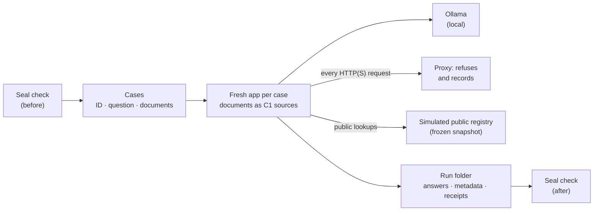

# Blind benchmark harness · Arnés de evaluación a ciegas

**Language / Idioma:** [English](#english) · [Español](#español)

---

## English

`run_bank.py` runs a **sealed** S2/S3 benchmark bank against Swarmbly AI. The bank stays private, outside this repository; the harness reads it by itself and **never prints a question, a document or an answer**, only case IDs, timings and counts.



| Step | What happens |
|---|---|
| Seal | Every file in the bank's SHA-256 manifest is checked; with a broken seal nothing runs |
| Cases | Only the fields `ID`, `Pregunta` and `Documentos` are read; keys and expected behaviour are never sent anywhere |
| App | A new Swarmbly App instance per case: its own data folder, no history, the case documents as the user's sources (LCE C1) |
| Network | Anything leaving the computer over HTTP(S) goes to a local proxy that refuses it and records the destination |
| Public source | A local stand-in for SearXNG answers with the bank's frozen public snapshot and records exactly what was asked |
| Receipt | Built from what was observed (schema `swarmbly.privacy_receipt/1.0`); fields the app does not report yet (lane in local mode, consent) are marked as not reported |
| Record | `registro_ejecucion.md`, one JSON per case, receipts, network log, app logs and the seal check after the run, in the bank's run folder |

### Use

```bash
# 1. Check the bank, the cases and their documents (runs nothing)
python3 bench/run_bank.py --bank /path/to/bank --model qwen2.5:7b --check

# 2. Run the battery once
python3 bench/run_bank.py --bank /path/to/bank --model qwen2.5:7b \
    --persona "<fictitious user's name>" --executor "<your name>"
```

Requirements: Swarmbly installed (the installer's `.venv`, or `--python`), Ollama running with the chat model and `nomic-embed-text`. Run each bank once per version; a technical failure means repeating the whole battery, never a single case.

---

## Español

`run_bank.py` ejecuta un banco S2/S3 **sellado** contra Swarmbly AI. El banco sigue siendo privado y vive fuera de este repositorio. El arnés lo lee por sí mismo y **nunca muestra una pregunta, un documento ni una respuesta**: solo identificadores de caso, tiempos y conteos.

| Paso | Qué ocurre |
|---|---|
| Sello | Se comprueba cada archivo del manifiesto SHA-256 del banco; con el sello roto no se ejecuta nada |
| Casos | Solo se leen los campos `ID`, `Pregunta` y `Documentos`; las claves y el comportamiento esperado no se envían a ningún sitio |
| App | Una instancia nueva de Swarmbly App por caso: carpeta de datos propia, sin historial, con los documentos del caso como fuentes del usuario (LCE C1) |
| Red | Todo lo que intente salir del equipo por HTTP(S) va a un proxy local que lo rechaza y anota el destino |
| Fuente pública | Un sustituto local de SearXNG responde con la instantánea pública congelada del banco y anota exactamente qué se preguntó |
| Recibo | Se construye con lo observado (esquema `swarmbly.privacy_receipt/1.0`); los campos que la app aún no informa (carril en modo local, consentimiento) quedan como «no informado» |
| Registro | `registro_ejecucion.md`, un JSON por caso, los recibos, el registro de red, los registros de la app y la verificación del sello posterior, en la carpeta de ejecuciones del banco |

### Uso

```bash
# 1. Comprobar el banco, los casos y sus documentos (no ejecuta nada)
python3 bench/run_bank.py --bank /ruta/al/banco --model qwen2.5:7b --check

# 2. Ejecutar la batería una vez
python3 bench/run_bank.py --bank /ruta/al/banco --model qwen2.5:7b \
    --persona "<nombre de la persona ficticia>" --executor "<tu nombre>"
```

**Requisitos:**

- Swarmbly instalado (el `.venv` del instalador, o indicado con `--python`).
- Ollama en marcha, con el modelo de chat y `nomic-embed-text`.

Cada banco se ejecuta una vez por versión. Si hay un fallo técnico, se repite la batería completa, nunca un caso suelto.
