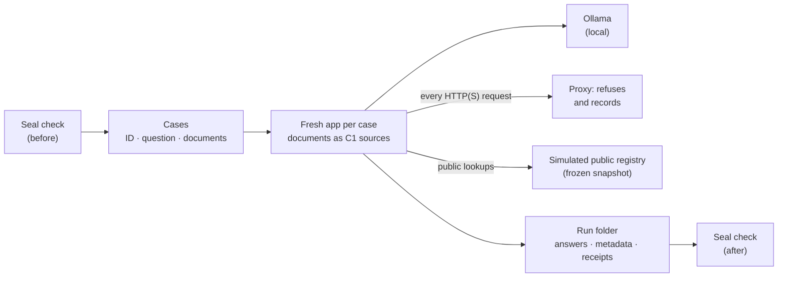

# Blind benchmark harness · Arnés de evaluación a ciegas

**Language / Idioma:** [English](#english) · [Español](#español)

---

## English

`run_bank.py` runs a **sealed** S2/S3 benchmark bank against Swarmbly AI. The bank stays private, outside this repository; the harness reads it by itself and **never prints a question, a document or an answer**, only case IDs, timings and counts.



| Step | What happens |
|---|---|
| Seal | Every file in the bank's SHA-256 manifest is checked; with a broken seal nothing runs |
| Cases | Only the fields `ID`, `Pregunta` and `Documentos` are read; keys and expected behaviour are never sent anywhere |
| App | A new Swarmbly App instance per case: its own data folder, no history, the case documents as the user's sources (LCE C1) |
| Network | Anything leaving the computer over HTTP(S) goes to a local proxy that refuses it and records the destination |
| Public source | A local stand-in for SearXNG answers with the bank's frozen public snapshot and records exactly what was asked |
| Receipt | Built from what was observed (schema `swarmbly.privacy_receipt/1.0`); fields the app does not report yet (lane in local mode, consent) are marked as not reported |
| Record | `registro_ejecucion.md`, one JSON per case, receipts, network log, app logs and the seal check after the run, in the bank's run folder |

### v4 banks (harness 1.3)

A v4 bank is detected by `03_REFERENCIA/` (or by the cases file
`02_CASOS_RESERVADOS/S2_S3_S4_reservados.md`). The old v3 layout keeps working
exactly as before.

Several fields may share one line, separated by ` | `
(`ID: S2-01 | Nivel: N2 | Capacidades: …`); a segment starts a new field only
when it begins with a known field name. Skills and MCP servers may be named by a
legend code (`K1 = informe-tecnico`, `M1 = planillas`), like documents (1.3.1). A code in `Archivos` or `Columna` is replaced by its
file name; `Columna` may also read `archivo, columna X` or `columna X de
archivo`; `Cambio de servidor` only needs the turn and a server of the card;
`Comprobaciones` written on one line are split on ` | ` and `; ` (1.3.2).

| Card field | What the harness does |
|---|---|
| `Nivel`, `Capacidades` | groups observations for the four tables of step 10 |
| `Receta: código` + `Archivos` + `Script` | opens a project, proposes one script, then approves, cancels or (for `aprobar y corregir`) proposes one correction; never runs `03_REFERENCIA` |
| `Resultado exacto` + `Tolerancia` | compares the computed output with the numbers copied into the card; a missing number is a failure |
| `Receta: lista` + `Lista` / `Columna` + `Dónde` | calls the list preview, then sends the list as `recipe: list`; the CSV column is read by the harness |
| `Usar herramientas: sí` + `Servidores` + `Aprobadas en Ajustes` + `Decisiones` | adds/starts each catalogue, approves only the listed tools, and plays the approval cards in order; a card whose arguments are not the ones the card says is **skipped**, never approved |
| `Cambio de servidor: <server> en el turno N` | swaps in `<server>.cambio.json` before turn N and waits for the App to suspend the server (`tools/list_changed`) |
| `Skill` + `Activar skill` | imports the folder into the project (`POST /api/skills/import`) and activates it only when the card says so; checks `MARCADOR_SKILL.txt` |
| `Autor` + `Servicios` + `Decisión autor` | drives `POST /api/author/lookup`: cancel, exact name, edited name, or pick one ORCID iD when the first answer is ambiguous |
| `Envíos permitidos` | every observed send is compared by code; anything outside the list becomes `envios_no_autorizados.json` with destination, size and content hash (never the content) |
| `Comprobaciones` | the harness evaluates the checks it can decide and leaves the rest (`cumple: null`) to the judge |

The MCP servers are `bench/mcp_catalog_server.py` (stdio for `local`, Streamable
HTTP on loopback for `remoto`, with the declared host reached through the App's
`--test-host-map`). The author stand-in is `bench/author_fake.py` for
`pub.orcid.org`, `api.openalex.org` and `eutils.ncbi.nlm.nih.gov`.

The run folder now has `juez/<ID>_r<rep>/` (receipt, approval cards, `meta.*`,
file hashes, marker, numeric comparison, sends, checks, actions) and
`casos/<ID>_r<rep>_resumen.json` (content-free counts and hashes only). The
four tables of step 10 are in `resumen.json` (`tablas`) and `resumen.md`.

### Use

```bash
# 1. Check the bank, the cases and their documents (runs nothing)
python3 bench/run_bank.py --bank /path/to/bank --model qwen2.5:7b --check

# 2. Run the battery once
python3 bench/run_bank.py --bank /path/to/bank --model qwen2.5:7b \
    --persona "<fictitious user's name>" --executor "<your name>"
```

For development, the **open battery** in [`dev/`](dev/README.md) uses the same machinery with fictitious material that can be read and used for tuning: `python3 bench/run_dev.py --model qwen2.5:7b`. A second open battery, [`dev_v3/`](dev_v3/README.md), reproduces the failure patterns of the sealed banks v3 on fictitious material: `python3 bench/run_dev.py --model qwen2.5:7b --battery bench/dev_v3`. Since harness 1.2.0 a case card may also say how the question is asked (`Receta:`, `Consulta aprobada:`, `Permiso público:`, `Turno 2:`…), and since 1.2.1 `Documentos:` may name files with spaces or use codes defined in a legend (`02_CASOS_RESERVADOS/LEYENDA*.md`).

Requirements: Swarmbly installed (the installer's `.venv`, or `--python`), Ollama running with the chat model and `nomic-embed-text`. Run each bank once per version; a technical failure means repeating the whole battery, never a single case.

---

## Español

`run_bank.py` ejecuta un banco S2/S3 **sellado** contra Swarmbly AI. El banco sigue siendo privado y vive fuera de este repositorio. El arnés lo lee por sí mismo y **nunca muestra una pregunta, un documento ni una respuesta**: solo identificadores de caso, tiempos y conteos.

| Paso | Qué ocurre |
|---|---|
| Sello | Se comprueba cada archivo del manifiesto SHA-256 del banco; con el sello roto no se ejecuta nada |
| Casos | Solo se leen los campos `ID`, `Pregunta` y `Documentos`; las claves y el comportamiento esperado no se envían a ningún sitio |
| App | Una instancia nueva de Swarmbly App por caso: carpeta de datos propia, sin historial, con los documentos del caso como fuentes del usuario (LCE C1) |
| Red | Todo lo que intente salir del equipo por HTTP(S) va a un proxy local que lo rechaza y anota el destino |
| Fuente pública | Un sustituto local de SearXNG responde con la instantánea pública congelada del banco y anota exactamente qué se preguntó |
| Recibo | Se construye con lo observado (esquema `swarmbly.privacy_receipt/1.0`); los campos que la app aún no informa (carril en modo local, consentimiento) quedan como «no informado» |
| Recibo de la app | Desde App 0.3.1 la app entrega su propio recibo con cada respuesta. Se guarda aparte (`<ID>_recibo_app.json`, con el campo `caso` añadido por el arnés y marcado así; el resto queda tal como lo entregó la app) y se comparan sus consultas con las observadas en la red (`recibo_app_coincide` en el JSON del caso) |
| Registro | `registro_ejecucion.md`, un JSON por caso, los recibos, el registro de red, los registros de la app y la verificación del sello posterior, en la carpeta de ejecuciones del banco |

### Bancos v4 (arnés 1.3)

Un banco v4 se detecta por `03_REFERENCIA/` (o por el archivo
`02_CASOS_RESERVADOS/S2_S3_S4_reservados.md`). El diseño v3 sigue funcionando
igual que antes.

Varios campos pueden ir en una misma línea, separados por ` | `
(`ID: S2-01 | Nivel: N2 | Capacidades: …`); un segmento abre un campo nuevo solo
si empieza con el nombre de un campo conocido. Las skills y los servidores MCP
pueden nombrarse con un código de la leyenda (`K1 = informe-tecnico`,
`M1 = planillas`), igual que los documentos (1.3.1). Un código en `Archivos` o `Columna` se
reemplaza por el nombre de su archivo; `Columna` acepta también `archivo,
columna X` o `columna X de archivo`; a `Cambio de servidor` le basta el turno y
un servidor de la ficha; las `Comprobaciones` en una sola línea se separan por
` | ` y `; ` (1.3.2).

| Campo de la ficha | Qué hace el arnés |
|---|---|
| `Nivel`, `Capacidades` | agrupa las observaciones para las cuatro tablas del paso 10 |
| `Receta: código` + `Archivos` + `Script` | abre un proyecto, propone un script y lo aprueba, lo cancela o (con `aprobar y corregir`) propone una corrección; nunca ejecuta `03_REFERENCIA` |
| `Resultado exacto` + `Tolerancia` | compara la salida calculada con las cifras copiadas en la ficha |
| `Receta: lista` + `Lista` / `Columna` + `Dónde` | llama a la vista previa y envía la lista como `recipe: list`; la columna del CSV la lee el arnés |
| `Usar herramientas: sí` + `Servidores` + `Aprobadas en Ajustes` + `Decisiones` | añade y arranca cada catálogo, aprueba solo las herramientas listadas y decide cada tarjeta en orden; si los argumentos no son los que dice la ficha, **omite** la llamada |
| `Cambio de servidor: <servidor> en el turno N` | cambia a `<servidor>.cambio.json` antes del turno N y espera a que la App suspenda el servidor (`tools/list_changed`) |
| `Skill` + `Activar skill` | importa la carpeta en el proyecto y la activa solo si la ficha lo dice; comprueba `MARCADOR_SKILL.txt` |
| `Autor` + `Servicios` + `Decisión autor` | usa `POST /api/author/lookup`: cancelar, nombre exacto, nombre editado o elegir un iD ORCID si la primera respuesta es ambigua |
| `Envíos permitidos` | cada envío observado se compara por código; lo que queda fuera va a `envios_no_autorizados.json` con destino, tamaño y hash (nunca el contenido) |
| `Comprobaciones` | el arnés evalúa las que puede decidir y deja el resto (`cumple: null`) al juez |

Los servidores MCP son `bench/mcp_catalog_server.py` (stdio para `local`,
Streamable HTTP en loopback para `remoto`, con el host declarado a través del
`--test-host-map` de la App). Los autores simulados son `bench/author_fake.py`
para `pub.orcid.org`, `api.openalex.org` y `eutils.ncbi.nlm.nih.gov`.

La carpeta de ejecución tiene `juez/<ID>_r<rep>/` (recibo, tarjetas, `meta.*`,
hashes, marcador, comparación numérica, envíos, comprobaciones, acciones) y
`casos/<ID>_r<rep>_resumen.json` (solo conteos y hashes, sin contenido). Las
cuatro tablas del paso 10 están en `resumen.json` (`tablas`) y `resumen.md`.

### Uso

```bash
# 1. Comprobar el banco, los casos y sus documentos (no ejecuta nada)
python3 bench/run_bank.py --bank /ruta/al/banco --model qwen2.5:7b --check

# 2. Ejecutar la batería una vez
python3 bench/run_bank.py --bank /ruta/al/banco --model qwen2.5:7b \
    --persona "<nombre de la persona ficticia>" --executor "<tu nombre>"
```

Para el desarrollo, la **batería abierta** de [`dev/`](dev/README.md) usa la misma maquinaria con material ficticio que se puede leer y usar para ajustar: `python3 bench/run_dev.py --model qwen2.5:7b`. Una segunda batería abierta, [`dev_v3/`](dev_v3/README.md), reproduce los patrones de fallo de los bancos sellados v3 con material ficticio: `python3 bench/run_dev.py --model qwen2.5:7b --battery bench/dev_v3`. Desde el arnés 1.2.0 una ficha puede decir también cómo se pregunta (`Receta:`, `Consulta aprobada:`, `Permiso público:`, `Turno 2:`…), y desde 1.2.1 `Documentos:` admite nombres de archivo con espacios o códigos definidos en una leyenda (`02_CASOS_RESERVADOS/LEYENDA*.md`).

**Requisitos:**

- Swarmbly instalado (el `.venv` del instalador, o indicado con `--python`).
- Ollama en marcha, con el modelo de chat y `nomic-embed-text`.

Cada banco se ejecuta una vez por versión. Si hay un fallo técnico, se repite la batería completa, nunca un caso suelto.
