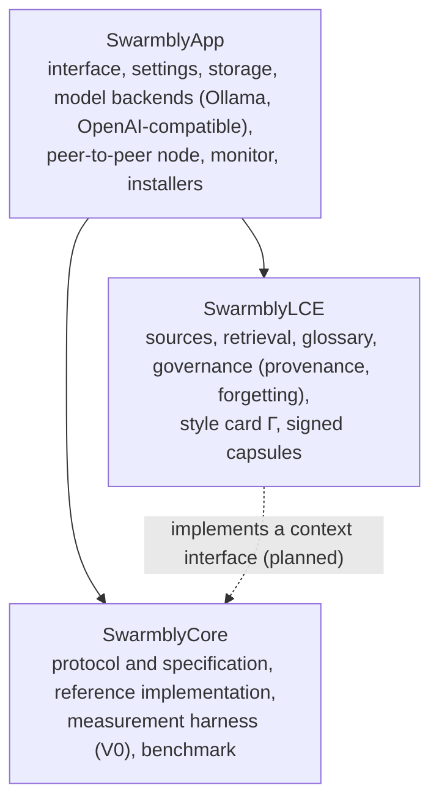
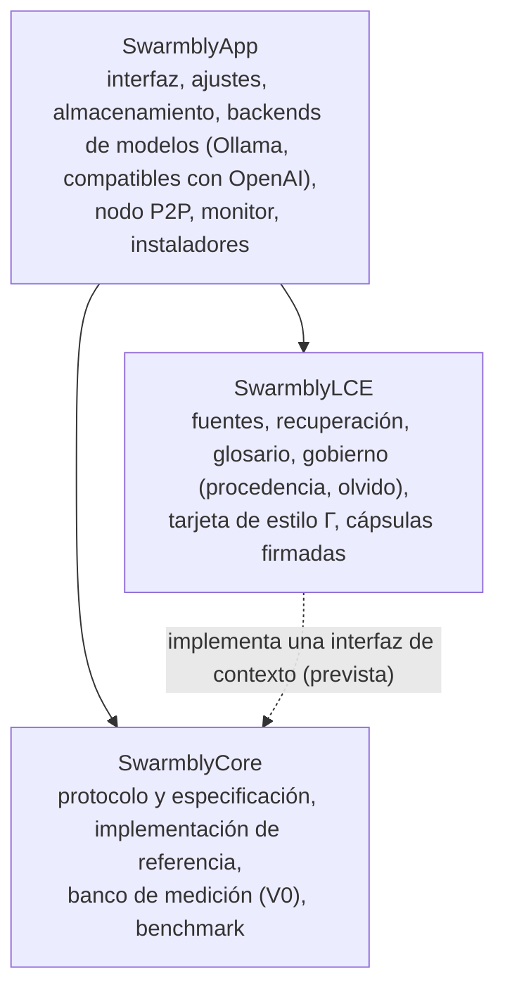

# Architecture · Arquitectura

**Language / Idioma:** [English](#english) · [Español](#español)

---

## English

### Layers

Each layer only knows the one below. The target, which the next releases move towards, is that SwarmblyCore holds the **orchestrator** (routing, planning, packing, scheduling, consensus, assembly, evidence providers, agents) and defines a context interface that SwarmblyLCE implements and SwarmblyApp wires in, so another client could use the core with another memory, or none.

**Where code lives today.** The production orchestrator grew inside SwarmblyApp (`swarmbly_app/engine/`, `swarmbly_app/p2p/`) while it was being measured; SwarmblyCore holds the protocol, the specification and the measurement harness, which by design (ADR-001) is not a production orchestrator. Retrieval over the user's sources (LCE C1) also lives in the app (`lce_adapter.py`). Both move to their layer module by module, with the app's full test suite passing at every step.

### A request, step by step

1. **Lane.** Sensitive or personal requests (passwords, health, money; first-person requests about the user's own material) never leave the device.
2. **Router and admission.** A request that splits into independent items with an operation per item ("for each…", classify, translate) becomes a batch; essays, rubrics and instructions do not.
3. **Local answer.** Retrieval over the user's sources (hybrid: keywords + local embeddings, glossary across languages), public facts looked up by name only, and a fusion template that keeps "my documents" apart from "public sources". A larger local model can write only the fused answers.
4. **Distributed answer.** Fragments with a shared contract (Γ) and per-item public evidence go once to volunteer nodes of different model families; per-item vote, selection of whole replicas for compositions, hedging and immediate local fallback.
5. **Assembly and report.** The answer is assembled locally; the monitor shows each stage, node and model, and what was sent.

### Privacy model

| What | Where it can go |
|---|---|
| Your documents and passages from them | Nowhere: only answers produced on this device use them |
| Requests in a sensitive or personal lane | Nowhere |
| Public batch fragments | Volunteer nodes on your LAN (TLS 1.3 + Ed25519, signed results) |
| Public look-ups | Only names of the things asked about (Wikidata, Wikipedia, PubMed, your local SearXNG); a person's name only when you explicitly ask for a search (planned) |
| Conversation history | Nowhere: follow-ups are rewritten locally into a standalone request |

### Genomics vocabulary

| Assembly | Swarmbly |
|---|---|
| Read | A fragment answered by one node |
| Coverage | Replicas per fragment (k) |
| Overlap and consensus | Shared contract Γ, vote per item, whole-replica selection |
| Reference-guided assembly | The plan made before generation |
| Hierarchical (BAC-by-BAC) shotgun | SwarmblyAgents: sub-orchestrators that assemble a part each (planned) |

---

## Español

### Capas

Cada capa solo conoce a la de abajo. El objetivo, hacia el que van las próximas versiones, es que SwarmblyCore contenga el **orquestador** (enrutar, planificar, empaquetar, programar, consenso, ensamblar, proveedores de evidencia, agentes) y defina una interfaz de contexto que SwarmblyLCE implemente y SwarmblyApp conecte. Así otro cliente podría usar el núcleo con otra memoria, o sin ninguna.

**Dónde vive hoy el código.** El orquestador de producción creció dentro de SwarmblyApp (`swarmbly_app/engine/`, `swarmbly_app/p2p/`) mientras se medía. SwarmblyCore contiene el protocolo, la especificación y el banco de medición, que por diseño (ADR-001) no es un orquestador de producción. La recuperación sobre las fuentes del usuario (LCE C1) también vive en la app (`lce_adapter.py`). Ambos se mudan a su capa módulo a módulo, y la suite completa de la app debe pasar en cada paso.

### Una petición, paso a paso

1. **Carril.** Las peticiones sensibles o personales (contraseñas, salud, dinero; peticiones en primera persona sobre el material del usuario) nunca salen del equipo.
2. **Enrutador y admisión.** Una petición que se divide en elementos independientes con una operación por elemento («para cada…», clasifica, traduce) se convierte en un lote; los ensayos, las rúbricas y las instrucciones no.
3. **Respuesta local.** Recuperación sobre las fuentes del usuario (híbrida: palabras clave + vectores locales, glosario entre idiomas), datos públicos consultados solo por nombre y una plantilla de fusión que separa «mis documentos» de «fuentes públicas». Un modelo local mayor puede redactar solo las respuestas fusionadas.
4. **Respuesta distribuida.** Fragmentos con un contrato compartido (Γ) y evidencia pública por elemento viajan una sola vez a nodos voluntarios de familias de modelos distintas; voto por elemento, selección de réplicas enteras en las composiciones, coberturas y respaldo local inmediato.
5. **Ensamblaje e informe.** La respuesta se ensambla en local; el monitor muestra cada etapa, nodo y modelo, y qué se envió.

### Modelo de privacidad

| Qué | Adónde puede ir |
|---|---|
| Tus documentos y sus pasajes | A ninguna parte: solo los usan las respuestas producidas en tu equipo |
| Peticiones de un carril sensible o personal | A ninguna parte |
| Fragmentos de lotes públicos | Nodos voluntarios de tu red local (TLS 1.3 + Ed25519, resultados firmados) |
| Consultas públicas | Solo nombres de lo que se pregunta (Wikidata, Wikipedia, PubMed, tu SearXNG local); el nombre de una persona solo cuando pides una búsqueda explícitamente (previsto) |
| Historial de la conversación | A ninguna parte: los seguimientos se reescriben en local como una petición autónoma |

### Vocabulario genómico

| Ensamblaje | Swarmbly |
|---|---|
| Lectura | Un fragmento respondido por un nodo |
| Cobertura | Réplicas por fragmento (k) |
| Solapamiento y consenso | Contrato compartido Γ, voto por elemento, selección de réplica entera |
| Ensamblaje guiado por referencia | El plan hecho antes de generar |
| Shotgun jerárquico (BAC por BAC) | SwarmblyAgents: suborquestadores que ensamblan una parte cada uno (previsto) |
