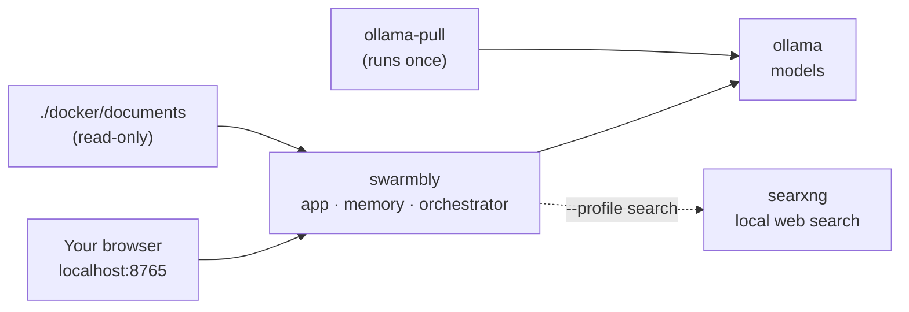
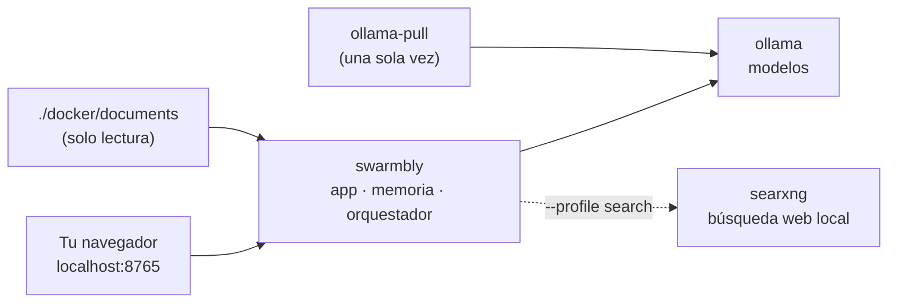

# Swarmbly AI with Docker · Swarmbly AI con Docker

**Language / Idioma:** [English](#english) · [Español](#español)

---

## English

Docker is the fastest way to **try** Swarmbly without installing Python: one command starts the app, a local model server (Ollama) and, if you want, local web search (SearXNG). For everyday use on your own computer, the [native installer](INSTALL.md) is still the recommended path: it adds desktop shortcuts, uses the GPU on a Mac and joins the LAN swarm without extra steps.

### What runs



| Service | Image | What it does |
|---|---|---|
| `swarmbly` | `ghcr.io/sebastardito/swarmbly` (or built from this repository) | The app: chat, memory over your documents (LCE C1), orchestrator, peer-to-peer node |
| `ollama` | `ollama/ollama` | Runs the models; they are stored in a Docker volume |
| `ollama-pull` | `ollama/ollama` | Downloads the chat model and `nomic-embed-text` once, then exits |
| `searxng` (optional) | `searxng/searxng` | Local web search, started only with `--profile search` |

### Start

Requirements: Docker Desktop (macOS, Windows) or Docker Engine with Compose v2 (Linux); about 12 GB of disk (the Ollama image alone takes several GB, the default model about 2 GB) and 8 GB of RAM.

```bash
git clone https://github.com/Sebastardito/SwarmblyAI.git
cd SwarmblyAI
docker compose up -d                    # app + Ollama + first models
# or, with local web search:
docker compose --profile search up -d
```

Open **http://localhost:8765**. The first start downloads the models (a few minutes). Follow it with `docker compose logs -f ollama-pull`.

`docker compose up` builds the image from this repository if it is not on your computer. To use the published image instead: `docker compose pull` first.

### Your documents

Put files in `docker/documents/` (text, Markdown, Word, HTML, PDF), or point to any folder:

```bash
SWARMBLY_DOCUMENTS=~/Documents/MyNotes docker compose up -d
```

The folder is mounted **read-only**, read in place and never sent anywhere. On the first start the app adds it as a source and turns on local memory (C1).

### Settings

Set them in the shell or in a `.env` file next to `compose.yaml`.

| Variable | Default | Meaning |
|---|---|---|
| `SWARMBLY_MODEL` | `qwen2.5:3b` | Chat model downloaded and selected on the first start. `qwen2.5:1.5b` for 4–8 GB of RAM; `qwen2.5:7b` for 16 GB or more |
| `SWARMBLY_DOCUMENTS` | `./docker/documents` | Folder read as your sources |
| `SWARMBLY_PORT` | `8765` | Port of the interface on this computer |
| `SWARMBLY_IMAGE` | `ghcr.io/sebastardito/swarmbly:edge` | Image to run. `edge` follows `main`; from the next tagged release, `latest` is the last release. Also on Docker Hub as `sebastardito/swarmbly` |
| `SWARMBLY_OLLAMA_URL` | `auto` | `auto` uses the bundled Ollama if it runs, otherwise the one on this computer; or any address, e.g. `http://192.168.1.20:11434` |

Only the server addresses are reapplied on every start; everything else you change in the interface is kept in the `swarmbly-data` volume.

### If you already run Ollama

You do not need the bundled Ollama (its image takes several GB). Use the one you already have, on this computer or on another one; only the Swarmbly image is downloaded (about 110 MB compressed).

```bash
docker compose -f compose.yaml -f docker/compose.external-ollama.yaml up -d
# Ollama on another computer:
SWARMBLY_OLLAMA_URL=http://192.168.1.20:11434 docker compose -f compose.yaml -f docker/compose.external-ollama.yaml up -d
```

Without Compose, one command is enough:

```bash
docker run -d --name swarmbly -p 127.0.0.1:8765:8765 \
  --add-host host.docker.internal:host-gateway \
  -v swarmbly-data:/data -v "$PWD/docker/documents:/documents:ro" \
  ghcr.io/sebastardito/swarmbly:edge
```

| Where Ollama runs | What to check |
|---|---|
| This Mac or Windows PC (Ollama app) | Nothing: Docker Desktop reaches it at `host.docker.internal:11434` |
| This Linux computer | Ollama listens on 127.0.0.1 by default, which containers cannot reach. Either start it with `OLLAMA_HOST=0.0.0.0` (and keep port 11434 closed in the firewall), or use the LAN variant, which shares the host's network |
| Another computer | Start Ollama there with `OLLAMA_HOST=0.0.0.0` and set `SWARMBLY_OLLAMA_URL` to its address |

Pull the models where Ollama runs (`ollama pull qwen2.5:3b` and `ollama pull nomic-embed-text`), or download them later from Settings → Models. At start, `docker compose logs swarmbly` says whether Ollama answers and which models are missing.

### Optional variants

| Need | Command |
|---|---|
| NVIDIA GPU (Linux, or Windows with WSL2) | `docker compose -f compose.yaml -f docker/compose.gpu.yaml up -d` |
| Join a LAN swarm (Linux host) | `docker compose -f compose.yaml -f docker/compose.lan.yaml up -d` |

**LAN swarms and Docker.** Discovery uses mDNS, which does not cross Docker's default network. The LAN variant puts the app on the host's network (Linux only; Docker Desktop on macOS and Windows does not offer this by default), keeps the interface on 127.0.0.1 and opens the peer-to-peer port 9765. It has not been tested yet on a real LAN with other computers; please report what you find.

### Everyday commands

| Task | Command |
|---|---|
| Status of the services | `docker compose ps` |
| App log | `docker compose logs -f swarmbly` |
| App status from inside | `docker compose exec swarmbly swarmbly-entrypoint status` |
| Another model | `docker compose exec ollama ollama pull qwen2.5:7b`, then choose it in Settings → Models |
| Update | `git pull && docker compose pull && docker compose up -d` (or `--build` to build from source) |
| Stop | `docker compose down` (your data and models stay in volumes) |
| Remove everything, data included | `docker compose down -v` |

### Privacy and limits

- The interface is published on **127.0.0.1 only**; inside the container it listens on all interfaces so Docker can reach it, which is why the log shows a warning about a non-loopback address. The session token and the host and origin checks still apply.
- Without the LAN variant, the container cannot see other Swarmbly computers: it is a single-computer installation.
- On macOS, Ollama inside Docker runs on the CPU (Docker cannot use the Mac's GPU); the native installer is faster there.
- The image contains the full source of the three components, as the AGPL asks for software offered over a network ([`NOTICE`](../NOTICE)).

### Building and publishing (maintainers)

The workflow [`.github/workflows/docker.yml`](../.github/workflows/docker.yml) builds the image and checks its health on every pull request. On a push to `main` it publishes `edge`, and on a tag `vX.Y.Z` it publishes `X.Y.Z`, `X.Y` and `latest` for `linux/amd64` and `linux/arm64`:

- to `ghcr.io/sebastardito/swarmbly`, with the repository's own token. The package is public, like the repository.
- to `docker.io/sebastardito/swarmbly`, when the repository has the secrets `DOCKERHUB_USERNAME` and `DOCKERHUB_TOKEN`:
  1. Docker Hub → avatar → Account settings → Personal access tokens → Generate new token. Description `github-actions-swarmbly`, expiration of your choice, access **Read & Write**. Copy the token (it is shown once).
  2. GitHub → the repository → Settings → Secrets and variables → Actions → New repository secret: `DOCKERHUB_USERNAME` = `sebastardito`, then `DOCKERHUB_TOKEN` = the token.
  3. Actions → docker → Run workflow (branch `main`). The first push creates the `sebastardito/swarmbly` repository on Docker Hub; add its description there, or create it beforehand under Repositories → Create repository.

---

## Español

Docker es la forma más rápida de **probar** Swarmbly sin instalar Python: un comando arranca la app, un servidor local de modelos (Ollama) y, si quieres, la búsqueda web local (SearXNG). Para el uso diario en tu propia computadora sigue siendo recomendable el [instalador nativo](INSTALL.md): añade accesos directos, usa la GPU en un Mac y se une al enjambre LAN sin pasos extra.

### Qué se ejecuta



| Servicio | Imagen | Qué hace |
|---|---|---|
| `swarmbly` | `ghcr.io/sebastardito/swarmbly` (o construida desde este repositorio) | La app: chat, memoria sobre tus documentos (LCE C1), orquestador, nodo P2P |
| `ollama` | `ollama/ollama` | Ejecuta los modelos; se guardan en un volumen de Docker |
| `ollama-pull` | `ollama/ollama` | Descarga una vez el modelo de chat y `nomic-embed-text`, y termina |
| `searxng` (opcional) | `searxng/searxng` | Búsqueda web local; solo arranca con `--profile search` |

### Arrancar

Requisitos: Docker Desktop (macOS, Windows) o Docker Engine con Compose v2 (Linux); unos 12 GB de disco (la imagen de Ollama ocupa varios GB y el modelo por defecto unos 2 GB) y 8 GB de RAM.

```bash
git clone https://github.com/Sebastardito/SwarmblyAI.git
cd SwarmblyAI
docker compose up -d                    # app + Ollama + primeros modelos
# o, con búsqueda web local:
docker compose --profile search up -d
```

Abre **http://localhost:8765**. El primer arranque descarga los modelos (unos minutos); puedes seguirlo con `docker compose logs -f ollama-pull`.

`docker compose up` construye la imagen desde este repositorio si no está en tu computadora. Para usar la imagen publicada: primero `docker compose pull`.

### Tus documentos

Pon archivos en `docker/documents/` (texto, Markdown, Word, HTML, PDF) o indica cualquier carpeta:

```bash
SWARMBLY_DOCUMENTS=~/Documents/MisNotas docker compose up -d
```

La carpeta se monta **en solo lectura**, se lee en su sitio y nunca se envía a ningún lado. En el primer arranque la app la añade como fuente y activa la memoria local (C1).

### Ajustes

Se definen en la terminal o en un archivo `.env` junto a `compose.yaml`.

| Variable | Por defecto | Significado |
|---|---|---|
| `SWARMBLY_MODEL` | `qwen2.5:3b` | Modelo de chat que se descarga y se elige en el primer arranque. `qwen2.5:1.5b` para 4–8 GB de RAM; `qwen2.5:7b` para 16 GB o más |
| `SWARMBLY_DOCUMENTS` | `./docker/documents` | Carpeta que se lee como tus fuentes |
| `SWARMBLY_PORT` | `8765` | Puerto de la interfaz en esta computadora |
| `SWARMBLY_IMAGE` | `ghcr.io/sebastardito/swarmbly:edge` | Imagen que se ejecuta. `edge` sigue a `main`; desde la próxima versión etiquetada, `latest` es la última versión. También en Docker Hub como `sebastardito/swarmbly` |
| `SWARMBLY_OLLAMA_URL` | `auto` | `auto` usa el Ollama incluido si está en marcha y, si no, el de esta computadora; o cualquier dirección, p. ej. `http://192.168.1.20:11434` |

En cada arranque solo se vuelven a aplicar las direcciones de los servidores; lo demás que cambies en la interfaz se conserva en el volumen `swarmbly-data`.

### Si ya tienes Ollama

No necesitas el Ollama incluido (su imagen ocupa varios GB). Usa el que ya tienes, en esta computadora o en otra; solo se descarga la imagen de Swarmbly (unos 110 MB comprimidos).

```bash
docker compose -f compose.yaml -f docker/compose.external-ollama.yaml up -d
# Ollama en otra computadora:
SWARMBLY_OLLAMA_URL=http://192.168.1.20:11434 docker compose -f compose.yaml -f docker/compose.external-ollama.yaml up -d
```

Sin Compose basta un comando:

```bash
docker run -d --name swarmbly -p 127.0.0.1:8765:8765 \
  --add-host host.docker.internal:host-gateway \
  -v swarmbly-data:/data -v "$PWD/docker/documents:/documents:ro" \
  ghcr.io/sebastardito/swarmbly:edge
```

| Dónde corre Ollama | Qué revisar |
|---|---|
| Este Mac o PC con Windows (app de Ollama) | Nada: Docker Desktop lo alcanza en `host.docker.internal:11434` |
| Esta computadora con Linux | Ollama escucha por defecto en 127.0.0.1, que los contenedores no alcanzan. Arráncalo con `OLLAMA_HOST=0.0.0.0` (y mantén el puerto 11434 cerrado en el cortafuegos), o usa la variante LAN, que comparte la red del anfitrión |
| Otra computadora | Arranca allí Ollama con `OLLAMA_HOST=0.0.0.0` y pon su dirección en `SWARMBLY_OLLAMA_URL` |

Descarga los modelos donde corre Ollama (`ollama pull qwen2.5:3b` y `ollama pull nomic-embed-text`), o después desde Ajustes → Modelos. Al arrancar, `docker compose logs swarmbly` dice si Ollama responde y qué modelos faltan.

### Variantes opcionales

| Necesidad | Comando |
|---|---|
| GPU NVIDIA (Linux, o Windows con WSL2) | `docker compose -f compose.yaml -f docker/compose.gpu.yaml up -d` |
| Unirse a un enjambre LAN (anfitrión Linux) | `docker compose -f compose.yaml -f docker/compose.lan.yaml up -d` |

**Enjambres LAN y Docker.** El descubrimiento usa mDNS, que no atraviesa la red por defecto de Docker. La variante LAN pone la app en la red del anfitrión (solo Linux; Docker Desktop en macOS y Windows no lo ofrece por defecto), mantiene la interfaz en 127.0.0.1 y abre el puerto P2P 9765. Aún no se ha probado en una LAN real con otras computadoras; cuéntanos qué encuentras.

### Comandos de uso diario

| Tarea | Comando |
|---|---|
| Estado de los servicios | `docker compose ps` |
| Registro de la app | `docker compose logs -f swarmbly` |
| Estado de la app desde dentro | `docker compose exec swarmbly swarmbly-entrypoint status` |
| Otro modelo | `docker compose exec ollama ollama pull qwen2.5:7b`, y elígelo en Ajustes → Modelos |
| Actualizar | `git pull && docker compose pull && docker compose up -d` (o `--build` para construir desde el código) |
| Detener | `docker compose down` (tus datos y modelos quedan en volúmenes) |
| Borrar todo, datos incluidos | `docker compose down -v` |

### Privacidad y límites

- La interfaz se publica **solo en 127.0.0.1**. Dentro del contenedor escucha en todas las interfaces para que Docker llegue a ella, y por eso el registro muestra un aviso sobre una dirección que no es de bucle local. El token de sesión y las comprobaciones de host y origen siguen activos.
- Sin la variante LAN, el contenedor no ve otras computadoras con Swarmbly: es una instalación de una sola computadora.
- En macOS, Ollama dentro de Docker usa la CPU (Docker no puede usar la GPU del Mac); ahí el instalador nativo es más rápido.
- La imagen contiene el código completo de los tres componentes, como pide la AGPL para el software ofrecido en red ([`NOTICE`](../NOTICE)).

### Construir y publicar (mantenimiento)

El flujo [`.github/workflows/docker.yml`](../.github/workflows/docker.yml) construye la imagen y comprueba su salud en cada pull request. Con un push a `main` publica `edge`, y con una etiqueta `vX.Y.Z` publica `X.Y.Z`, `X.Y` y `latest` para `linux/amd64` y `linux/arm64`:

- en `ghcr.io/sebastardito/swarmbly`, con el token propio del repositorio. El paquete es público, como el repositorio.
- en `docker.io/sebastardito/swarmbly`, cuando el repositorio tiene los secretos `DOCKERHUB_USERNAME` y `DOCKERHUB_TOKEN`:
  1. Docker Hub → avatar → Account settings → Personal access tokens → Generate new token. Descripción `github-actions-swarmbly`, la caducidad que prefieras, acceso **Read & Write**. Copia el token (se muestra una sola vez).
  2. GitHub → el repositorio → Settings → Secrets and variables → Actions → New repository secret: `DOCKERHUB_USERNAME` = `sebastardito` y después `DOCKERHUB_TOKEN` = el token.
  3. Actions → docker → Run workflow (rama `main`). El primer push crea el repositorio `sebastardito/swarmbly` en Docker Hub; añade allí su descripción, o créalo antes en Repositories → Create repository.
