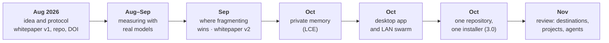
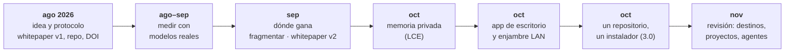

# Roadmap · Hoja de ruta

**Language / Idioma:** [English](#english) · [Español](#español)

> The exit criteria below are **targets**, written before measuring so that the goalposts do not move; they carry no dates. Results that miss a target are published as they are.
>
> Los criterios de salida son **objetivos**, escritos antes de medir para que la meta no se mueva; no llevan fechas. Los resultados que no alcancen un objetivo se publican tal cual.

---

## English

### Contents

1. [From the idea to today](#from-the-idea-to-today)
2. [Where the project stands](#where-the-project-stands)
3. [The road to a public network with volunteers](#the-road-to-a-public-network-with-volunteers)
4. [Volunteer programme](#volunteer-programme)
5. [Tracks that run alongside](#tracks-that-run-alongside)
6. [Decisions behind this roadmap](#decisions-behind-this-roadmap)

### From the idea to today

| Stage | When | What was built | What was learned |
|---|---|---|---|
| **1 · Idea and protocol** | August 2026 | The question was whether AI could run on hardware shared by its users, like a torrent. Existing systems (Petals) split the **model**, so every token crosses the network and the slowest node sets the pace. The answer proposed here splits the **problem**, borrowing the vocabulary of genome shotgun assembly (reads, overlaps, contigs, consensus). The project began as GenoNet AI and was renamed Swarmbly. First outputs: whitepaper v1 and specification v0.2, reference implementation, measurement harness (V0), public repository (15 August), and Zenodo DOIs for the software ([10.5281/zenodo.21956743](https://doi.org/10.5281/zenodo.21956743)) and the whitepaper ([10.5281/zenodo.21957088](https://doi.org/10.5281/zenodo.21957088)) | Defensive publication: the design is dated, public and enabling. Mock runs validate the instrument, not the idea |
| **2 · Measuring with real models** | 23 August – 5 September | Campaigns with several model families, pre-registrations, and incident and post-mortem reports, published even when they went against the design | Agreement between replicas does **not** predict correctness (AUC 0.507): the confidence map was withdrawn. Distributed composition lost to a single model. The coherence-tax criterion was not met |
| **3 · Where fragmenting wins** | 21–29 September | L curve (fragment size as the variable), matched-budget campaign (473 runs), whitepaper v2 ([10.5281/zenodo.23031305](https://doi.org/10.5281/zenodo.23031305)), release v2 | **Extract with small models, aggregate with code: +46.9 points** over the model alone. This is the strongest result, and it points the design at search, extraction and verification rather than at writing |
| **4 · Private memory (LCE)** | 4–10 October | Local Cognitive Extension: whitepaper and specification 0.1 ([10.5281/zenodo.23150478](https://doi.org/10.5281/zenodo.23150478)), pre-registered runs, v0.1.0 and v0.1.1 | Local memory helps (+0.500 [0.420, 0.578]). The anchored wiki **loses** to plain retrieval over the user's documents (−0.146), so it became a governance layer. Errors are correlated across model families |
| **5 · App and LAN swarm** | 11–25 October | SwarmblyApp: local chat, real peer-to-peer over the LAN (TLS 1.3, Ed25519, mDNS), validated with 2 to 5 machines. v0.2.0 ([10.5281/zenodo.23322639](https://doi.org/10.5281/zenodo.23322639)) added guided setup. Later work added the item vote and the composition planner, public evidence (Wikidata, Wikipedia, PubMed, SearXNG), local memory in the chat, hybrid retrieval, and a heterogeneous network of 4–5 machines with routing by capability and speed | Public evidence per item fixes what small models do not know (IUCN status 8/8 against about 1/8). The network survives losing its largest node. An open test showed that a personal request could leave the device and be written without data: personal requests now stay local |
| **6 · One repository, one installer** | 25–28 October | Swarmbly AI 3.0.0 ([10.5281/zenodo.23650763](https://doi.org/10.5281/zenodo.23650763)): SwarmblyCore, SwarmblyLCE and SwarmblyApp in one distribution, an interactive installer for three systems and documentation for the whole project | Measurements so far come from one person's material; a held-out benchmark is required before calling any change general |
| **7 · Review of the next ideas** | 4 November | A review of the code and of the proposals for agents, a fuller app, projects, tools and templates. The decisions are listed [at the end](#decisions-behind-this-roadmap) | A configured third-party API received private passages on the "local" path. Controlling where each piece of data goes comes before any new feature. A Docker distribution was added so more people can try the app |
| **8 · Destinations and a sealed benchmark** | 5–7 November | Swarmbly AI 3.0.1 ([notes](releases/v3.0.1.md)): an outbound policy before every call, a privacy receipt with every answer, API keys in the keychain, a Docker image. Two sealed banks written by the maintainer, run blind by a harness and scored by an isolated judge (κ = 0.885 against a blind human review) | Nothing forbidden left in 17/17 personal-data cases; the app's receipt matched the network in 23/24; composition is still weak (0/7 pass), which sets 3.2's priority |
| **9 · Projects** | 7–9 November | Swarmbly AI 3.1.0 ([10.5281/zenodo.24070646](https://doi.org/10.5281/zenodo.24070646), [notes](releases/v3.1.0.md)): projects, citations to the paragraph, memory with the user's yes, approved online search with terms reviewed as concepts, consent per question, sentences without a source marked. Daily hands-on tests by the maintainer and automated rounds on his computer; two measurements on the sealed banks, the first diagnosed on an open fictitious battery | Nothing forbidden left in 24/24 cases and the receipt matched the network in 24/24; citation-backed claims rose; no composition passes yet (3.2). Pending exit criterion: 3–5 non-technical people understand the receipt |
| **10 · Grounded composition** | 14–15 November | Swarmbly AI 3.2.0 ([10.5281/zenodo.24265876](https://doi.org/10.5281/zenodo.24265876), [notes](releases/v3.2.0.md)): labels attached by code, the facts a composition leaves out shown and closed, sources that disagree shown, documents named by file, an optional composer model by role; Ollama cloud models treated as third parties and instructions inside documents never followed. An open fictitious battery measured every step; what did not help with a 7B model stays off | Claims in compositions backed by a citation roughly doubled in both sealed banks, no regression in S2, nothing forbidden left; no composition passes its rubric yet (3.3) |
| **11 · Roles and recipes** | 16–17 November | Swarmbly AI 3.3.0 ([10.5281/zenodo.24330451](https://doi.org/10.5281/zenodo.24330451), [notes](releases/v3.3.0.md)): models by role; a "What do you want to do?" screen with three recipes run as flows in code (ask your documents, a table built by code, research with public sources and an approved query); a claim verifier; glossaries in more formats (LCE 0.2.1). Two new sealed banks (v3.1, v3.2) and a second open battery from their failure patterns | No passage or personal name sent, but a private site name left once in a query approved as proposed (fixed); tables by code and compositions still fail on the banks' own material; confirmation runs on the same banks are not blind |

### Where the project stands

| Works, measured | Not yet, or refuted |
|---|---|
| Privacy lanes; personal requests stay local; evidence sent by name only; where each call goes is enforced, with a privacy receipt per answer (3.0.1); projects, consent per question, memory with the user's yes (3.1); models by role, queries approved before anything leaves (3.3) | A private name kept out of proposed queries, to confirm on a new bank (3.3); the receipt tried with non-technical people (postponed) |
| LAN swarm: authentication, hedging, local fallback, learned speed | Internet swarms; no tools (MCP) or skills |
| Batches with evidence; extraction with aggregation by code | Distributed long-form writing; coherence-tax criterion |
| Local memory over text, Word, HTML and PDF; grounded composition, first steps: labels by code, omitted facts shown, gaps closed, sources that disagree shown (3.2, open battery); recipes, tables built by code, comparisons by code, a claim verifier (3.3, open batteries) | Compositions that pass the banks' rubric; tables from free prose; calculations over a table (recipe 5, 3.4) |
| Installer for three systems; Docker image; sealed benchmark banks, run once per version | Testers outside the project; a second model on the banks |

### The road to a public network with volunteers

Each version can be shown working on its own. Volunteers join in growing circles: first people the maintainer knows, then invited circles, then the public.

```mermaid
flowchart LR
  V1["<b>3.0.1</b><br/>destinations<br/>+ Docker"] --> V2["<b>3.1</b><br/>projects and<br/>privacy receipt"]
  V2 --> V3["<b>3.2</b><br/>grounded composition<br/>and safety"]
  V3 --> V3b["<b>3.3</b><br/>roles<br/>and recipes"]
  V3b --> V4["<b>3.4</b><br/>tools: MCP, skills<br/>and data with code"]
  V4 --> V5["<b>3.5</b><br/>teams and trusted<br/>circles · private beta"]
  V5 --> V6["<b>3.6</b><br/>public network<br/>· public beta"]
  V6 --> V7["<b>4.0</b><br/>protocol 1.0<br/>· public release"]
  V7 -.-> V8["<b>later</b><br/>agent hierarchy,<br/>LCE C3–C4"]
  style V5 fill:#2a78d622,stroke:#2a78d6
  style V6 fill:#2a78d622,stroke:#2a78d6
```

| Version | Content | Exit criteria (targets) |
|---|---|---|
| **3.0.1 — Destinations** | <ul><li>Every model provider is labelled local, my network or third party, checked from its address.</li><li>An outbound policy runs before every call: answer, query expansion, embeddings, assembly, worker, retries and fallback.</li><li>A node never serves the swarm through a third-party API.</li><li>Answers record where they were actually computed.</li><li>API keys move to the system keychain.</li><li>Docker distribution.</li></ul> | A synthetic leak test fails if any path sends private passages, or other nodes' fragments, to an unauthorised destination |
| **3.1 — Projects** | <ul><li>Projects with their own folder (default `Documents/Swarmbly/<Project>`, with a warning for cloud-synced folders).</li><li>Project memory kept apart from personal memory.</li><li>Chats saved in the folder.</li><li>Export and restore as a `.swarmbly` package with hashes and without secrets.</li><li>A **privacy receipt** for each answer: what left, for whom, why.</li><li>C1 moved into SwarmblyLCE.</li></ul> | <ul><li>Two projects stay isolated.</li><li>A restore on another computer and system keeps chats, sources and citations.</li><li>3–5 non-technical people understand the receipt</li></ul> |
| **3.2 — Grounded composition and safety** | <ul><li>An open development battery (fictitious, 30 cases), separate from the sealed banks: compositions, follow-ups, contradictions, consent, privacy of public lookups and prompt injection.</li><li>Labels attached by code where a sentence's figures are in a passage; the facts of the sources that a composition leaves out, shown under it; those gaps closed with one short paragraph.</li><li>Sources that disagree shown side by side; documents named by their file found first; questions outside the documents answered as such.</li><li>An optional larger **composer model by role**, which also writes the search terms of a composition.</li><li>Ollama cloud models treated as third parties; instructions inside a document marked and never followed.</li><li>Every step measured on the open battery; what did not help (a requirement list for the model, self-repair, lexical scaffolding) stays off.</li></ul> | <ul><li>The sealed banks, run once against 3.1: more supported claims in compositions, no regression in S2.</li><li>Zero unauthorised sends, with leak tests for cloud models and injected instructions.</li><li>The open battery and each step's result published</li></ul> |
| **3.3 — Roles and recipes** | <ul><li>A registry of **roles** (writer, search terms, verifier, embeddings) over several providers (local, OpenAI-compatible, Anthropic), with bounded reasoning per role. A third party stays an explicit choice per project and per role.</li><li>Four reference recipes, run as flows in code behind a "What do you want to do?" entry: *ask your documents*, *compare documents into a table* (fact sheet and table built by code), *research with public sources* (claim verifier), *process a list on the swarm*.</li><li>The agent runtime is born in SwarmblyCore.</li><li>A new sealed bank (v3) written by the maintainer, on a new person and domain, with tasks for recipes 2 and 3.</li></ul> | <ul><li>The same recipes run with a local model and with a simulated API.</li><li>Recipes 2 and 3 measured on bank v3 (claim precision, coverage).</li><li>3–5 non-technical people understand the receipt and the notices (carried over from 3.1).</li><li>Zero unauthorised sends</li></ul> |
| **3.4 — Tools** | <ul><li>Carried over from 3.3: the Anthropic provider and an embeddings role; recipe 4, *process a list on the swarm*; the agent runtime in SwarmblyCore.</li><li>One tool broker.</li><li>MCP client: local servers approved one by one; remote ones shown as third parties.</li><li>Skills in the open Agent Skills format (`SKILL.md`), instructions only at first.</li><li>Importing never runs anything.</li><li>Author search with consent (ORCID, OpenAlex, PubMed).</li><li>**Recipe 5, data with code:** the model writes a short script for the user's table or file (a CSV, a spreadsheet, the tables of their documents), the user sees it and approves it, and it runs in an isolated sandbox (no network, limited time, memory and files, the user's data read-only); the answer gives the result with the script and its output. Checks per row or per function can be shared on the swarm.</li><li>An open battery with automatic checks (the expected result of each task, computed beforehand), as for recipes 2 and 3.</li></ul> | <ul><li>Effective permissions equal the declared ones.</li><li>A page containing instructions cannot widen them.</li><li>Recipe 5: nothing runs without the user's yes; a script cannot reach the network or write outside its folder (tested); results checked against the expected ones on the open battery</li></ul> |
| **3.5 — Teams and trusted circles · private beta** | <ul><li>Nodes announce roles: search, large model, reasoner, corpus.</li><li>The same team runs on one node or several.</li><li>**Trusted circles:** small swarms joined by invitation (code or QR) that also work beyond the LAN, through direct addresses or an overlay network.</li><li>Non-transferable reciprocity credits.</li><li>Signed installers.</li><li>**20–50 volunteers** in 3–5 circles.</li></ul> | <ul><li>Team versus equivalent local run measured.</li><li>Losing a node leaves honest partial results.</li><li>≥ 90 % successful installs.</li><li>No severe bug open for two weeks</li></ul> |
| **3.6 — Public network · public beta** | <ul><li>Rendezvous and relay; NAT traversal.</li><li>Reputation, rate limits and abuse protection.</li><li>Protocol 1.0-rc with conformance tests.</li><li>LCE specification 0.3.</li><li>External privacy review.</li><li>Automatic updates.</li><li>Open registration of volunteers.</li></ul> | <ul><li>No critical finding.</li><li>A third-party node passes conformance.</li><li>Leak test and held-out sets without regression on the public network</li></ul> |
| **4.0 — Protocol 1.0 · public release** | <ul><li>Protocol frozen, with capability negotiation, delegation and third-party destinations decided.</li><li>Versioning policy.</li><li>Governance in place (Swiss Verein).</li></ul> | Public-beta criteria held for two releases |
| **Later** | <ul><li>**SwarmblyAgents hierarchy:** one level of delegation, kept only if a held-out experiment shows it beats the flat team.</li><li>LCE C3–C4.</li><li>Further incentives for sharing.</li></ul> | Each starts with a design document and a pre-registered experiment |

**Out of scope for now:**

- sharing API keys through the swarm;
- running scripts from skills, or starting MCP servers automatically (the only code that runs is recipe 5's, in its sandbox and with the user's yes);
- delegation deeper than one level;
- calling a recipe "optimised" without a measurement;
- a transferable token (see [`GOVERNANCE.md`](../GOVERNANCE.md)).

### Volunteer programme

| Phase | Who | What volunteers do | What they get |
|---|---|---|---|
| Alpha (3.1–3.4) | People the maintainer knows, 5–10 | Install (native or Docker), use the recipes, send local reports voluntarily | Early access; their findings shape the next version |
| Private beta (3.5) | 3–5 invited circles, 20–50 people | Share their computers within their circle; try teams and batches | A swarm of their own; reciprocity credits |
| Public beta (3.6) | Anyone | Run a node on the public network, report problems | Free access to community computing |

Telemetry is never collected. Reports are files the user chooses to send. Feedback goes through GitHub issues and the private security channel ([`SECURITY.md`](../SECURITY.md)).

### Tracks that run alongside

| Track | Content |
|---|---|
| Evaluation | Benchmark v2: development and held-out sets, a second fictitious person, open composition with a rubric, network batches in new domains. Held-out sets run once per release |
| Research | Pre-registered experiments: reasoning by role; single agent → flat team → specialised models → distributed → hierarchy |
| Documentation and community | Bilingual guides, a guide for volunteers, a contributing guide, a short paper of honest results |
| Governance and funding | Swiss Verein, then Stiftung; sustainability grants; [Buy Me a Coffee](https://buymeacoffee.com/swarmbly). Support never buys influence |

### Decisions behind this roadmap

Taken on 4 November 2026 (1–5), 15 November 2026 (6) and 17 November 2026 (7):

1. **Local by default.** A third-party API is an explicit choice per project and per role, with a receipt.
2. **No sharing of API keys in the swarm.** The swarm shares open models, within trusted circles first.
3. **Standard formats:** Agent Skills (`SKILL.md`) for skills, MCP for tools.
4. **Projects** go in `Documents/Swarmbly/<Project>`, with a warning for cloud-synced folders.
5. **Trusted circles come before the open internet network.**
6. **3.2 is published as grounded composition and safety**, measured on the open battery and the sealed banks; roles and recipes move to 3.3, and each later version moves one number.
7. **3.3 is closed with two criteria open:** the receipt test with people is postponed (it needs participants and a formal design, and it does not block development), and zero unauthorised sends is to be confirmed on a new sealed bank (the blind run found one case, fixed afterwards). What 3.3 did not reach (the Anthropic provider, recipe 4, the agent runtime) moves to 3.4.

---

## Español

### Contenido

1. [De la idea a hoy](#de-la-idea-a-hoy)
2. [Dónde está el proyecto](#dónde-está-el-proyecto)
3. [El camino a una red pública con voluntarios](#el-camino-a-una-red-pública-con-voluntarios)
4. [Programa de voluntarios](#programa-de-voluntarios)
5. [Líneas de trabajo paralelas](#líneas-de-trabajo-paralelas)
6. [Decisiones detrás de esta hoja de ruta](#decisiones-detrás-de-esta-hoja-de-ruta)

### De la idea a hoy

| Etapa | Cuándo | Qué se construyó | Qué se aprendió |
|---|---|---|---|
| **1 · Idea y protocolo** | Agosto de 2026 | La pregunta era si la IA podía correr en hardware compartido por sus usuarios, como un torrent. Los sistemas existentes (Petals) reparten **el modelo**, así que cada token cruza la red y el nodo más lento marca el ritmo. La respuesta que se propone aquí reparte **el problema**, con el vocabulario del ensamblaje genómico por shotgun (lecturas, solapamientos, contigs, consenso). El proyecto nació como GenoNet AI y pasó a llamarse Swarmbly. Primeros productos: whitepaper v1 y especificación v0.2, implementación de referencia, banco de medición (V0), repositorio público (15 de agosto) y DOI en Zenodo para el software ([10.5281/zenodo.21956743](https://doi.org/10.5281/zenodo.21956743)) y el whitepaper ([10.5281/zenodo.21957088](https://doi.org/10.5281/zenodo.21957088)) | Publicación defensiva: el diseño queda fechado, público y habilitante. Las corridas simuladas validan el instrumento, no la idea |
| **2 · Medir con modelos reales** | 23 de agosto – 5 de septiembre | Campañas con varias familias de modelos, preregistros, e informes de incidentes y posmortem, publicados aunque fueran en contra del diseño | El acuerdo entre réplicas **no** predice el acierto (AUC 0,507): se retiró el mapa de confianza. La composición distribuida perdió frente a un modelo solo. No se cumplió el criterio del impuesto de coherencia |
| **3 · Dónde gana fragmentar** | 21–29 de septiembre | Curva L (el tamaño del fragmento como variable), campaña con presupuesto igualado (473 corridas), whitepaper v2 ([10.5281/zenodo.23031305](https://doi.org/10.5281/zenodo.23031305)), versión v2 | **Extraer con modelos pequeños y agregar con código: +46,9 puntos** sobre el modelo solo. Es el resultado más sólido, y orienta el diseño hacia la búsqueda, la extracción y la verificación, no hacia la redacción |
| **4 · Memoria privada (LCE)** | 4–10 de octubre | Extensión Cognitiva Local: whitepaper y especificación 0.1 ([10.5281/zenodo.23150478](https://doi.org/10.5281/zenodo.23150478)), corridas preregistradas, v0.1.0 y v0.1.1 | La memoria local ayuda (+0,500 [0,420; 0,578]). La wiki anclada **pierde** frente a la recuperación simple sobre los documentos del usuario (−0,146), así que pasó a ser capa de gobierno. Los errores se correlacionan entre familias de modelos |
| **5 · App y enjambre LAN** | 11–25 de octubre | SwarmblyApp: chat local y P2P real en LAN (TLS 1.3, Ed25519, mDNS), validado con 2 a 5 máquinas. La v0.2.0 ([10.5281/zenodo.23322639](https://doi.org/10.5281/zenodo.23322639)) añadió la configuración guiada. Después llegaron el voto por ítem y el planificador de composición, la evidencia pública (Wikidata, Wikipedia, PubMed, SearXNG), la memoria local en el chat, la recuperación híbrida y una red heterogénea de 4–5 máquinas con enrutamiento por capacidad y velocidad | La evidencia por ítem corrige lo que los modelos pequeños no saben (estado UICN 8/8 frente a cerca de 1/8). La red sobrevive a la caída de su nodo mayor. Una prueba abierta mostró que una petición personal podía salir del equipo y redactarse sin datos: ahora lo personal se queda en local |
| **6 · Un repositorio, un instalador** | 25–28 de octubre | Swarmbly AI 3.0.0 ([10.5281/zenodo.23650763](https://doi.org/10.5281/zenodo.23650763)): SwarmblyCore, SwarmblyLCE y SwarmblyApp en una distribución, un instalador interactivo para tres sistemas y la documentación del conjunto | Lo medido procede del material de una sola persona; hace falta un banco reservado antes de llamar general a cualquier cambio |
| **7 · Revisión de las próximas ideas** | 4 de noviembre | Una revisión del código y de las propuestas de agentes, una app más completa, proyectos, herramientas y plantillas. Las decisiones están [al final](#decisiones-detrás-de-esta-hoja-de-ruta) | Una API de terceros configurada recibía pasajes privados en la ruta «local». Controlar adónde va cada dato es previo a cualquier funcionalidad nueva. Se añadió una distribución Docker para que más personas puedan probar la app |
| **8 · Destinos y un banco sellado** | 5–7 de noviembre | Swarmbly AI 3.0.1 ([notas](releases/v3.0.1.md#español)): una política de salida antes de cada llamada, un recibo de privacidad con cada respuesta, claves API en el llavero, una imagen Docker. Dos bancos sellados escritos por el mantenedor, corridos a ciegas por un arnés y puntuados por un juez aislado (κ = 0,885 frente a una revisión humana a ciegas) | No salió nada prohibido en 17/17 casos de datos personales; el recibo de la app coincidió con la red en 23/24; la composición sigue débil (0/7 superan), lo que fija la prioridad de 3.2 |
| **9 · Proyectos** | 7–9 de noviembre | Swarmbly AI 3.1.0 ([10.5281/zenodo.24070646](https://doi.org/10.5281/zenodo.24070646), [notas](releases/v3.1.0.md#español)): proyectos, citas al párrafo, memoria con el sí del usuario, búsqueda en línea aprobada con términos revisados como conceptos, consentimiento por pregunta, frases sin fuente marcadas. Pruebas diarias del mantenedor y rondas automáticas en su computadora; dos mediciones con los bancos sellados, la primera diagnosticada con una batería abierta ficticia | No salió nada prohibido en 24/24 casos y el recibo coincidió con la red en 24/24; subieron las afirmaciones respaldadas por citas; ninguna composición aprueba aún (3.2). Criterio de salida pendiente: que 3–5 personas no técnicas entiendan el recibo |
| **10 · Composición fundamentada** | 14–15 de noviembre | Swarmbly AI 3.2.0 ([10.5281/zenodo.24265876](https://doi.org/10.5281/zenodo.24265876), [notas](releases/v3.2.0.md#español)): etiquetas añadidas por código, datos omitidos a la vista y cerrados, fuentes que no coinciden a la vista, documentos nombrados por su archivo, un modelo redactor por papel opcional; los modelos en la nube de Ollama tratados como terceros y las instrucciones dentro de documentos nunca seguidas. Una batería abierta ficticia midió cada paso; lo que no ayudó con un modelo de 7B queda apagado | Las afirmaciones respaldadas por citas en las composiciones se duplican aproximadamente en los dos bancos sellados, sin regresión en S2 y sin nada prohibido; ninguna composición aprueba aún (3.3) |
| **11 · Papeles y recetas** | 16–17 de noviembre | Swarmbly AI 3.3.0 ([10.5281/zenodo.24330451](https://doi.org/10.5281/zenodo.24330451), [notas](releases/v3.3.0.md#español)): modelos por papel; una pantalla «¿Qué quieres hacer?» con tres recetas ejecutadas como flujos en código (preguntar a tus documentos, una tabla armada por código, investigar con fuentes públicas y una consulta aprobada); un verificador de afirmaciones; glosarios en más formatos (LCE 0.2.1). Dos bancos sellados nuevos (v3.1, v3.2) y una segunda batería abierta con sus patrones de fallo | Ningún pasaje ni nombre personal enviado, pero un nombre privado de un sitio salió una vez en una consulta aprobada tal como se propuso (corregido); las tablas por código y las composiciones siguen fallando con el material de los bancos; las corridas de confirmación sobre los mismos bancos no son ciegas |

### Dónde está el proyecto

| Funciona, medido | Todavía no, o refutado |
|---|---|
| Carriles de privacidad; lo personal se queda en local; evidencia enviada solo por nombre; se controla adónde va cada llamada, con un recibo de privacidad por respuesta (3.0.1); proyectos, consentimiento por pregunta, memoria con el sí del usuario (3.1); modelos por papel, consultas aprobadas antes de que salga nada (3.3) | Un nombre privado fuera de las consultas propuestas, por confirmar en un banco nuevo (3.3); el recibo probado con personas no técnicas (pospuesto) |
| Enjambre LAN: autenticación, coberturas, respaldo local, velocidad aprendida | Enjambres por internet; sin herramientas (MCP) ni habilidades |
| Lotes con evidencia; extracción con agregación por código | Redacción larga distribuida; criterio del impuesto de coherencia |
| Memoria local sobre texto, Word, HTML y PDF; composición fundamentada, primeros pasos: etiquetas por código, datos omitidos a la vista, huecos cerrados, fuentes que no coinciden a la vista (3.2, batería abierta); recetas, tablas armadas por código, comparaciones por código, un verificador de afirmaciones (3.3, baterías abiertas) | Composiciones que superan la rúbrica de los bancos; tablas a partir de prosa libre; cálculos sobre una tabla (receta 5, 3.4) |
| Instalador para tres sistemas; imagen Docker; bancos de preguntas sellados, una corrida por versión | Probadores ajenos al proyecto; un segundo modelo en los bancos |

### El camino a una red pública con voluntarios

Cada versión puede demostrarse funcionando por sí sola. Los voluntarios entran en círculos crecientes: primero personas que conoce el mantenedor, después círculos por invitación, después el público.

```mermaid
flowchart LR
  V1["<b>3.0.1</b><br/>destinos<br/>+ Docker"] --> V2["<b>3.1</b><br/>proyectos y<br/>recibo de privacidad"]
  V2 --> V3["<b>3.2</b><br/>composición fundamentada<br/>y seguridad"]
  V3 --> V3b["<b>3.3</b><br/>papeles<br/>y recetas"]
  V3b --> V4["<b>3.4</b><br/>herramientas: MCP, habilidades<br/>y datos con código"]
  V4 --> V5["<b>3.5</b><br/>equipos y círculos<br/>de confianza · beta privada"]
  V5 --> V6["<b>3.6</b><br/>red pública<br/>· beta pública"]
  V6 --> V7["<b>4.0</b><br/>protocolo 1.0<br/>· versión pública"]
  V7 -.-> V8["<b>después</b><br/>jerarquía de agentes,<br/>LCE C3–C4"]
  style V5 fill:#2a78d622,stroke:#2a78d6
  style V6 fill:#2a78d622,stroke:#2a78d6
```

| Versión | Contenido | Criterios de salida (objetivos) |
|---|---|---|
| **3.0.1 — Destinos** | <ul><li>Cada proveedor de modelos queda marcado como local, de mi red o de terceros, comprobado a partir de su dirección.</li><li>Una política de salida se aplica antes de cada llamada: respuesta, expansión de consultas, embeddings, ensamblaje, worker, reintentos y respaldo.</li><li>Un nodo nunca sirve al enjambre a través de una API de terceros.</li><li>Las respuestas registran dónde se calcularon de verdad.</li><li>Las claves API pasan al llavero del sistema.</li><li>Distribución Docker.</li></ul> | Una prueba de fuga sintética falla si algún camino envía pasajes privados, o fragmentos de otros nodos, a un destino no autorizado |
| **3.1 — Proyectos** | <ul><li>Proyectos con carpeta propia (por defecto `Documentos/Swarmbly/<Proyecto>`, con aviso si está sincronizada en la nube).</li><li>Memoria de proyecto separada de la memoria personal.</li><li>Chats guardados en la carpeta.</li><li>Exportar y restaurar como paquete `.swarmbly` con hashes y sin secretos.</li><li>**Recibo de privacidad** por respuesta: qué salió, para quién y por qué.</li><li>C1 movida a SwarmblyLCE.</li></ul> | <ul><li>Dos proyectos quedan aislados.</li><li>Una restauración en otra computadora y otro sistema conserva chats, fuentes y citas.</li><li>3–5 personas no técnicas entienden el recibo</li></ul> |
| **3.2 — Composición fundamentada y seguridad** | <ul><li>Una batería de desarrollo abierta (ficticia, 30 casos), separada de los bancos sellados: composiciones, seguimientos, contradicciones, consentimiento, privacidad de las consultas públicas e inyección de instrucciones.</li><li>Etiquetas añadidas por código donde las cifras de una frase están en un pasaje; los datos de las fuentes que una composición omite, mostrados debajo; esos huecos cerrados con un párrafo breve.</li><li>Las fuentes que no coinciden se muestran juntas; los documentos nombrados por su archivo se encuentran primero; las preguntas ajenas a los documentos se responden como tales.</li><li>Un **modelo redactor por papel**, opcional y más grande, que también escribe los términos de búsqueda de una composición.</li><li>Los modelos en la nube de Ollama se tratan como terceros; las instrucciones dentro de un documento se marcan y nunca se siguen.</li><li>Cada paso medido en la batería abierta; lo que no ayudó (una lista de requisitos para el modelo, la autorreparación, el andamiaje léxico) queda apagado.</li></ul> | <ul><li>Los bancos sellados, corridos una vez frente a 3.1: más afirmaciones respaldadas en las composiciones, sin regresión en S2.</li><li>Cero envíos no autorizados, con pruebas de fuga para modelos en la nube e instrucciones inyectadas.</li><li>La batería abierta y el resultado de cada paso, publicados</li></ul> |
| **3.3 — Papeles y recetas** | <ul><li>Un registro de **papeles** (redactor, términos de búsqueda, verificador, embeddings) sobre varios proveedores (locales, compatibles con OpenAI, Anthropic), con razonamiento acotado por papel. Un tercero sigue siendo una elección explícita por proyecto y por papel.</li><li>Cuatro recetas de referencia, ejecutadas como flujos en código tras una entrada «¿Qué quieres hacer?»: *pregunta a tus documentos*, *compara documentos en una tabla* (hoja de datos y tabla armada por código), *investiga con fuentes públicas* (verificador de afirmaciones), *procesa una lista en el enjambre*.</li><li>El runtime de agentes nace en SwarmblyCore.</li><li>Un banco sellado nuevo (v3) escrito por el mantenedor, sobre una persona y un dominio nuevos, con tareas para las recetas 2 y 3.</li></ul> | <ul><li>Las mismas recetas funcionan con un modelo local y con una API simulada.</li><li>Recetas 2 y 3 medidas en el banco v3 (precisión de afirmaciones, cobertura).</li><li>3–5 personas no técnicas entienden el recibo y los avisos (viene de 3.1).</li><li>Cero envíos no autorizados</li></ul> |
| **3.4 — Herramientas** | <ul><li>Viene de 3.3: el proveedor Anthropic y un papel de embeddings; la receta 4, *procesar una lista en el enjambre*; el runtime de agentes en SwarmblyCore.</li><li>Un único intermediario de herramientas.</li><li>Cliente MCP: servidores locales aprobados uno a uno; los remotos se muestran como terceros.</li><li>Habilidades en el formato abierto Agent Skills (`SKILL.md`), al principio solo instrucciones.</li><li>Importar nunca ejecuta nada.</li><li>Búsqueda de autor con consentimiento (ORCID, OpenAlex, PubMed).</li><li>**Receta 5, datos con código:** el modelo escribe un script corto para la tabla o el archivo del usuario (un CSV, una hoja de cálculo, las tablas de sus documentos), el usuario lo ve y lo aprueba, y se ejecuta en una caja aislada (sin red, con tiempo, memoria y archivos limitados, los datos del usuario solo de lectura); la respuesta da el resultado con el script y su salida. Las comprobaciones por fila o por función se pueden repartir en el enjambre.</li><li>Una batería abierta con comprobaciones automáticas (el resultado esperado de cada tarea, calculado de antemano), como en las recetas 2 y 3.</li></ul> | <ul><li>Los permisos efectivos son iguales a los declarados.</li><li>Una página con instrucciones no puede ampliarlos.</li><li>Receta 5: nada se ejecuta sin el sí del usuario; un script no puede salir a la red ni escribir fuera de su carpeta (probado); resultados comparados con los esperados en la batería abierta</li></ul> |
| **3.5 — Equipos y círculos de confianza · beta privada** | <ul><li>Los nodos anuncian papeles: búsqueda, modelo grande, razonador, corpus.</li><li>El mismo equipo funciona en uno o varios nodos.</li><li>**Círculos de confianza:** enjambres pequeños por invitación (código o QR) que funcionan también fuera de la LAN, con direcciones directas o una red superpuesta.</li><li>Créditos de reciprocidad no transferibles.</li><li>Instaladores firmados.</li><li>**20–50 voluntarios** en 3–5 círculos.</li></ul> | <ul><li>Equipo frente a ejecución local equivalente, medido.</li><li>La caída de un nodo deja resultados parciales honestos.</li><li>≥ 90 % de instalaciones exitosas.</li><li>Ningún error grave abierto durante dos semanas</li></ul> |
| **3.6 — Red pública · beta pública** | <ul><li>Encuentro y relevo de nodos; travesía de NAT.</li><li>Reputación, límites y protección contra abuso.</li><li>Protocolo 1.0-rc con pruebas de conformidad.</li><li>Especificación LCE 0.3.</li><li>Revisión externa de privacidad.</li><li>Actualizaciones automáticas.</li><li>Registro abierto de voluntarios.</li></ul> | <ul><li>Ningún hallazgo crítico.</li><li>Un nodo de terceros pasa la conformidad.</li><li>Prueba de fugas y conjuntos reservados sin regresión en la red pública</li></ul> |
| **4.0 — Protocolo 1.0 · versión pública** | <ul><li>Protocolo congelado, con negociación de capacidades, delegación y destinos de terceros decididos.</li><li>Política de versiones.</li><li>Gobernanza en marcha (Verein suiza).</li></ul> | Criterios de la beta pública sostenidos durante dos versiones |
| **Después** | <ul><li>**Jerarquía de SwarmblyAgents:** un nivel de delegación, que se conserva solo si un experimento con conjunto reservado muestra que supera al equipo plano.</li><li>LCE C3–C4.</li><li>Más incentivos para compartir.</li></ul> | Cada uno empieza con un documento de diseño y un experimento preregistrado |

**Fuera de alcance por ahora:**

- compartir claves API a través del enjambre;
- ejecutar scripts de habilidades o arrancar servidores MCP automáticamente (el único código que se ejecuta es el de la receta 5, en su caja aislada y con el sí del usuario);
- delegación de más de un nivel;
- llamar «optimizada» a una receta sin medición;
- un token transferible (ver [`GOVERNANCE.md`](../GOVERNANCE.md)).

### Programa de voluntarios

| Fase | Quiénes | Qué hacen los voluntarios | Qué reciben |
|---|---|---|---|
| Alfa (3.1–3.4) | Personas que conoce el mantenedor, 5–10 | Instalar (nativo o Docker), usar las recetas, enviar informes locales si quieren | Acceso temprano; sus hallazgos dan forma a la siguiente versión |
| Beta privada (3.5) | 3–5 círculos invitados, 20–50 personas | Compartir sus computadoras dentro de su círculo; probar equipos y lotes | Un enjambre propio; créditos de reciprocidad |
| Beta pública (3.6) | Cualquiera | Correr un nodo en la red pública, informar de problemas | Acceso libre al cómputo comunitario |

Nunca se recoge telemetría. Los informes son archivos que el usuario decide enviar. Las opiniones llegan por issues de GitHub y por el canal privado de seguridad ([`SECURITY.md`](../SECURITY.md)).

### Líneas de trabajo paralelas

| Línea | Contenido |
|---|---|
| Evaluación | Banco v2: conjuntos de desarrollo y reservados, una segunda persona ficticia, composición abierta con rúbrica, lotes de red en dominios nuevos. Los reservados se corren una vez por versión |
| Investigación | Experimentos preregistrados: razonamiento por papel; agente único → equipo plano → modelos especializados → distribuido → jerarquía |
| Documentación y comunidad | Guías bilingües, guía para voluntarios, guía para contribuir, un artículo corto de resultados honestos |
| Gobernanza y financiación | Verein suiza y después Stiftung; fondos de sostenibilidad; [Buy Me a Coffee](https://buymeacoffee.com/swarmbly). El apoyo nunca compra influencia |

### Decisiones detrás de esta hoja de ruta

Tomadas el 4 de noviembre de 2026 (1–5), el 15 de noviembre de 2026 (6) y el 17 de noviembre de 2026 (7):

1. **Local por defecto.** Una API de terceros es una elección explícita por proyecto y por papel, con recibo.
2. **No se comparten claves API en el enjambre.** El enjambre comparte modelos abiertos, primero dentro de círculos de confianza.
3. **Formatos estándar:** Agent Skills (`SKILL.md`) para habilidades y MCP para herramientas.
4. **Los proyectos** van en `Documentos/Swarmbly/<Proyecto>`, con aviso si la carpeta está sincronizada en la nube.
5. **Los círculos de confianza van antes que la red abierta por internet.**
6. **3.2 se publica como composición fundamentada y seguridad**, medida en la batería abierta y en los bancos sellados; papeles y recetas pasan a 3.3, y cada versión siguiente avanza un número.
7. **3.3 se cierra con dos criterios abiertos:** la prueba del recibo con personas queda pospuesta (necesita participantes y un diseño formal, y no bloquea el desarrollo), y cero envíos no autorizados queda por confirmar en un banco sellado nuevo (la corrida ciega encontró un caso, corregido después). Lo que 3.3 no alcanzó (el proveedor Anthropic, la receta 4, el runtime de agentes) pasa a 3.4.
